# 不完美CSI下V2V RF/VLC异构通信的能效公平资源分配

## 摘要

<!-- CHANGE M001 -->

[**〔M001〕**](03_逐段修改前后与理由.md#m001)

车辆运动使接收信号和链路间干扰在传输期间变化，导频观测误差与到达时延进一步限制了信道状态信息的准确性。因此，仅依据决策时刻的信道估计值分配资源，难以评价整个通信周期的传输性能。另一方面，平均能效的提高并不保证低能效链路得到改善。针对这两个问题，本文提出预测驱动的能效公平资源分配方法（PF-EERA），联合优化射频（RF）与可见光（VLC）异构车联网中的通信模式和发射功率。该方法根据导频观测估计信道状态及其不确定性，预测各车对的周期平均速率分布。速率预测均值用于计算链路能效（EE），校准预测速率用于判断各车对能否满足最低速率要求。算法以平均EE优化所得分配为参考，在限定预测平均EE下降比例的条件下最大化预测最低链路EE。解析干扰模型给出联合调整发射功率的候选方案，周期速率预测用于比较各方案。10车和50车仿真表明，相对于平均EE参考分配，PF-EERA的实际平均EE下降4.95%–5.62%，实际最低链路EE的均值提高44.65%–80.59%。消融对比表明，连续功率优化贡献了主要增量。50车场景中，RF链路的平均EE高于VLC链路，但多数通信周期中EE最低的链路采用的是RF通信。

**关键词：** 车用通信；RF/VLC异构网络；信道估计；能效公平；连续功率优化。

# I. 引言

车用通信是智能交通系统的重要组成部分，车辆对车辆（vehicle-to-vehicle，V2V）通信在提高交通安全与通行效率方面发挥着重要作用[1]。射频（radio frequency，RF）通信具有较广的覆盖范围，但共享频谱的链路之间存在同频干扰。可见光通信（visible light communication，VLC）利用车灯传输数据，具有较强的方向性，有利于空间复用[2]，但其通信质量受到车辆相对位置、收发角度和遮挡的影响[3]。通过联合优化车辆间的通信模式和发射功率，RF/VLC异构资源分配能够发挥两种通信方式的互补优势，改善车用通信系统的通信性能。

资源分配的效果受到信道状态信息（channel state information，CSI）准确性的直接影响。车辆运动会改变接收信号强度以及其他车辆产生的干扰；车用VLC实测也表明，转弯和车辆垂直运动会引起接收功率变化，从而影响车辆间的通信效果[4]。在本文考虑的周期性资源分配中，系统在每个通信周期开始时根据已有CSI确定通信模式和发射功率，并在该周期内保持不变。信道估计误差不仅影响本链路的速率判断，还会通过通信模式和发射功率的选择影响其他链路的服务质量（quality of service，QoS）。因此，资源分配需要考虑估计误差以及通信周期内的信道变化，联合预测各链路的传输速率及其相互干扰。

除了满足通信质量要求，RF/VLC异构资源分配还需兼顾能效（energy efficiency，EE）与链路间的公平性。由于高EE链路能够抬高平均值，平均EE的提高并不意味着低EE链路也得到改善。最低速率约束也不足以保障能效公平，因为不同链路达到相同速率所需的功耗可能不同。另一方面，以最大化最低链路EE（Max-Min EE）为目标进行资源分配，也可能导致平均EE下降。因此，本文研究不完美CSI下通信模式与发射功率的联合优化，在满足预测速率约束并限定预测平均EE下降比例的条件下，提高最低链路EE。

### A. 相关工作

**1）RF/VLC异构通信的联合资源分配。**

RF/VLC异构系统的能效优化涉及多种通信资源的联合分配。Zhang等采用Dinkelbach变换处理能效比值目标，并结合交替方向乘子法（ADMM）分布式求解RF/VLC子信道与发射功率的联合分配问题[5]；Aboagye等结合匹配理论与交替优化，联合确定接入点关联、子信道和发射功率，并考虑同频干扰与VLC遮挡对能效的影响[6]。这些研究通过协调接入关系、频谱和发射功率，提高RF/VLC系统的能效。

在车用RF/VLC网络中，Chen和Wang利用博弈方法调整链路与功率，在网络连通性和功耗之间进行权衡[7]，并进一步引入历史状态信息，使拓扑控制适应车辆移动[8]。Yin等利用等效信干噪比选择RF/VLC通信模式，在直接通信受阻或质量不足时引入邻车中继，以提高车用通信的传输速率[9]。这些研究从链路选择和功率协调出发改善异构通信性能；在动态V2V环境中，如何依据不准确的信道信息作出有效决策，也是资源分配需要解决的问题。

**2）不完美CSI下的信道预测与可靠资源分配。**

用于资源分配的CSI可能存在观测与估计误差；即使准确估计了某一时刻的信道，随后发生的车辆移动和衰落变化也会使这些信息过时。Al Hammadi等分析了信道估计误差对混合VLC/RF系统总传输速率和能效的影响[10]；Hsiao等将给定范围内的信道估计误差纳入RF/VLC波束设计，在满足用户速率要求的同时优化最坏情况下的系统EE[11]。针对车用动态信道，Qin等结合卡尔曼滤波与最小均方误差估计，联合优化通信模式和发射功率，以提高车用RF/VLC系统的能效[12]。Bozanis等则根据移动引起的VLC覆盖变化预测传输速率，主动分配RF/VLC资源，减轻过时CSI造成的通信中断[13]。

在可靠资源分配方面，Liang等利用统计信道信息协调频谱与功率，在提高车辆与基础设施间通信容量的同时满足V2V可靠性要求[14]。Wu等根据CSI估计误差的分布信息构造机会约束，并在误差分布不完全已知时利用统计矩和支持集设计分布鲁棒资源分配方法[15]。本文考虑一个通信周期内信道与干扰的共同变化，预测给定通信模式和发射功率下各链路平均传输速率的分布。预测均值用于评价能效，分布中的较低速率情形用于判断服务要求，从而使资源分配同时考虑预期效率和速率不足的风险。

**3）能效公平与平均EE的取舍。**

公平性既可以针对传输速率，也可以针对链路EE。Yang等将用户消息分为公共和私有两部分，并由信道较好的用户通过RF链路向弱用户转发公共消息；通过联合优化VLC预编码、公共消息的速率分配与RF发射功率，最大化最低用户速率[16]。在能效公平方面，Zamani等采用个体EE的加权和，通过设置用户EE权重表达不同的优先级[17]；Ding等联合优化用户关联与发射功率，分别研究比例公平EE和Max-Min EE两类优化目标[18]。针对相互干扰的无线链路，Zappone等在最低速率和功率约束下，结合分式规划与逐次凸优化求解Max-Min EE功率控制问题[19]。

在上述能效公平研究中，用户EE加权和与Max-Min EE分别通过设置用户权重和最大化最低链路EE进行资源分配，但这两类目标本身并未显式限定平均EE的下降比例。本文首先以平均EE最大化为目标求得通信模式与发射功率的初始分配，再以Max-Min EE为目标进一步优化，并约束预测平均EE相对于第一阶段结果的下降比例。由此，在优化过程中明确控制改善最低链路EE所伴随的平均EE下降。

### B. 本文方法与主要贡献

<!-- CHANGE M002 -->

[**〔M002〕**](03_逐段修改前后与理由.md#m002)

针对上述问题，本文提出预测驱动的能效公平资源分配方法（prediction-based fair energy-efficient resource allocation，PF-EERA）。该方法联合优化通信模式与发射功率，以预测平均EE的允许下降比例为约束，以预测最低链路EE为优化目标。主要贡献如下。

1. **建立考虑信道估计误差与链路间干扰的周期速率预测方法。** 根据导频观测估计RF与VLC信道状态，并结合时间相关模型预测传输期间的信道变化。对给定通信模式和发射功率，同时计算期望信号与其他发送车辆的干扰，获得周期平均速率的预测分布。该分布将信道估计的不确定性传递到能效评价和最低速率约束中。

<!-- CHANGE M003 -->

[**〔M003〕**](03_逐段修改前后与理由.md#m003)

2. **构建限制平均EE下降比例的Max-Min EE优化问题。** 第一阶段以平均EE最大化为目标得到初始分配；第二阶段通过参数$\delta$限定预测平均EE相对初始结果的允许下降比例，并在此约束下最大化预测最低链路EE。

3. **设计结合周期速率预测与解析干扰关系的联合求解方法。** 通过通信模式搜索选择收发车辆及RF/VLC方式，在固定模式后联合优化发射功率。连续功率细化直接使用周期速率预测，解析速率模型则显式描述各发射功率对期望信号和同方式干扰的影响，为进一步调整功率提供方向。两类搜索所得分配均由周期速率预测评价，使解析模型的求解便利与不完美CSI下的性能评价相结合。

仿真在10车与50车场景下比较能效分布、实际服务及计算时间，并通过功率与模式消融分析公平收益的来源；导频时延和允许平均EE下降比例的对照分别考察信息质量与效率约束对分配结果的影响。

本文其余部分安排如下：第2节介绍系统与信道信息模型；第3节给出RF/VLC信道估计方法，分析导频观测的CRLB及观测至决策的时间间隔对预测方差的影响；第4节建立周期速率预测与能效公平优化问题，并给出通信模式搜索和连续功率协调方法；第5节介绍仿真设置并分析结果；第6节总结全文。

# II. 系统模型

### A. 通信场景与可用信息

考虑由$N$辆车组成的V2V RF/VLC异构网络，车辆集合为$\mathcal V=\{1,\ldots,N\}$。每辆车配置RF收发设备，并在车头和车尾设置VLC发射端与接收端。系统根据车辆运动信息与导频观测，联合优化通信模式与发射功率。这里，通信方式指RF或VLC；通信模式进一步包含车辆配对与发送方向。采用VLC时，选择预测平均光增益最大的前后收发端组合。

时间划分为长度为$T$的通信周期，第$k$个周期为$[t_k,t_k+T)$，其中$t_k=kT$。通信模式和发射功率在周期开始时确定，并保持至周期结束。车辆在此期间继续运动，期望信号和其他发送车辆产生的干扰随之变化。因此，需要评价一项资源分配在整个周期内的传输速率。

<!-- CHANGE M004 -->

[**〔M004〕**](03_逐段修改前后与理由.md#m004)

本文考虑车辆间的单播传输，候选车辆之间有可供共享的信息。设$N$为偶数，每个周期将$N$辆车分成$K=N/2$个通信车对。每对由一辆车发送、另一辆车接收，形成一条有向通信链路。令$x_{ij}^{m}(k)=1$表示车辆$i$通过方式$m\in\{\mathrm{RF},\mathrm{VLC}\}$向车辆$j$发送数据，否则为0。每辆车仅参与一条链路的配对约束为：

$$
\sum_{m\in\{\mathrm{RF},\mathrm{VLC}\}}\sum_{j\ne i}
\left[x_{ij}^{m}(k)+x_{ji}^{m}(k)\right]=1,
\qquad i\in\mathcal V. \tag{1}
$$

令$\mathcal E_k$为周期开始时满足通信条件的车辆对及通信方式集合，通信模式变量须满足二元取值与候选资格约束：

$$
x_{ij}^{m}(k)\in\{0,1\},\qquad
x_{ij}^{m}(k)=0\quad\text{if }(i,j,m)\notin\mathcal E_k. \tag{2}
$$

RF候选链路须满足通信距离要求；VLC还须满足发射方向、接收视场和无遮挡条件。选中的链路集合记为$\mathcal L_k$。对于链路$\ell$，$i_\ell$、$j_\ell$和$m_\ell$分别表示发送车辆、接收车辆与通信方式，发射功率$p_\ell$按车辆$i_\ell$发送支路的电输入定义，RF辐射功率和VLC光输出功率由式（8）的转换效率确定。采用VLC时，选定的发射端和接收端分别记为$u_\ell$和$v_\ell$。

设导频观测时刻为$t_o$，方式$m$的观测到达时延为$d_m$。决策时刻$t_k$可用的观测满足$t_o+d_m\le t_k$。将这些观测、当前车辆位置、速度、航向以及道路和建筑信息统记为$\mathcal I_k$。周期内的车辆位置由当前运动信息外推，据此预测链路距离、收发角度与遮挡。导频采用预先设定的功率和积分时长，数据发射功率由资源分配方法确定。

### B. RF/VLC信道模型

**RF信道。** 采用3GPP城市V2V视距（LOS）与非视距（NLOS）路径损耗模型[20]：

$$
\mathrm{PL}_{ij}(t)=
\begin{cases}
38.77+16.7\log_{10}\!\frac{d_{ij}(t)}{1\,\mathrm m}+18.2\log_{10}\!\frac{f_c}{1\,\mathrm{GHz}},&\mathrm{LOS},\\
36.85+30\log_{10}\!\frac{d_{ij}(t)}{1\,\mathrm m}+18.9\log_{10}\!\frac{f_c}{1\,\mathrm{GHz}},&\mathrm{NLOS},
\end{cases} \tag{3}
$$

其中，$d_{ij}$表示车辆$i$与$j$之间的距离，$f_c$为RF载波频率。建筑物对传播路径的遮挡决定LOS/NLOS状态。RF功率增益由路径损耗、阴影衰落和小尺度衰落共同给出：

$$
g_{ij}^{\mathrm{RF}}(t)=10^{-\mathrm{PL}_{ij}(t)/10}
e^{L_{ij}(t)}|a_{ij}(t)|^2, \tag{4}
$$

$X_{ij}$为零均值高斯阴影衰落，在LOS与NLOS条件下的平稳标准差分别为3 dB和4 dB[20]。令$L_{ij}=(\ln10/10)X_{ij}$，其标准差为$\sigma_{L,ij}=(\ln10/10)\sigma_{X,ij}$；$a_{ij}$为平稳分布为$\mathcal{CN}(0,1)$的复衰落系数。以$\Delta t$为采样间隔，RF复衰落系数$a_{ij}$与对数阴影状态$L_{ij}$的递推关系分别为：

$$
\begin{aligned}
a_{ij}(t+\Delta t)&=\rho_{ij}a_{ij}(t)
 +\sqrt{1-\rho_{ij}^{2}}\,\xi_{ij}(t),\\
L_{ij}(t+\Delta t)&=\rho_{s,ij}L_{ij}(t)
 +\sigma_{L,ij}\sqrt{1-\rho_{s,ij}^{2}}\,w_{ij}(t),
\end{aligned} \tag{5}
$$

其中，$\xi_{ij}\sim\mathcal{CN}(0,1)$、$w_{ij}\sim\mathcal N(0,1)$，随机扰动在链路间及采样时刻间相互独立。$\rho_{ij}=\exp(-\Delta t/\tau_{ij})$和$\rho_{s,ij}=\exp(-v_{ij}^{\mathrm{rel}}\Delta t/d_s)$分别描述快衰落与阴影在相邻时刻的相关程度；$v_{ij}^{\mathrm{rel}}$为车辆相对速度，$d_s$为阴影去相关距离。参考相干时间近似$0.423\lambda/v_{ij}^{\mathrm{rel}}$[21]，设置快衰落的时间常数$\tau_{ij}$，其中$\lambda$为RF载波波长。LOS/NLOS状态改变时，相应更新阴影标准差。

**VLC信道。** 采用晴天车灯光增益模型[3]，车辆$i$的发射端$u$到车辆$j$的接收端$v$的几何光增益为：

$$
H_{ij}^{uv}(t)=\chi_{ij}^{uv}(t)
\left(\frac{D_{\mathrm{PD}}}{\zeta d_{ij}^{uv}(t)}\right)^2
\left[\cos\phi_{ij}^{uv}(t)\right]^{2/\epsilon_o}. \tag{6}
$$

$d_{ij}^{uv}$为收发端距离，$\phi_{ij}^{uv}$为发射角，$D_{\mathrm{PD}}=2\sqrt{A_{\mathrm{PD}}/\pi}$是由探测器面积换算的等效直径；$\zeta$和$\epsilon_o$为光束参数。可见标志$\chi_{ij}^{uv}$仅在发射角小于$90^\circ$、入射角不超过接收半视场、距离满足下限且传播路径未被建筑或车辆遮挡时取1。否则直接令$H_{ij}^{uv}=0$。

在几何光增益之外，以对数光强状态$z_{ij}^{uv}$描述剩余随机波动。VLC光增益及对数光强的状态递推关系为：

$$
\begin{aligned}
h_{ij}^{uv}(t)&=H_{ij}^{uv}(t)e^{z_{ij}^{uv}(t)},\\
z_{ij}^{uv}(t+\Delta t)&=\mu_z+\rho_v[z_{ij}^{uv}(t)-\mu_z]
 +\sigma_z\sqrt{1-\rho_v^2}\,\omega_{ij}^{uv}(t),
\end{aligned} \tag{7}
$$

其中，$\omega_{ij}^{uv}\sim\mathcal N(0,1)$为独立随机扰动，$\rho_v=\exp(-\Delta t/\tau_v)$，$\tau_v$和$\sigma_z$分别为对数光强的相关时间与平稳标准差。取$\mu_z=-\sigma_z^2/2$，使平稳条件下$\mathbb E[e^z]=1$。车辆运动引起的方向和遮挡变化通过$H_{ij}^{uv}$改变光增益，$z_{ij}^{uv}$描述其余随机波动。选定收发端在周期内失去可见条件时，链路增益变为0；通信模式在下一周期重新确定。

### C. 性能指标

同一通信方式的链路复用频谱，产生同频干扰；RF与VLC之间不计交叉干扰。令$\varepsilon_m$表示转换效率，RF辐射功率和VLC光输出功率分别为：

$$
P_\ell^{\mathrm{RF}}=\varepsilon_{\mathrm{RF}}p_\ell,
\qquad P_\ell^{\mathrm{VLC}}=\varepsilon_{\mathrm{VLC}}p_\ell. \tag{8}
$$

RF链路$\ell$的瞬时信干噪比为：

$$
\gamma_\ell^{\mathrm{RF}}(t)=
\frac{P_\ell^{\mathrm{RF}}g_{i_\ell j_\ell}^{\mathrm{RF}}(t)}
{N_{\mathrm{RF}}+
\displaystyle\sum_{b\in\mathcal L_k,\ b\ne\ell,\ m_b=\mathrm{RF}}
P_b^{\mathrm{RF}}g_{i_bj_\ell}^{\mathrm{RF}}(t)}. \tag{9}
$$

$N_{\mathrm{RF}}$为接收带宽内的噪声功率。干扰项计入所有其他RF发送车辆到接收车辆$j_\ell$的交叉信道，其计算范围不限于候选通信距离。对于VLC，发送车辆$i_b$在接收车辆$j_\ell$产生的光功率为：

$$
O_{b\ell}(t)=P_b^{\mathrm{VLC}}
h_{i_bj_\ell}^{u_bv_\ell}(t). \tag{10}
$$

根据式（10）的接收光功率和光电响应度$\varrho$，VLC链路$\ell$的瞬时信干噪比为：

$$
\gamma_\ell^{\mathrm{VLC}}(t)=
\frac{[\varrho O_{\ell\ell}(t)]^2}
{\displaystyle\sum_{b\ne\ell:m_b=\mathrm{VLC}}
[\varrho O_{b\ell}(t)]^2+\sigma_\ell^2(t)}, \tag{11}
$$

其中，VLC链路$\ell$的接收噪声方差为：

$$
\sigma_\ell^2(t)=\sigma_{\mathrm{th}}^2+\sigma_{\mathrm{bg}}^2
+2q_e\varrho B_{\mathrm{VLC}}
\sum_{b:m_b=\mathrm{VLC}}O_{b\ell}(t). \tag{12}
$$

$q_e$为电子电荷，$\sigma_{\mathrm{th}}^2$和$\sigma_{\mathrm{bg}}^2$分别为热噪声和背景光散粒噪声方差。根据文献[22]的接收噪声模型，式（12）的最后一项是期望信号与干扰光共同产生的散粒噪声。因此，VLC发射功率同时影响接收信号、同方式干扰和接收噪声。交叉光增益由干扰车辆的发射端和目标车辆的接收端共同确定。

两种通信方式的瞬时速率与周期平均速率分别为：

$$
r_\ell(t)=B_{m_\ell}\log_2\left(1+
\frac{\gamma_\ell^{m_\ell}(t)}{\Gamma_{m_\ell}}\right),
\qquad
\overline R_\ell(k)=\frac{1}{T}\int_{t_k}^{t_k+T}r_\ell(t)\,\mathrm dt, \tag{13}
$$

<!-- CHANGE M005 -->

[**〔M005〕**](03_逐段修改前后与理由.md#m005)

$B_m$为带宽，$\Gamma_m$为描述实际调制编码与理想速率差异的实现间隙，$\overline R_\ell$为周期平均速率。式（13）评价数据传输阶段的物理层速率，未扣除固定导频方案占用的资源。每个通信车对的周期平均速率均须达到$R_{\min}$。

发送车辆在一个周期内用于该链路数据传输的能量及发射功率约束为：

$$
E_\ell(k)=T\left(P_{c,m_\ell}+p_\ell\right),\qquad
p_{\min,m_\ell}\le p_\ell\le p_{\max,m_\ell}, \tag{14}
$$

$P_{c,m}$为固定发送电路功耗。能效分母包括数据发送支路的电输入与固定电路功耗，不包括导频、原有照明、接收端及其他车载设备能耗。链路EE、平均EE与最低链路EE定义为：

$$
\begin{aligned}
\eta_\ell(k)&=\frac{T\overline R_\ell(k)}{E_\ell(k)}
=\frac{\overline R_\ell(k)}{P_{c,m_\ell}+p_\ell},\\
\eta_{\mathrm{avg}}(k)&=\frac1K\sum_{\ell\in\mathcal L_k}\eta_\ell(k),\\
\eta_{\min}(k)&=\min_{\ell\in\mathcal L_k}\eta_\ell(k).
\end{aligned} \tag{15}
$$

<!-- CHANGE M006 -->

[**〔M006〕**](03_逐段修改前后与理由.md#m006)

在第$k$个通信周期，$\eta_\ell(k)$表示收发车对$\ell$每消耗1 J发送能量所传输的数据量。$\eta_{\mathrm{avg}}(k)$是该周期各车对$\eta_\ell(k)$的算术平均值，每对车辆的权重相同。$\eta_{\min}(k)$取能效最低车对的$\eta_\ell(k)$。下文用横线表示时间平均，用帽号表示估计或预测。将实际速率或预测速率代入式（15），分别得到实际EE或预测EE。

# III. 信道估计与精度分析

为预测一个通信周期内的传输速率，需要先估计决策时刻的信道状态及其不确定性。本节根据已到达的导频观测，估计RF阴影、复衰落和VLC对数光强状态，并分析单次观测精度与观测至决策的时间间隔对预测方差的影响。所得状态均值和方差用于第四节的周期速率预测。

### A. 导频观测与状态估计

<!-- CHANGE M007 -->

[**〔M007〕**](03_逐段修改前后与理由.md#m007)

以下省略链路及收发端编号。$P_{p,m}$为导频输出功率，分别对应RF辐射功率和VLC光功率；$T_{p,m}$为积分时长。信道估计使用截至决策时刻已到达的导频观测。对于VLC，导频观测还须满足几何光增益$H\ge10^{-8}$。没有可用的新观测时，按状态方程预测。RF导频按已知发射信号和路径损耗归一化后，观测模型及噪声方差为：

$$
\begin{aligned}
y^{\mathrm{RF}}&=h^{\mathrm{RF}}+n,\qquad h^{\mathrm{RF}}=e^{L/2}a,
\qquad n\sim\mathcal{CN}(0,\nu^{\mathrm{RF}}),\\
\nu^{\mathrm{RF}}&=
\frac{N_{\mathrm{RF}}10^{\mathrm{PL}/10}}
{B_{\mathrm{RF}}P_{p,\mathrm{RF}}T_{p,\mathrm{RF}}}.
\end{aligned} \tag{16}
$$

<!-- CHANGE M008 -->

[**〔M008〕**](03_逐段修改前后与理由.md#m008)

式（16）中，$h^{\mathrm{RF}}$为去除路径损耗后的RF信道系数，包含阴影衰落和快衰落。RF导频观测该系数的实部和虚部，式（4）则用其模平方计算功率增益，即$g^{\mathrm{RF}}=10^{-\mathrm{PL}/10}|h^{\mathrm{RF}}|^2$。对于VLC导频，由式（7）得到接收光功率与几何光增益的关系：

$$
P_{r,0}=HP_{p,\mathrm{VLC}},\qquad
P_r=P_{r,0}e^z, \tag{17}
$$

<!-- CHANGE M009 -->

[**〔M009〕**](03_逐段修改前后与理由.md#m009)

$P_{r,0}$为不计随机光强波动时的导频接收光功率，$P_r$进一步计入随机因子$e^z$。用$P_{r,0}$计算观测噪声方差，得到VLC对数光强的观测模型：

<!-- CHANGE M055 -->

[**〔M055〕**](03_逐段修改前后与理由.md#m055)

$$
\begin{aligned}
y^{\mathrm{VLC}}&=z+e,\qquad e\sim\mathcal N(0,\nu^{\mathrm{VLC}}),\\
\nu_{\mathrm{rx}}&=\frac{\sigma_{\mathrm{th}}^2+\sigma_{\mathrm{bg}}^2
+2q_e\varrho B_{\mathrm{VLC}}P_{r,0}}
{(\varrho P_{r,0})^2B_{\mathrm{VLC}}T_{p,\mathrm{VLC}}},\\
\nu^{\mathrm{VLC}}&=\max\{\nu_{\mathrm{rx}},\sigma_0^2\}.
\end{aligned} \tag{18}
$$

<!-- CHANGE M056 -->

[**〔M056〕**](03_逐段修改前后与理由.md#m056)

式（18）中，$\nu_{\mathrm{rx}}$表示接收噪声对对数光强观测方差的贡献，$\sigma_0$为观测噪声标准差的预设下限。几何条件与导频设置给定后，$\nu^{\mathrm{VLC}}$不随待估的对数光强$z$变化。

RF阴影、复衰落与VLC对数光强均采用一阶状态递推。以$n$标记递推时刻，上标“−”和“+”分别表示观测更新前后，状态均值和方差的预测关系为：

$$
\mu_{n+1}^-=\mu_\infty+\rho_n(\mu_n^+-\mu_\infty),\qquad P_{n+1}^-=|\rho_n|^2P_n^++Q_n. \tag{19}
$$

$\mu_n$和$P_n$分别为状态均值与方差，$\mu_\infty$为平稳均值，$\rho_n$和$Q_n$分别为转移系数与过程噪声方差。RF两类状态的平稳均值为0，VLC对数光强的平稳均值为$\mu_z$；状态演化见式（5）、（7），滤波所用的转移系数及数值设置见附录A。给定观测$y_o$及其噪声方差$R_o$，卡尔曼增益、更新后的状态均值与方差分别为[23]：

$$
K_n^{\mathrm{KF}}=\frac{P_n^-}{P_n^-+R_o},\qquad \mu_n^+=\mu_n^-+K_n^{\mathrm{KF}}(y_o-\mu_n^-),\qquad P_n^+=(1-K_n^{\mathrm{KF}})P_n^-. \tag{20}
$$

VLC的线性高斯观测可直接用于式（20），其中$y_o=y^{\mathrm{VLC}}$、$R_o=\nu^{\mathrm{VLC}}$。RF观测中的阴影与快衰落相乘，二者的变化速度又不同。为分别跟踪这两类变化，采用顺序近似估计：利用导频强度更新阴影状态，再根据阴影估计归一化复观测以更新快衰落。用于RF阴影和快衰落估计的有效观测与方差为：

$$
\begin{aligned}
y_L&=\ln|y^{\mathrm{RF}}|^2+\gamma_E,\qquad
R_L=\frac{\pi^2}{6}+\left(\frac{\nu^{\mathrm{RF}}}{|y^{\mathrm{RF}}|^2}\right)^2,\\
s_L&=e^{\mu_L^+/2},\qquad y_a=y^{\mathrm{RF}}/s_L,\\
R_a&=\frac{\nu^{\mathrm{RF}}}{s_L^2}+|y_a|^2(e^{P_L^+}-1).
\end{aligned}\tag{21}
$$

<!-- CHANGE M010 -->

[**〔M010〕**](03_逐段修改前后与理由.md#m010)

$\gamma_E$为欧拉常数。单位平均功率Rayleigh衰落的$\ln|a|^2$具有均值$-\gamma_E$和方差$\pi^2/6$，因而$y_L$补偿了快衰落对数强度的均值偏移。$\mu_L^+$和$P_L^+$分别表示阴影状态更新后的均值与方差。$R_a$的两项分别计入归一化导频噪声及阴影估计误差的影响。对RF阴影状态和复衰落系数的估计采用独立高斯近似，保留各自的均值和方差用于预测。

### B. 导频观测的估计精度

Cramér–Rao下界（CRLB）用于分析无偏估计的精度[24]。以下将观测时刻的信道量视为确定参数，并给定几何条件、导频设置和正的噪声方差，分析仅利用单次导频观测且满足正则条件的无偏估计量。

<!-- CHANGE M057 -->

[**〔M057〕**](03_逐段修改前后与理由.md#m057)

对RF导频，以信道系数$h^{\mathrm{RF}}$的实部和虚部组成待估参数向量$\boldsymbol\vartheta=[\operatorname{Re}h^{\mathrm{RF}},\operatorname{Im}h^{\mathrm{RF}}]^T$。由式（16）可得这两个分量的Fisher信息矩阵，以及$h^{\mathrm{RF}}$无偏估计的均方误差下界：

$$
\mathbf J_{\mathrm{RF}}=\frac{2}{\nu^{\mathrm{RF}}}\mathbf I_2,\qquad \mathbb E\!\left[|\widehat h^{\mathrm{RF}}-h^{\mathrm{RF}}|^2\right]\ge\operatorname{tr}(\mathbf J_{\mathrm{RF}}^{-1})=\nu^{\mathrm{RF}}. \tag{22}
$$

<!-- CHANGE M058 -->

[**〔M058〕**](03_逐段修改前后与理由.md#m058)

观测噪声$n$的实部和虚部相互独立，方差均为$\nu^{\mathrm{RF}}/2$。取$\widehat h^{\mathrm{RF}}=y^{\mathrm{RF}}$时，估计误差就是$n$，其均方误差$\mathbb E|n|^2=\nu^{\mathrm{RF}}$达到式（22）的下界。由式（16），在带宽与接收噪声功率给定时，$\nu^{\mathrm{RF}}$与导频能量$P_{p,\mathrm{RF}}T_{p,\mathrm{RF}}$及路径功率增益$10^{-\mathrm{PL}/10}$均成反比。因此，增加导频能量或减小路径损耗，都能降低单次RF导频估计的均方误差下界。

对于VLC，待估量为对数光强$z$。式（18）的导频对数观测服从均值为$z$、方差为$\nu^{\mathrm{VLC}}$的高斯分布，且该方差不随$z$变化。由此得到VLC对数光强$z$的Fisher信息及其无偏估计的方差下界：

$$
J_{\mathrm{VLC}}=\frac{1}{\nu^{\mathrm{VLC}}},\qquad
\operatorname{Var}_z(\widehat z)\ge J_{\mathrm{VLC}}^{-1}
=\nu^{\mathrm{VLC}}. \tag{23}
$$

<!-- CHANGE M011 -->

[**〔M011〕**](03_逐段修改前后与理由.md#m011)

在几何条件不变时，提高导频发射光功率或延长积分时长，都能减小式（18）中的$\nu_{\mathrm{rx}}$。当$\nu_{\mathrm{rx}}$低于$\sigma_0^2$时，观测方差取$\sigma_0^2$。两类CRLB用于分析单次导频的观测精度，递推估计还利用历史观测和状态先验，其方差由式（19）—（21）计算。

<!-- CHANGE M012 -->

[**〔M012〕**](03_逐段修改前后与理由.md#m012)

### C. 导频观测后的信道预测

<!-- CHANGE M059 -->

[**〔M059〕**](03_逐段修改前后与理由.md#m059)

在决策时刻$t_k$已经收到的有效导频观测中，记最晚的采样时刻为$t_o$。从该次采样到决策经过的时间为$\tau_o=t_k-t_o$。估计器利用式（19）将观测时刻的状态估计推进至决策时刻。在无新观测的区间内，若平稳方差$\Sigma$固定且$Q_n=(1-|\rho_n|^2)\Sigma$，令$c(\tau_o)$为该区间各步$|\rho_n|$的乘积，决策时刻的信道状态预测方差为：

$$
P(t_k)=c^2(\tau_o)P^+(t_o)+[1-c^2(\tau_o)]\Sigma. \tag{24}
$$

<!-- CHANGE M013 -->

[**〔M013〕**](03_逐段修改前后与理由.md#m013)

这里，$c(\tau_o)$描述观测时刻与决策时刻的信道状态相关程度。当$P^+(t_o)\le\Sigma$时，预测方差随$c(\tau_o)$减小而增大或保持不变。当$c(\tau_o)$趋于0时，预测方差趋于平稳方差$\Sigma$。观测后的信道状态相关性逐渐衰减，因而较早的观测对当前信道状态的约束也随之减弱。RF快衰落、阴影和VLC对数光强的平稳方差分别为1、$\sigma_L^2$和$\sigma_z^2$；传播条件改变时，按式（19）计算相应的方差。

记决策时刻的状态均值为$\widehat L_{ij}$、$\widehat a_{ij}$、$\widehat z_{ij}^{uv}$，相应方差为$P_{L,ij}$、$P_{a,ij}$、$P_{z,ij}^{uv}$。由RF信道状态的独立高斯近似与VLC对数光强的高斯分布，得到RF功率增益和VLC光增益的预测均值：

$$
\begin{aligned}
\widehat g_{ij}^{\mathrm{RF}}
&=10^{-\mathrm{PL}_{ij}/10}
e^{\widehat L_{ij}+P_{L,ij}/2}
\left(|\widehat a_{ij}|^2+P_{a,ij}\right),\\
\widehat h_{ij}^{uv}
&=H_{ij}^{uv}
\exp\!\left(\widehat z_{ij}^{uv}+\frac{P_{z,ij}^{uv}}2\right).
\end{aligned} \tag{25}
$$

式（25）给出决策时刻的平均信道增益。第四节利用这一平均量建立连续功率优化的速率函数，并利用状态均值、方差和时间相关模型预测周期内的信道变化，评价同一分配下各链路可能达到的速率。

# IV. 预测驱动的能效公平资源分配

高EE链路可以抬高平均值，而EE较低的链路仍可能得不到改善。本文以平均EE优化所得分配为参考，在限定平均EE下降比例的条件下，联合优化通信模式与发射功率，提高最低链路EE。PF-EERA通过调整车辆配对、发送方向和RF/VLC方式选择通信模式，并结合周期速率预测联合优化发射功率。

### A. 周期速率预测与服务约束

<!-- CHANGE M014 -->

[**〔M014〕**](03_逐段修改前后与理由.md#m014)

信道估计误差和周期内的信道变化，使同一通信模式与功率分配对应不同的传输速率。根据式（19）—（21）得到决策时刻各信道状态的均值与方差。对RF阴影状态和复衰落系数按独立高斯近似抽样，对VLC对数光强按其高斯分布抽样，再按式（5）、（7）生成$S$组周期内的信道变化样本。车辆位置由当前运动信息外推，用于计算各时刻的几何信道增益。

记$\boldsymbol x$为通信模式变量的集合，$\mathbf p$为发射功率向量。每个长度为$T$的通信周期按间隔$\Delta t$采样，采样时刻数为$M=T/\Delta t$。给定$(\boldsymbol x,\mathbf p)$，在每组信道样本的$M$个采样时刻计算瞬时速率，得到周期平均速率、预测均值和速率分位数：

$$
\begin{aligned}
\overline R_\ell^{(s)}(\boldsymbol x,\mathbf p)
&=\frac1M\sum_{n=0}^{M-1}
r_\ell^{(s)}(t_k+n\Delta t;\boldsymbol x,\mathbf p),\\
\widehat R_\ell&=\frac1S\sum_{s=1}^{S}\overline R_\ell^{(s)},\qquad
Q_\ell(q)=\operatorname{Quantile}_{q}
\{\overline R_\ell^{(s)}\}_{s=1}^{S},
\end{aligned} \tag{26}
$$

$\overline R_\ell^{(s)}$为第$s$组信道样本在一个周期内的平均速率；$\widehat R_\ell$为$S$组周期平均速率的均值，用于计算预测EE。为评价低速率情形，取$q=0.05$，由样本估计预测速率分布的5%分位数$Q_\ell(q)$，即划分最低5%速率的阈值。根据预测平均速率$\widehat R_\ell$与速率分位数$Q_\ell(q)$，定义校准预测速率$\widetilde R_\ell$，并建立最低速率约束：

$$
\widetilde R_\ell=\max(\widehat R_\ell,r_f)
\left[\frac{\max(Q_\ell(q),r_f)}
{\max(\widehat R_\ell,r_f)}\right]^\alpha,
\qquad
\widetilde R_\ell\ge R_{\min},\quad\ell\in\mathcal L_k. \tag{27}
$$

<!-- CHANGE M015 -->

[**〔M015〕**](03_逐段修改前后与理由.md#m015)

$r_f=10^{-9}$ bit/s用于避免零值运算。当式（27）括号内的比值小于1时，取$\alpha>1$会进一步降低用于服务判断的校准预测速率$\widetilde R_\ell$。各分配共用同一组信道预测样本，并根据各自的模式和功率重新计算信号与干扰。因此，即使两个分配的预测平均速率相近，其低速率情形也可能不同，从而影响服务判断和最终选择。

### B. 平均EE约束下的公平优化

将$\widehat R_\ell$代入式（15），得到预测链路EE $\widehat\eta_\ell=\widehat R_\ell/(P_{c,m_\ell}+p_\ell)$，并按相同定义计算$\widehat\eta_{\mathrm{avg}}$和$\widehat\eta_{\min}$。第一阶段联合优化通信模式与发射功率，最大化预测平均EE：

$$
\begin{aligned}
\max_{\boldsymbol x,\mathbf p}\quad&\widehat\eta_{\mathrm{avg}}(\boldsymbol x,\mathbf p) &&\text{(28a)}\\
\mathrm{s.t.}\quad&\sum_{m\in\{\mathrm{RF},\mathrm{VLC}\}}\sum_{j\ne i}
(x_{ij}^{m}+x_{ji}^{m})=1,\quad i\in\mathcal V, &&\text{(28b)}\\
&x_{ij}^{m}\in\{0,1\},\quad i\ne j,\ m\in\{\mathrm{RF},\mathrm{VLC}\}, &&\text{(28c)}\\
&x_{ij}^{m}=0,\quad(i,j,m)\notin\mathcal E_k, &&\text{(28d)}\\
&p_{\min,m_\ell}\le p_\ell\le p_{\max,m_\ell},\quad\ell\in\mathcal L_k, &&\text{(28e)}\\
&\widetilde R_\ell(\boldsymbol x,\mathbf p)\ge R_{\min},
\quad\ell\in\mathcal L_k. &&\text{(28f)}
\end{aligned}
$$

记数值方法所得初始分配为$(\boldsymbol x^{(0)},\mathbf p^{(0)})$，其预测平均EE为$\eta_{\mathrm{ref}}$。这一参考值代表相同信道信息和通信要求下，平均EE优化实际取得的效率。第二阶段固定平均EE参考值$\eta_{\mathrm{ref}}$，在允许下降比例$\delta$的约束下，最大化预测最低链路EE：

$$
\begin{aligned}
\max_{\boldsymbol x,\mathbf p,\theta}\quad&\theta\\
\mathrm{s.t.}\quad&\widehat\eta_\ell(\boldsymbol x,\mathbf p)\ge\theta,
\quad\ell\in\mathcal L_k,\\
&\widehat\eta_{\mathrm{avg}}(\boldsymbol x,\mathbf p)
\ge(1-\delta)\eta_{\mathrm{ref}},\\
&\widetilde R_\ell(\boldsymbol x,\mathbf p)\ge R_{\min},
\quad\ell\in\mathcal L_k,\\
&\text{(28b)--(28e)}.
\end{aligned} \tag{29}
$$

<!-- CHANGE M016 -->

[**〔M016〕**](03_逐段修改前后与理由.md#m016)

$\theta$为本周期各通信车对预测EE的共同下界。最大化$\theta$等价于最大化这些车对中最低的预测EE。允许预测平均EE下降的比例满足$0\le\delta\le1$。当$\delta=0$时，预测平均EE须达到参考值。增大$\delta$可放宽这一约束。初始分配满足通信与功率约束，其预测平均EE等于固定参考值$\eta_{\mathrm{ref}}$，因而满足问题（29）的平均EE约束。若初始分配中每个车对均满足式（27）的服务要求，该分配即可作为问题（29）的可行起点。

<!-- CHANGE M017 -->

[**〔M017〕**](03_逐段修改前后与理由.md#m017)

车辆间采用的通信模式确定收发车辆的配对关系和各车对的RF/VLC通信方式，因而影响哪些发送车辆会干扰同一接收车辆。各发送车辆的功率进一步影响期望信号与干扰的强度。第一阶段建立平均EE参考值，第二阶段依次比较公平模式候选、细化连续功率，并利用解析速率函数进一步协调功率。

### C. 通信模式与发射功率的联合求解

<!-- CHANGE M018 -->

[**〔M018〕**](03_逐段修改前后与理由.md#m018)

固定通信模式后，一辆发送车的信号在配对接收车处是期望信号，在采用同一通信方式的其他接收车处则可能构成干扰。因此，提高最低链路EE需要联合调整各发送车辆的发射功率。将式（25）的平均信道增益代入式（9）—（12），并采用式（8）定义的输出功率。对于RF链路，期望接收功率和干扰加噪声功率分别为：

$$
\begin{aligned}
S_\ell^{\mathrm{RF}}(\mathbf p)
&=P_\ell^{\mathrm{RF}}\widehat g_{i_\ell j_\ell}^{\mathrm{RF}},\\
D_\ell^{\mathrm{RF}}(\mathbf p)
&=N_{\mathrm{RF}}
+\sum_{\substack{b\in\mathcal L_k,\ b\ne\ell\\m_b=\mathrm{RF}}}
P_b^{\mathrm{RF}}\widehat g_{i_bj_\ell}^{\mathrm{RF}}.
\end{aligned}\tag{30}
$$

对于VLC链路，期望接收电流的平方构成信号项，干扰电流平方之和与接收噪声方差构成干扰加噪声项，分别表示为：

$$
\begin{aligned}
S_\ell^{\mathrm{VLC}}(\mathbf p)
&=\left(\varrho P_\ell^{\mathrm{VLC}}
\widehat h_{i_\ell j_\ell}^{u_\ell v_\ell}\right)^2,\\
D_\ell^{\mathrm{VLC}}(\mathbf p)
&=\sum_{\substack{b\in\mathcal L_k,\ b\ne\ell\\m_b=\mathrm{VLC}}}
\left(\varrho P_b^{\mathrm{VLC}}
\widehat h_{i_bj_\ell}^{u_bv_\ell}\right)^2
+\sigma_{\mathrm{th}}^2+\sigma_{\mathrm{bg}}^2\\
&\quad+2q_e\varrho B_{\mathrm{VLC}}
\sum_{\substack{b\in\mathcal L_k\\m_b=\mathrm{VLC}}}
P_b^{\mathrm{VLC}}\widehat h_{i_bj_\ell}^{u_bv_\ell}.
\end{aligned}\tag{31}
$$

式（31）的最后一项计入全部VLC发送车辆在目标接收端产生的光功率，包含期望信号与干扰光。式（8）的输出功率随发射功率$\mathbf p$变化。对选定的通信方式$m_\ell$，记$S_\ell=S_\ell^{m_\ell}$、$D_\ell=D_\ell^{m_\ell}$，两种通信方式的解析速率统一写为：

$$
r_\ell^{\mathrm a}(\mathbf p)
=B_{m_\ell}\log_2\!\left(1+
\frac{S_\ell(\mathbf p)}{\Gamma_{m_\ell}D_\ell(\mathbf p)}\right). \tag{32}
$$

式（32）明确描述发射功率如何改变信号和干扰，用于构造连续功率子问题；式（26）—（27）则考虑估计误差及周期内信道变化，用于比较所得分配。

**1）功率子问题的构造。** 功率同时出现在式（32）的信号项与干扰项中。为建立便于联合求解的功率子问题，采用二次变换[25]，将有效SINR改写为关于辅助变量的等价最大化形式：

$$
\frac{S_\ell(\mathbf p)}{\Gamma_{m_\ell}D_\ell(\mathbf p)}
=\max_{y_\ell\in\mathbb R}
\left[2y_\ell\sqrt{S_\ell(\mathbf p)}
-y_\ell^2\Gamma_{m_\ell}D_\ell(\mathbf p)\right]. \tag{33}
$$

在第$r$次迭代功率$\mathbf p^{(r)}$处更新辅助变量$y_\ell^{(r)}$，并据此定义有效SINR下界$A_\ell^{(r)}(\mathbf p)$：

$$
\begin{aligned}
y_\ell^{(r)}&=\frac{\sqrt{S_\ell(\mathbf p^{(r)})}}
{\Gamma_{m_\ell}D_\ell(\mathbf p^{(r)})},\\
A_\ell^{(r)}(\mathbf p)
&=2y_\ell^{(r)}\sqrt{S_\ell(\mathbf p)}
-(y_\ell^{(r)})^2\Gamma_{m_\ell}D_\ell(\mathbf p).
\end{aligned} \tag{34}
$$

<!-- CHANGE M019 -->

[**〔M019〕**](03_逐段修改前后与理由.md#m019)

将$y_\ell$固定为式（34）的值后，$A_\ell^{(r)}$给出有效SINR的下界，在当前功率$\mathbf p^{(r)}$处等于原有效SINR。当信号项为正且可微时，两者在该点的梯度也相同。由于对数函数单调递增，在$1+A_\ell^{(r)}(\mathbf p)>0$时，解析速率$r_\ell^{\mathrm a}(\mathbf p)$的下界为$\widetilde r_\ell^{(r)}(\mathbf p)=B_{m_\ell}\log_2[1+A_\ell^{(r)}(\mathbf p)]$。这一速率下界关于功率为凹函数，可用于构造平均EE与最低链路EE的功率子问题，证明见附录B.1。

**2）平均EE参考分配。** 为生成不同的初始通信模式，在给定发射功率$p_{0,m}$下，分别定义基于孤立链路EE和SINR映射的两类候选链路评分：

$$
\begin{aligned} w_{ij}^{m}(p_{0,m})&=\frac{r_{ij,\mathrm{iso}}^{m}(p_{0,m})}{P_{c,m}+p_{0,m}},\\ w_{ij,\gamma}^{\mathrm{RF}}&=\gamma_{ij,\mathrm{iso}}^{\mathrm{RF}},\quad w_{ij,\gamma}^{\mathrm{VLC}}=\kappa_1\left[\left(1+\frac{\gamma_{ij,\mathrm{iso}}^{\mathrm{VLC}}}{\kappa_2}\right)^{B_{\mathrm{VLC}}/B_{\mathrm{RF}}}-1\right].\end{aligned} \tag{35}
$$

下标$\mathrm{iso}$表示不计其他发送者的干扰，$\gamma_{ij,\mathrm{iso}}^m$未除以实现间隙。$\kappa_1,\kappa_2$为启发式评分系数。分别最大化两类评分之和，形成满足配对要求的初始模式。给定功率只用于生成起点，随后功率在原允许区间内连续优化。

<!-- CHANGE M020 -->

[**〔M020〕**](03_逐段修改前后与理由.md#m020)

令$d_\ell(\mathbf p)=P_{c,m_\ell}+p_\ell$。平均EE是各链路速率与功耗之比的算术平均；仅改写SINR尚未消除这一层比值。再次应用二次变换，得到$r_\ell^{\mathrm a}/d_\ell=\max_{b_\ell}[2b_\ell\sqrt{r_\ell^{\mathrm a}}-b_\ell^2d_\ell]$，在当前功率处取$b_\ell^{(r)}=\sqrt{r_\ell^{\mathrm a}(\mathbf p^{(r)})}/d_\ell(\mathbf p^{(r)})$。引入非负变量$s_\ell$，约束$s_\ell^2$不超过解析速率下界$\widetilde r_\ell^{(r)}(\mathbf p)$，得到固定通信模式下的平均EE功率优化子问题：

$$
\begin{aligned}
\max_{\mathbf p,\mathbf s}\quad&
\frac1K\sum_{\ell\in\mathcal L_k}
\left[2b_\ell^{(r)}s_\ell-(b_\ell^{(r)})^2d_\ell(\mathbf p)\right]\\
\mathrm{s.t.}\quad&2^{s_\ell^2/B_{m_\ell}}-1\le A_\ell^{(r)}(\mathbf p),\\
&s_\ell\ge\sqrt{R_\ell^{\mathrm{tar}}},\qquad
p_{\min,m_\ell}\le p_\ell\le p_{\max,m_\ell},
\quad\ell\in\mathcal L_k.
\end{aligned} \tag{36}
$$

<!-- CHANGE M021 -->

[**〔M021〕**](03_逐段修改前后与理由.md#m021)

$R_\ell^{\mathrm{tar}}$为连续求解采用的速率目标，初始取$R_{\min}$。固定$y_\ell^{(r)}$和$b_\ell^{(r)}$后，式（36）的目标函数为仿射函数，可行域为凸集。交替更新辅助变量并求解功率，得到候选分配。若有车对未满足式（27）的服务要求，则按式（A2）更新其内部速率目标，再求解发射功率。

通信模式通过以下调整产生邻近方案：切换RF/VLC方式、反转发送方向，或交换两条链路的接收车辆并保留或互换原通信方式。各调整均满足式（1）、（2）。候选较多时采用弱链路优先搜索，将有限计算用于涉及低EE链路的模式调整。每轮先以解析速率比较邻域分配，再用周期预测决定是否更新；结束后固定模式再次细化功率，并重新评价周期速率，确定第一阶段的平均EE参考分配。

**3）平均EE约束下的公平分配。** 第二阶段对式（35）的孤立链路EE评分取对数，最大化对数评分之和，以减弱高EE链路对模式选择的主导作用。在三个给定功率$p_0^{[j]}$下分别生成通信模式；第$j$个候选采用的发射功率为：

$$
p_\ell^{[j]}=\min\!\left\{p_{\max,m_\ell^{[j]}},
\max\!\left(p_{\min,m_\ell^{[j]}},p_0^{[j]}\right)\right\},
\qquad j=1,2,3. \tag{37}
$$

同时保留一个固定初始通信模式的功率方案：对预测EE高于最低值的链路，将其发送车辆功率降至原值的四分之一，并限制在允许范围内，其他功率不变。该方案尝试通过降低部分发射功率减轻同方式干扰。四个候选按式（29）检查服务与平均EE约束，再按预测最低EE择优。

随后固定选定的通信模式，采用多起点Nelder–Mead（NM）方法[26]，直接优化周期预测下的最低链路EE。搜索变量为发射功率的对数；服务与平均EE约束通过式（A3）的罚项参与搜索，同时保留满足式（29）且预测最低EE最高的访问点。

<!-- CHANGE M022 -->

[**〔M022〕**](03_逐段修改前后与理由.md#m022)

NM直接评价周期速率预测，解析优化则利用信号和交叉干扰对功率的显式关系提出进一步调整。给定最低EE目标$\theta>0$，以各链路归一化速率余量的共同下界$\epsilon$为目标，求解联合功率优化问题：

$$
\begin{aligned}
\max_{\mathbf p,\epsilon\ge0}\quad&\epsilon\\
\mathrm{s.t.}\quad&
\widetilde r_\ell^{(r)}(\mathbf p)-\theta d_\ell(\mathbf p)
\ge\epsilon\,\theta d_\ell(\mathbf p^{(r)}),\\
&\widetilde r_\ell^{(r)}(\mathbf p)\ge R_{\min},\quad\ell\in\mathcal L_k,\\
&\max\!\left\{p_{\min,m_\ell},\frac{p_\ell^{(r)}}{\omega}\right\}
\le p_\ell\le
\min\!\left\{p_{\max,m_\ell},\omega p_\ell^{(r)}\right\},
\quad\ell\in\mathcal L_k.
\end{aligned} \tag{38}
$$

<!-- CHANGE M023 -->

[**〔M023〕**](03_逐段修改前后与理由.md#m023)

其中，链路$\ell$的速率余量为$\widetilde r_\ell^{(r)}(\mathbf p)-\theta d_\ell(\mathbf p)$，以当前迭代功率对应的$\theta d_\ell(\mathbf p^{(r)})$归一化；$\epsilon$为各链路归一化余量的共同下界，$\omega>1$限制单次功率变化幅度。固定$\theta$后，式（38）为凸子问题。先由式（A4）求得初始功率，再在式（A5）给出的范围内试探$\theta$。按式（32）计算候选功率对应的各车对速率和EE。若各车对的速率均达到$R_{\min}$且最低EE达到$\theta$，则提高搜索下限，否则降低上限。所得功率再用周期速率预测评价。

<!-- CHANGE M024 -->

[**〔M024〕**](03_逐段修改前后与理由.md#m024)

记NM细化后保留的发射功率为$\mathbf p^{\mathrm b}$，并令$\mathbf p^{\mathrm{keep}}=\mathbf p^{\mathrm b}$。对解析求解及速率修正得到的候选功率$\mathbf p^{\mathrm c}$，从固定起点$\mathbf p^{\mathrm b}$按步长$\beta$在对数功率上插值，得到试探发射功率：

$$
p_\ell(\beta)=\exp\!\left[(1-\beta)\ln p_\ell^{\mathrm b}
+\beta\ln p_\ell^{\mathrm c}\right],\qquad 0<\beta\le1. \tag{39}
$$

最终以相同的周期预测评价候选功率。候选分配满足以下服务与平均EE约束，且预测最低链路EE高于当前分配时，更新发射功率：

$$
\begin{aligned}
\widehat\eta_{\mathrm{avg}}(\mathbf p)&\ge(1-\delta)\eta_{\mathrm{ref}},\\
\widetilde R_\ell(\mathbf p)&\ge R_{\min},\quad\ell\in\mathcal L_k,\\
\widehat\eta_{\min}(\mathbf p)&>
\widehat\eta_{\min}(\mathbf p^{\mathrm{keep}})+\varepsilon_{\mathrm{num}}
\end{aligned} \tag{40}
$$

接受候选后更新$\mathbf p^{\mathrm{keep}}$，参考值$\eta_{\mathrm{ref}}$和插值起点$\mathbf p^{\mathrm b}$保持不变。算法1给出两阶段的完整顺序；附录A列出初始分配、服务修复及功率搜索规则，附录B分析功率近似与速率预测误差对EE的影响。

**算法1　PF-EERA通信模式与发射功率联合分配**

<!-- CHANGE M025 -->

[**〔M025〕**](03_逐段修改前后与理由.md#m025)

```text
输入：信道估计、车辆运动信息、通信候选、功率范围、R_min、δ及搜索上限。
输出：通信模式 x、发送车辆功率 p 及服务状态。
Begin
 1  按第二节预选VLC收发端，生成本周期共用的信道预测样本。
    第一阶段：平均EE参考分配〔式(28)〕
 2  由式(35)生成初始模式，对各模式求式(36)并预测周期速率。
 3  按服务达标、服务总缺口、预测平均EE的顺序保留当前分配。
 4  repeat 搜索合法模式邻域，优化功率并预测所选分配的周期速率。
 5         按第3行规则更新当前分配。
 6  until 无改进或达到搜索上限。
 7  固定模式再细化功率并复评，按附录A修复服务或选择均值后备。
 8  无完整分配则返回失败；否则保存初始分配并固定 η_ref。
    第二阶段：平均EE约束下的公平分配〔式(29)〕
 9  检查三个模式候选及功率重平衡候选，按式(29)的约束和附录A的规则择优。
10  固定选定模式，按式(A3)执行NM搜索，再按第9行规则比较所得功率。
11  保存 pᵇ，令 p_keep=pᵇ；求式(38)，形成解析候选及服务修正候选。
12  for 每个候选及其预设步长 β do
13      从 pᵇ 按式(39)插值，预测周期速率；满足式(40)时更新 p_keep。
14  end for
15  返回通信模式与发送车辆功率，并计算最终服务状态。
End
```

# V. 仿真结果与分析

### A. 仿真设置

采用10车和50车两种城市交通场景。每种规模设置两次独立的信道随机实现，各实现持续100 s，通信周期为100 ms，每次共评价1000次资源分配。相同规模的算法共用车辆轨迹、可用信道信息与执行信道；两个信道实现之间仅更换信道随机数，保持交通和业务条件不变。

交通轨迹由SUMO 1.22.0生成。10车路网节点跨度为80 m × 80 m，含3栋建筑；50车采用160 m × 120 m路网，含4栋建筑。两种场景每方向一条车道，限速30 km/h，使用Krauss跟驰模型及信号灯控制。经过30 s预热后记录车辆轨迹。车辆长、宽、高分别为4.5、1.8、1.5 m，VLC前后收发端距车身中心的纵向距离为±2.25 m，高度为1 m。VLC收发端之间的最小距离取1 m。

<!-- CHANGE M026 -->

[**〔M026〕**](03_逐段修改前后与理由.md#m026)

RF载波频率$f_c=5.89$ GHz，主要通信参数列于表I。带宽采用文献[9]的设置，光电响应度和接收半视场角采用文献[12]的取值。RF转换效率与电路功耗取自文献[27]；VLC电路功耗由文献[28]中的数模转换器与发送放大器功耗相加得到。文献[29]所列青色LED在200 mA下的电光转换效率为25.38%，本文据此取VLC的等效转换系数为0.25。

结合城市路网尺度与已有RF覆盖分析[30]，RF候选通信距离取100 m；VLC取实车试验覆盖的45 m[31]。

**表I　主要通信参数**

<!-- CHANGE M027 -->

[**〔M027〕**](03_逐段修改前后与理由.md#m027)

| 物理意义 | 符号 | 数值 |
|---|---|---|
| 通信带宽 | $B_m$ | RF：22 MHz；VLC：50 MHz<sup>[9]</sup> |
| 发射功率范围 | $[p_{\min,m},p_{\max,m}]$ | RF：0.01–20 W；VLC：0.1–30 W |
| 转换效率 | $\varepsilon_m$ | RF：0.10<sup>[27]</sup>；VLC：0.25<sup>[29]</sup> |
| 固定发送电路功耗 | $P_{c,m}$ | RF：0.1159 W<sup>[27]</sup>；VLC：1.745 W<sup>[28]</sup> |
| 实现间隙 | $10\log_{10}\Gamma_m$ | RF：3 dB；VLC：5.4 dB |
| 候选通信距离上限 | $d_{\max,m}$ | RF：100 m；VLC：45 m<sup>[31]</sup> |
| 光电探测器有效面积 | $A_{\mathrm{PD}}$ | 150 mm²<sup>[22]</sup> |
| 光电响应度 | $\varrho$ | 0.45 A/W<sup>[12]</sup> |
| 接收半视场角 | $\Psi_{\mathrm{FOV}}$ | 60°<sup>[12]</sup> |
| 光束扩展参数 | $(\zeta,\epsilon_o)$ | (0.1585 rad, 0.0175)<sup>[3]</sup> |

RF接收噪声功率为$6.9570\times10^{-13}$ W。VLC热噪声与背景光散粒噪声的方差之和为$5.83053\times10^{-14}$ A²，信号散粒噪声按式（12）计算。

RF阴影去相关距离$d_s=10$ m；VLC对数光强的标准差$\sigma_z=0.25$、相关时间$\tau_v=0.5$ s。导频输出功率均为2 W，每种通信方式分配20%的导频资源。表II给出观测与资源分配参数，相关时间限幅及估计设置列于附录A。

<!-- CHANGE M028 -->

[**〔M028〕**](03_逐段修改前后与理由.md#m028)

各算法的最低速率要求均为$R_{\min}=1$ Mbit/s。对PF-EERA及其两种消融方法，预测平均EE的允许下降比例默认取$\delta=0.10$。另取$\delta=0.05$、$0.10$和$0.20$，比较PF-EERA在不同效率约束下的最低链路EE。

**表II　观测与资源分配参数**

| 物理意义 | 符号 | 数值 |
|---|---|---|
| 导频观测间隔 | $\Delta_m$ | RF：1 ms；VLC：50 ms |
| 导频到达时延 | $d_m$ | RF：2 ms；VLC：5 ms |
| 导频积分时长 | $T_{p,m}$ | 10车：RF 20 μs、VLC 1 ms；50车：RF 4 μs、VLC 0.2 ms |
| 条件信道轨迹数量 | $S$ | 10车：32；50车：16 |
| 最低周期平均速率 | $R_{\min}$ | 1 Mbit/s |
| 允许预测平均EE下降比例 | $\delta$ | 0.10 |
| 预测速率分位比例 | $q$ | 0.05 |
| 预测速率校准系数 | $\alpha$ | 1.35 |
| SINR启发式评分系数 | $(\kappa_1,\kappa_2)$ | (2, 3.3) |
| 对数观测噪声标准差下限 | $\sigma_0$ | 0.12 |

信道与速率计算的时间间隔为1 ms。式（35）的初始链路评分分别在0.01、0.3和3 W下计算，超出功率范围时取相应边界；最终发射功率连续优化。10车和50车的通信模式搜索上限分别为8轮和4轮，50车每轮至多评价64个调整，优先涉及低EE链路。NM迭代与初始化设置见附录A。

<!-- CHANGE M029 -->

[**〔M029〕**](03_逐段修改前后与理由.md#m029)

表III列出PF-EERA、平均EE参考方法Mean-EE、两种文献对照及两种消融方法。两种文献对照均采用相同的信道模型、功耗参数与候选配对条件，优化目标按各自的方法设定。

**表III　算法与消融定义**

<!-- CHANGE M030 -->

[**〔M030〕**](03_逐段修改前后与理由.md#m030)

| 名称 | 优化任务与保留环节 |
|---|---|
| **PF-EERA** | 本文完整方法：平均EE参考分配、平均EE约束下的模式比较、NM与解析联合功率优化 |
| **Mean-EE** | 第一阶段平均EE参考分配，不执行后续公平优化 |
| **Matching-QT [6]** | 交替优化匹配与连续功率，以平均EE为目标 |
| **MMEE-FP [19]** | 固定Mean-EE给出的通信模式，采用广义分式规划和局部速率近似，在功率与速率约束下优化最低链路EE |
| **Fixed-Mode** | 固定第一阶段的通信模式，保留公平连续功率优化 |
| **No-Fair-Power** | 保留公平模式候选比较，关闭其后的NM与解析功率协调 |

### B. 信道信息与异构能效表现

**导频时延的影响。** 为考察信息新鲜度如何影响预测和分配，在10车场景的第二次信道实现上改变额外导频到达时延，取$\Delta d\in\{0,5,10,20\}$ ms。在覆盖整个100 s的200个均匀选定时刻，使用各档可获得的观测重新估计信道，并分别求得Mean-EE和PF-EERA分配。图1(a)给出信道增益的归一化均方误差；图1(b)固定零额外时延下的Mean-EE通信模式与功率，比较不同信息条件下的周期速率预测。图1(c)、(d)给出重新分配后的实际最低EE和通信模式变化。

<!-- CHANGE M031 -->

[**〔M031〕**](03_逐段修改前后与理由.md#m031)

额外时延从0增至20 ms时，RF信道增益的归一化均方误差由0.318增至0.488，固定分配下RF周期速率的相应误差由0.01694增至0.01957。RF导频每1 ms更新，到达时延增大使资源决策依赖更早的观测。VLC的两项误差保持不变。VLC每50 ms发送一次导频，系统每100 ms进行一次资源决策。对每个决策时刻，四档时延下用于更新VLC信道估计的最后一个导频样本均来自同一采样时刻。因此，缩短到达时延能否更新决策所依据的信道估计，取决于下一次导频观测能否及时到达。

<!-- CHANGE M032 -->

[**〔M032〕**](03_逐段修改前后与理由.md#m032)

PF-EERA在四档时延下均提高了相对于Mean-EE的实际最低链路EE，均值增幅为53.02%–61.63%，平均EE下降5.17%–6.55%。与零额外时延相比，20 ms额外时延下VLC使用比例仅由23.4%变为22.2%，但PF-EERA在65.5%的决策时刻改变了车辆间的通信模式。

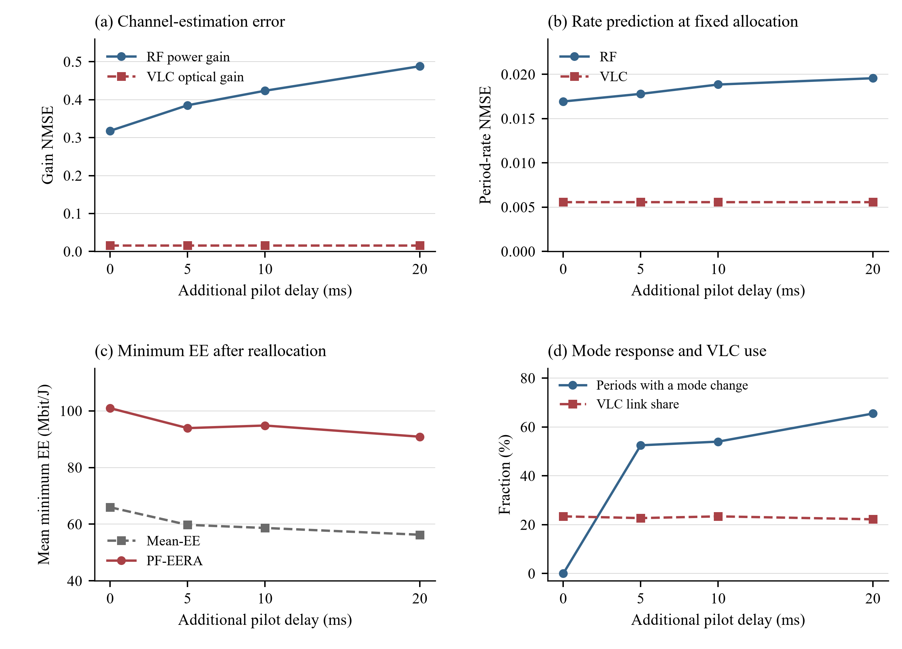

**图1　导频时延对预测与资源分配的影响。** (a) 信道误差；(b) 固定分配的速率误差；(c) 最低EE；(d) 相对零额外时延的模式变化比例与VLC使用比例。

<!-- CHANGE M033 -->

[**〔M033〕**](03_逐段修改前后与理由.md#m033)

**不同算法的能效。** 部分车对的高EE可以抬高平均值，因此只优化平均EE可能忽视能效较低的车对。PF-EERA在公平阶段以每个通信周期的预测最低链路EE为优化目标。图2表明，与Mean-EE相比，两种车辆规模下实际最低链路EE的中位数和第25百分位均提高。10车场景的中位数由36.94升至82.29 Mbit/J，第25百分位由20.66升至36.84 Mbit/J。50车场景的相应数值分别由21.22升至42.88 Mbit/J、由12.93升至26.48 Mbit/J。

图2选取六种方法均返回完整分配的通信周期，并对同一车辆规模的两次信道实现等权汇总。

<!-- CHANGE M034 -->

[**〔M034〕**](03_逐段修改前后与理由.md#m034)

在四组实验中，相对于Mean-EE，PF-EERA的实际平均EE下降4.95%–5.62%，实际最低链路EE的均值提高44.65%–80.59%。相对于两种文献对照，PF-EERA在10车场景取得更高的平均EE和最低EE；50车场景中，其最低EE分布与MMEE-FP接近，平均EE为277.56 Mbit/J，高于后者的274.77 Mbit/J。

<!-- panels F2 -->
| 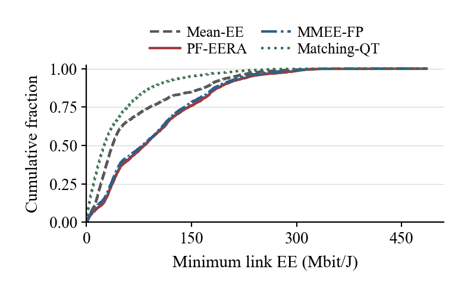 | 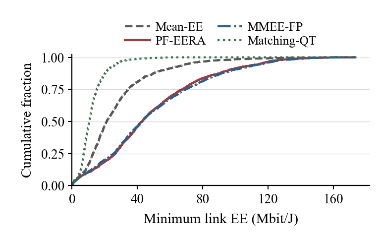 |
|:---:|:---:|
| (a) 10车最低链路EE | (b) 50车最低链路EE |
| 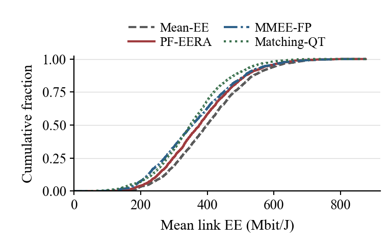 | 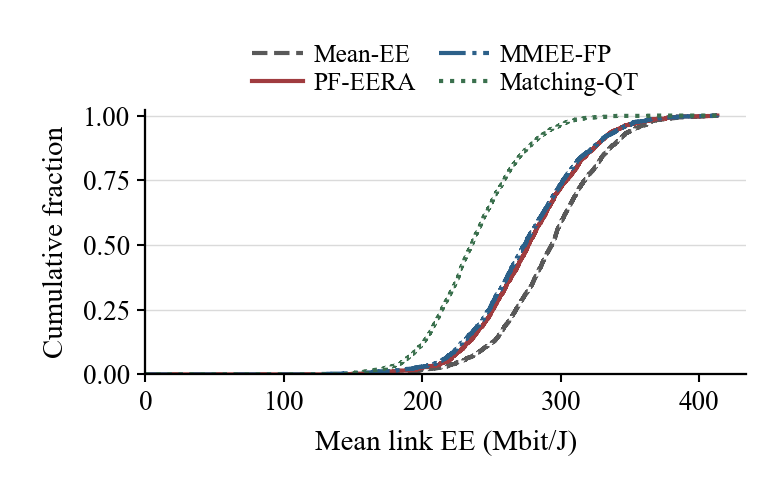 |
| (c) 10车平均链路EE | (d) 50车平均链路EE |
<!-- /panels -->

<!-- CHANGE M060 -->

[**〔M060〕**](03_逐段修改前后与理由.md#m060)

**图2　不同算法的最低链路EE与平均EE分布。**

<!-- CHANGE M035 -->

[**〔M035〕**](03_逐段修改前后与理由.md#m035)

**RF与VLC的链路差异。** 在PF-EERA的50车分配结果中，RF链路的平均EE高于VLC链路，但多数通信周期中EE最低的链路采用的是RF通信。两次信道实现中，采用RF传输的车对分别占34.04%和34.70%，而最低链路EE出现在RF车对的周期分别占70.30%和70.97%。

<!-- CHANGE M037 -->

[**〔M037〕**](03_逐段修改前后与理由.md#m037)

图3分别显示两次信道实现。统计RF使用比例和链路EE时，每个周期实际通信的一对收发车辆计为一个样本。统计最低链路EE出现在哪种通信方式时，每个有完整分配的周期计为一个样本。

<!-- CHANGE M038 -->

[**〔M038〕**](03_逐段修改前后与理由.md#m038)

<!-- CHANGE M062 -->

[**〔M062〕**](03_逐段修改前后与理由.md#m062)

图3(c)、(d)比较两种车辆规模下RF链路EE的第5百分位，即按EE从低到高排列后，最差5%样本与其余样本之间的分界值。相对于Mean-EE，PF-EERA在50车两次信道实现中将RF链路EE的第5百分位分别由18.57提高至35.56 Mbit/J、由17.35提高至33.12 Mbit/J，增幅为91.48%和90.87%。RF/VLC使用比例基本不变，RF链路中能效较低的部分却得到明显改善。因此，提高异构通信的能效公平性，需要识别各通信方式内部EE较低的链路，并联合调整相应发送车辆的功率。

<!-- panels F3 -->
| 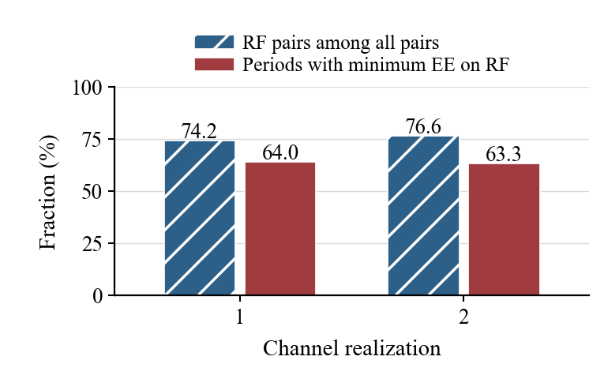 | 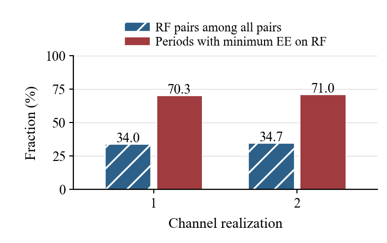 |
|:---:|:---:|
| (a) 10车：全体车对和最低EE车对的RF使用率 | (b) 50车：全体车对和最低EE车对的RF使用率 |
| 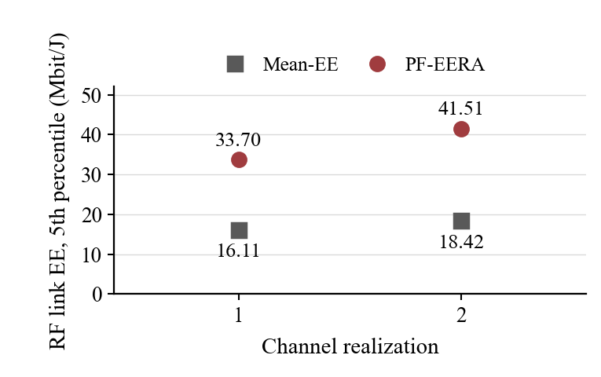 | 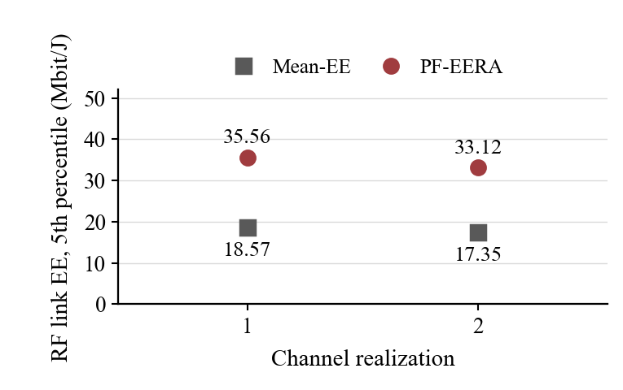 |
| (c) 10车RF链路EE的第5百分位 | (d) 50车RF链路EE的第5百分位 |
<!-- /panels -->

<!-- CHANGE M036 -->

[**〔M036〕**](03_逐段修改前后与理由.md#m036)

<!-- CHANGE M061 -->

[**〔M061〕**](03_逐段修改前后与理由.md#m061)

**图3　RF使用比例与RF链路能效的第5百分位。**

### C. 公平优化、效率约束与实际服务

<!-- CHANGE M039 -->

[**〔M039〕**](03_逐段修改前后与理由.md#m039)

**通信模式和功率的作用。** 图4(a)、(b)比较PF-EERA与两项消融的实际最低EE。加入公平连续功率优化后，10车和50车分别有80.84%和87.74%的周期获得高于No-Fair-Power的最低EE。与Fixed-Mode相比，10车和50车分别有62.88%和96.45%的周期，两种方法实际最低链路EE之差的绝对值不超过$10^{-6}$ Mbit/J。第一阶段确定收发车对和通信方式后，进一步改善最低链路EE主要依靠各发送车辆联合调整功率。

图4选取PF-EERA、Fixed-Mode和No-Fair-Power均返回完整分配的通信周期，并对同一车辆规模的两次信道实现等权汇总。

图4(c)、(d)按Mean-EE分配下各周期的最低链路EE，将通信周期由低到高分为数量相近的四组。与Mean-EE相比，PF-EERA在四组中的最低链路EE均值都有提高；第三组的平均增量最大，10车和50车分别为47.56和27.08 Mbit/J。因此，初始分配中最差链路的EE越低，并不意味着公平优化带来的绝对增量越大。结合功率优化模型，这种差异说明判断改善空间还需考虑允许的功率调整范围与链路间的干扰关系，初始最低EE不能单独决定公平优化的收益。

<!-- CHANGE M041 -->

[**〔M041〕**](03_逐段修改前后与理由.md#m041)

在50车场景的第二次信道实现中，两种方案都执行通信模式比较和NM功率细化。增加解析功率协调后，实际最低链路EE的均值由37.045提高到48.470 Mbit/J，增幅为30.84%，平均EE下降2.40%。NM直接搜索周期预测指标，解析协调利用功率与交叉干扰的显式关系生成另一组联合调整方案。该对照说明，固定通信模式后，利用干扰关系构造新的联合功率调整仍能进一步提高最低链路EE。

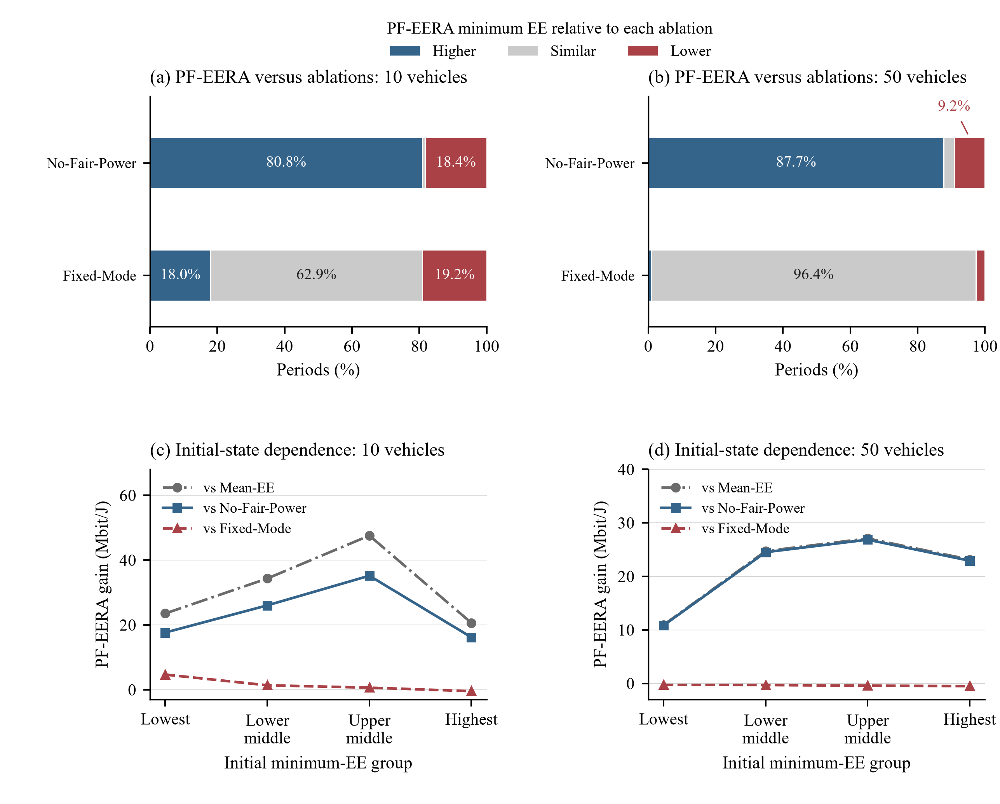

<!-- CHANGE M040 -->

[**〔M040〕**](03_逐段修改前后与理由.md#m040)

**图4　通信模式与连续功率优化的作用。** 上排为PF-EERA相对两种消融方法的最低EE更高、相近或更低的周期比例。下排为按初始最低EE分组后的平均增量。

<!-- CHANGE M042 -->

[**〔M042〕**](03_逐段修改前后与理由.md#m042)

**允许平均EE下降比例的影响。** 取10车和50车场景的第二次信道实现。在每个场景内，三种$\delta$设置共用同一组200个决策时刻，以及各时刻的Mean-EE参考分配，分别求解公平分配。图5中，每个点的横、纵坐标分别为相对Mean-EE的实际平均EE下降百分比和实际最低链路EE增量的中位数。横向和纵向误差线各自覆盖对应指标的第25至第75百分位。

[**〔M043〕**](03_逐段修改前后与理由.md#m043)

增大允许的平均EE下降比例能够继续提高最低链路EE，但新增收益与代价并不成比例。以50车为例，允许下降比例由5%增至10%时，图5中的最低EE增量中位值增加2.23 Mbit/J，实际平均EE损失中位值增加3.37个百分点；由10%增至20%时，两项增量分别为1.67 Mbit/J和5.55个百分点。按相邻两档中位数的变化计算，每多让出一个百分点的平均EE，换得的最低链路EE增量由0.66降至0.30 Mbit/J。在这组50车实验中，从10%放宽到20%所获得的额外公平收益小于从5%放宽到10%，付出的平均EE代价却更高。

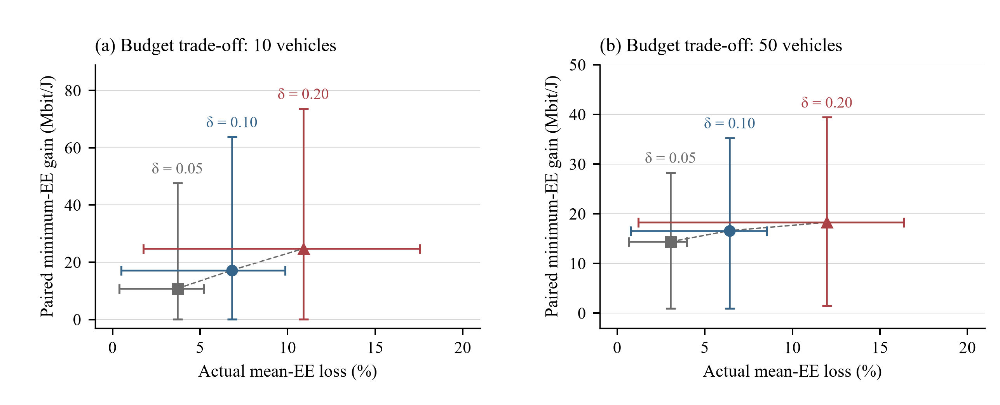

**图5　允许平均EE下降比例与最低EE收益。** (a) 10车；(b) 50车。

<!-- CHANGE M043 -->

<!-- CHANGE M044 -->

[**〔M044〕**](03_逐段修改前后与理由.md#m044)

**实际服务与计算时间。** 在两种车辆规模的四组实验中，PF-EERA的实际服务达标率为99.4%–99.7%，Matching-QT为63.3%–91.5%（图6）。

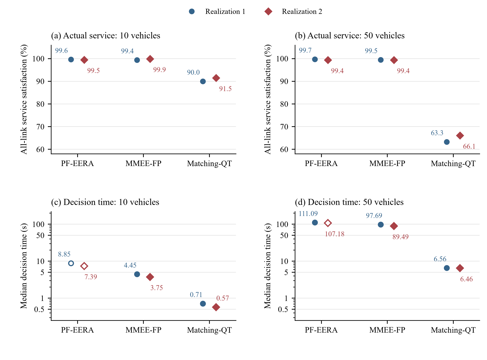

<!-- CHANGE M045 -->

[**〔M045〕**](03_逐段修改前后与理由.md#m045)

**图6　不同算法的实际服务与计算时间。** 上排为实际服务达标率，下排为决策耗时中位数。空心点表示逐周期合计分项耗时后的中位数。

<!-- CHANGE M046 -->

[**〔M046〕**](03_逐段修改前后与理由.md#m046)

图6分别给出同一规模下两次信道实现的结果。实际服务达标率以全部计划周期为分母。某一周期有完整分配，且每对收发车辆的实际周期平均速率都达到$R_{\min}$，该周期计为达标。

在10车第二次信道实现中，仅将公平阶段的校准速率筛选改为预测均值筛选，平均EE和最低EE分别增加0.34%和0.66%，实际服务达标率由99.5%变为99.4%。该对照中，两种筛选都已使1 Mbit/s业务的实际服务接近饱和，差异主要表现为幅度较小的能效与服务取舍。

计算主要消耗在初始通信模式搜索和平均EE功率求解。当前采用离线求解，图6给出决策时间中位数；仿真车辆轨迹不包含程序计算等待。50车第一次实现的PF-EERA时间来自完整流程计时，其余三次由原流程与新增解析协调的逐周期耗时相加得到。10车原流程使用1个数值线程，50车使用2个，解析协调使用1个；解析协调运行于AMD Ryzen 5 3600处理器。50车第二次实现中，解析协调平均增加1.97 s，相对于初始模式与功率搜索的计算量较小。由此，缩短计算时间应优先减少初始搜索中的重复求解，并保留完整周期预测对最终分配的统一评价。

# VI. 结论

本文提出了不完美CSI下V2V RF/VLC通信的能效公平资源分配方法PF-EERA。该方法由导频观测估计信道状态，预测传输期间的速率变化，并联合选择通信模式与发射功率。平均EE优化所得分配为公平阶段提供固定参考，以允许下降比例约束公平阶段的预测平均EE，明确提高最低链路EE所允许付出的效率代价。

10车和50车仿真表明，相对于平均EE参考分配，PF-EERA以4.95%–5.62%的实际平均EE下降，使最低链路EE均值提高44.65%–80.59%。消融结果说明，在初始通信模式确定后，主要公平收益来自连续功率优化。发射功率同时影响目标信号和其他同方式链路的干扰，联合调整功率能够在通信模式基本保持的情况下提高低EE链路的传输效率。

<!-- CHANGE M047 -->

[**〔M047〕**](03_逐段修改前后与理由.md#m047)

在50车场景中，RF链路的平均EE高于VLC链路，但多数通信周期中EE最低的链路采用的是RF通信。公平分配因而需要识别两种通信方式中能效较低的车对，并协调发送车辆的功率。导频时延实验表明，缩短时延能否改善决策所用的信道信息，取决于新观测能否在决策前到达。50车的效率约束对照表明，把允许的平均EE下降比例从10%放宽到20%，比从5%放宽到10%付出了更大的实际平均EE代价，获得的最低链路EE增量反而更小。

# 附录A　估计设置与连续功率求解

本附录集中给出信道估计的数值设置与第四节的连续功率求解规则。

<!-- CHANGE M048 -->

[**〔M048〕**](03_逐段修改前后与理由.md#m048)

**信道估计设置。** 式（3）的计算距离下限为1 m。RF快衰落时间常数$\tau_{ij}$限制在1–500 ms，零相对速度时取500 ms。RF滤波的阴影相关系数取$\rho_{s,ij}^{\mathrm{est}}=\exp[-0.423\lambda\Delta t/(\tau_{ij}d_s)]$；真实阴影信道与周期预测轨迹采用式（5）的实际相对速度。导频积分时长为$T_{p,m}=\min(1\ \mathrm{ms},0.20\Delta_m/N)$，对应取值见表II。RF噪声按固定谱密度由10 MHz内−95 dBm换算至22 MHz；VLC接收噪声采用文献[22]的模型，热噪声与背景光散粒噪声的方差之和为$5.83053\times10^{-14}$ A²，信号散粒噪声系数$2q_e\varrho B_{\mathrm{VLC}}=7.209\times10^{-12}$ A²/W。

**初始功率与服务修复。** 以功率下限为起点，按解析平均EE进行两轮坐标搜索，各坐标在允许范围内比较八个对数等距功率值，所得功率用于初始化式（36）。令$R_\ell^{\mathrm{tar}}=R_{\min}$，相应的有效SINR目标为$\gamma_\ell^{\mathrm{tar}}=2^{R_\ell^{\mathrm{tar}}/B_{m_\ell}}-1$。若解析速率未达到$R_\ell^{\mathrm{tar}}$，则引入非负松弛量$v_\ell$，通过以下功率子问题最小化有效SINR目标的归一化缺口总和：

$$
\begin{aligned}
\min_{\mathbf p,\mathbf v\ge\mathbf0}\quad&\sum_\ell v_\ell\\
\mathrm{s.t.}\quad&A_\ell^{(r)}(\mathbf p)-\gamma_\ell^{\mathrm{tar}}
\ge-v_\ell\max(\gamma_\ell^{\mathrm{tar}},10^{-8}),\\
&p_{\min,m_\ell}\le p_\ell\le p_{\max,m_\ell},\quad\ell\in\mathcal L_k.
\end{aligned} \tag{A1}
$$

按原有效SINR计算各链路的相对目标缺口，缺口之和减小时更新功率与辅助变量。该搜索最多40轮；达到内部速率目标后转入式（36），交替优化最多30轮。若所得分配的校准预测速率仍低于最低速率要求，则更新相应链路的内部速率目标$R_\ell^{\mathrm{tar}}$：

$$
\begin{aligned}
c_\ell&=\min\!\left\{100,\max\!\left(1,\frac{R_{\min}}{\max(\widetilde R_\ell,r_g)}\right)\right\},\\
R_\ell^{\mathrm{tar}}&=\begin{cases}
\max(\widehat R_\ell c_\ell,R_{\min}),&\widetilde R_\ell<R_{\min}(1-\varepsilon_q),\\
R_{\min},&\text{otherwise},
\end{cases}
\end{aligned} \tag{A2}
$$

<!-- CHANGE M049 -->

[**〔M049〕**](03_逐段修改前后与理由.md#m049)

其中$r_g=1$ bit/s、$\varepsilon_q=10^{-8}$。式（A2）根据当前的预测均值和校准预测速率重新计算未达标车对的内部目标，已达标车对的目标取$R_{\min}$，最多修复两次。第一阶段比较两项分配时，优先保留每个车对均满足$\widetilde R_\ell\ge R_{\min}(1-\varepsilon_q)$的分配。若两项分配均未达标，先比较总缺口$\sum_\ell\max(0,R_{\min}-\widetilde R_\ell)$，取较小者。若两项均达标或总缺口相等，则取预测平均EE较高者。修复后仍无达标分配，则从已评价分配中选择全部链路预测均值达标且平均EE最高者作为后备；不存在该后备时返回求解失败。后备分配的校准预测速率单独检验，$\eta_{\mathrm{ref}}$由第一阶段最终返回的分配确定。

**NM连续细化。** 对数变量$\xi_\ell$通过$p_\ell=\operatorname{clip}(e^{\xi_\ell},p_{\min,m_\ell},p_{\max,m_\ell})$转换为发射功率。NM最小化以下目标函数，其中最低链路EE取负值，服务和平均EE约束的违约量构成罚项：

$$
\begin{aligned}
J_{\mathrm{NM}}(\boldsymbol\xi)=&-\frac{\widehat\eta_{\min}(\mathbf p)}{\eta_{\mathrm{ref}}}\\
&+\lambda_{\mathrm{pen}}\left[
\frac{\max\{0,(1-\delta)\eta_{\mathrm{ref}}-\widehat\eta_{\mathrm{avg}}(\mathbf p)\}}{\eta_{\mathrm{ref}}}
+\frac{\max\{0,R_{\min}-\min_\ell\widetilde R_\ell(\mathbf p)\}}{R_{\min}}\right],
\end{aligned} \tag{A3}
$$

其中$\lambda_{\mathrm{pen}}=10^3$。满足原约束的访问点独立保存。附加起点由当前功率乘以逐分量独立的$\mathcal U[0.3,3]$系数并限幅得到，随机种子固定为0。10车与50车分别采用2与1个附加起点，每起点最多240与120次迭代；自适应NM的变量与归一化目标终止容差分别为$10^{-3}$和$10^{-4}$。

<!-- CHANGE M050 -->

[**〔M050〕**](03_逐段修改前后与理由.md#m050)

公平模式候选与NM返回点首先满足式（29）的服务和平均EE约束，再与当前分配比较。10车场景接受预测最低EE严格增加的候选。50车场景同样优先接受严格增加的候选。对其余候选，若其预测最低EE与当前分配的相对差绝对值不超过$10^{-9}$，则保留平均EE约束余量较大者。相对差的分母取两个预测最低EE的绝对值与$10^{-12}$三者中的最大值。NM内部保存访问点只按最低EE比较，以上平局规则用于外层分配更新。解析协调按式（40）接受候选，其中$\varepsilon_{\mathrm{num}}=10^{-10}\max(1,|\widehat\eta_{\min}^{\mathrm{keep}}|)$。

**解析功率初始化与门限搜索。** 在当前功率处固定能效分母$d_\ell^{(r)}=P_{c,m_\ell}+p_\ell^{(r)}$，联合优化发射功率与最低EE试探值$\theta_w$，得到功率初始化问题：

$$
\begin{aligned}
\max_{\mathbf p,\theta_w\ge0}\quad&\theta_w\\
\mathrm{s.t.}\quad&\widetilde r_\ell^{(r)}(\mathbf p)\ge\theta_w d_\ell^{(r)},\quad
\widetilde r_\ell^{(r)}(\mathbf p)\ge R_{\min},\\
&\max\{p_{\min,m_\ell},p_\ell^{(r)}/\omega\}\le p_\ell
\le\min\{p_{\max,m_\ell},\omega p_\ell^{(r)}\},\quad\ell\in\mathcal L_k.
\end{aligned} \tag{A4}
$$

<!-- CHANGE M051 -->

[**〔M051〕**](03_逐段修改前后与理由.md#m051)

其中$\omega=2$。固定$d_\ell^{(r)}$后，$\theta_w$与功率不再相乘，式（A4）可联合优化功率和最低EE试探值。分别从当前功率、各方式的功率下限、上限及二者的几何中点开始，每个起点最多更新3次，按式（32）的速率计算各初始功率方案的最低链路EE，保留其中取值最大的方案。以初始化功率对应的解析最低EE作为搜索下限$\theta_L$；忽略干扰，并分别取最大的信号项和最小的发送功耗，构造最低EE试探区间的上限$\theta_U$：

$$
\theta_U=\max\!\left\{\theta_L,\min_\ell
\frac{B_{m_\ell}\log_2\!\left[1+S_\ell(\mathbf p_{\max})/(\Gamma_{m_\ell}D_{\ell,0})\right]}
{P_{c,m_\ell}+p_{\min,m_\ell}}\right\}. \tag{A5}
$$

<!-- CHANGE M052 -->

[**〔M052〕**](03_逐段修改前后与理由.md#m052)

对RF，$D_{\ell,0}$为接收噪声功率。对VLC，$D_{\ell,0}$为热噪声与背景光散粒噪声的电流方差之和。每次取$\theta=\sqrt{\theta_L\theta_U}$，从上述四个起点分别迭代求解式（38），每个起点最多3次。用式（32）计算所得功率下各车对的解析速率，检查$r_\ell^{\mathrm a}/d_\ell\ge\theta(1-10^{-6})$及$r_\ell^{\mathrm a}\ge R_{\min}(1-10^{-6})$。只要有一个起点所得的功率同时满足两项条件，就用该方案的解析最低EE更新$\theta_L$。若各起点均未找到满足条件的功率，则令$\theta_U=\theta$。最多试探6次，或在$\theta_U-\theta_L\le10^{-4}\max(|\theta_L|,1)$时结束。

<!-- CHANGE M053 -->

[**〔M053〕**](03_逐段修改前后与理由.md#m053)

式（A4）与式（38）采用序列最小二乘规划（SLSQP）求解，每次最多40步。中间试探使用$B_{m_\ell}\log_2[1+\max(A_\ell^{(r)},-1/2)]$避免对数越界，取截断分支时导数为零。候选功率按式（32）复验速率和最低EE，最终分配按式（40）的周期预测结果选定。

另以解析求解所得功率为起点，对$r_\ell^{\mathrm a}<R_{\min}(1-10^{-9})$的链路，同时将其发送车辆功率更新为$\min(p_{\max,m_\ell},1.6p_\ell+10^{-3}\ \mathrm W)$，重新计算全部链路的解析速率，最多80次，形成服务修正候选。原解析候选取$\beta\in\{1,0.75,0.5,0.25,0.125\}$，修正候选取$\beta\in\{1,0.5,0.25\}$，均从固定$\mathbf p^{\mathrm b}$插值。

# 附录B　功率近似与预测误差的理论分析

### B.1 速率下界及功率子问题的性质

**命题1。** 固定通信模式，设$S_\ell(\mathbf p)\ge0$、$D_\ell(\mathbf p)>0$、$\Gamma_{m_\ell}>0$。式（34）给出的$A_\ell^{(r)}$是有效SINR的下界，在当前功率$\mathbf p^{(r)}$处取等号；在该点$S_\ell>0$且相关函数可微时，两者的一阶导数也相同。对于式（9）—（12）的RF/VLC模型，固定辅助变量后的式（36），以及固定$\theta>0$、在$1+A_\ell^{(r)}>0$内的式（38），均为凸优化子问题。

**证明。** 省略链路下标，记$D'=\Gamma D$。对任意实数$y$，有效SINR与二次变换表达式之差满足：

$$
\frac{S}{D'}-(2y\sqrt S-y^2D')
=D'\left(y-\frac{\sqrt S}{D'}\right)^2\ge0. \tag{B1}
$$

<!-- CHANGE M054 -->

[**〔M054〕**](03_逐段修改前后与理由.md#m054)

取$y=y^{(r)}=\sqrt{S(\mathbf p^{(r)})}/D'(\mathbf p^{(r)})$，则式（B1）右端在$\mathbf p^{(r)}$处为零，式（34）的下界在该点等于原有效SINR。当$S>0$且相关函数可微时，右端梯度也含有$y^{(r)}-\sqrt S/D'$这一因子，因此在该点为零。利用对数函数的单调性和链式法则，解析速率下界及其在当前功率处的取值和梯度满足：

$$
\begin{aligned}
\widetilde r_\ell^{(r)}(\mathbf p)&\le r_\ell^{\mathrm a}(\mathbf p),\\
\widetilde r_\ell^{(r)}(\mathbf p^{(r)})&=r_\ell^{\mathrm a}(\mathbf p^{(r)}),\qquad
\nabla\widetilde r_\ell^{(r)}(\mathbf p^{(r)})=\nabla r_\ell^{\mathrm a}(\mathbf p^{(r)}).
\end{aligned} \tag{B2}
$$

RF的$S_\ell$是自身功率的非负线性函数，$\sqrt{S_\ell}$为凹函数，$D_\ell$为仿射函数。VLC的$\sqrt{S_\ell}$为自身功率的线性函数，$D_\ell$由非负二次干扰项、线性散粒噪声和正常数构成，为凸函数。又因$y_\ell^{(r)}\ge0$，$A_\ell^{(r)}$为凹函数，$\widetilde r_\ell^{(r)}$在$1+A_\ell^{(r)}>0$内亦为凹函数。

式（36）的目标为仿射函数，$2^{s_\ell^2/B_{m_\ell}}-1-A_\ell^{(r)}(\mathbf p)$为凸函数，其余为线性或箱约束。式（38）中$\theta$固定、$d_\ell(\mathbf p)$仿射、$d_\ell(\mathbf p^{(r)})$常数，两条速率不等式构成凹函数的上水平集。因此，两类功率子问题均为凸问题。证毕。

因此，固定辅助变量后可以联合优化各发送车辆的功率，再以更新的功率重新构造下界。命题1针对式（36）与式（38）的解析子问题，最终分配仍由周期速率预测评价。

### B.2 速率预测误差对实际能效的影响

**命题2。** 对一个固定分配，设实际周期速率和预测均值满足$|\overline R_\ell-\widehat R_\ell|\le e_\ell$，$e_\ell\ge0$，且$d_\ell=P_{c,m_\ell}+p_\ell>0$。定义$E_{\mathrm{avg}}=K^{-1}\sum_\ell e_\ell/d_\ell$和$E_{\min}=\max_\ell e_\ell/d_\ell$，则平均链路EE与最低链路EE的预测误差满足以下上界：

$$
|\eta_{\mathrm{avg}}-\widehat\eta_{\mathrm{avg}}|\le E_{\mathrm{avg}},\qquad
|\eta_{\min}-\widehat\eta_{\min}|\le E_{\min}. \tag{B3}
$$

对候选分配$a$和参考分配$0$分别取其速率误差界，令$0\le\delta\le1$，并定义实际平均EE约束余量$G=\eta_{\mathrm{avg}}^a-(1-\delta)\eta_{\mathrm{avg}}^0$及预测余量$\widehat G=\widehat\eta_{\mathrm{avg}}^a-(1-\delta)\widehat\eta_{\mathrm{avg}}^0$。实际平均EE约束余量和最低链路EE增量满足以下下界：

$$
\begin{aligned}
G&\ge\widehat G-E_{\mathrm{avg}}^a-(1-\delta)E_{\mathrm{avg}}^0,\\
\eta_{\min}^a-\eta_{\min}^0&\ge\widehat\eta_{\min}^a-\widehat\eta_{\min}^0-E_{\min}^a-E_{\min}^0.
\end{aligned} \tag{B4}
$$

**证明。** 固定分配下，实际EE与预测EE的分母相同，故$|\eta_\ell-\widehat\eta_\ell|\le e_\ell/d_\ell$。取平均并应用三角不等式，得到式（B3）第一项。任意两组数满足$|\min_\ell x_\ell-\min_\ell y_\ell|\le\max_\ell|x_\ell-y_\ell|$，故第二项成立。分别对候选与参考应用上下界，整理即得式（B4）。证毕。

由式（B4），当$\widehat G\ge E_{\mathrm{avg}}^a+(1-\delta)E_{\mathrm{avg}}^0$时，实际平均EE也满足相对于参考分配的下降约束；当预测最低EE增量超过$E_{\min}^a+E_{\min}^0$时，实际最低EE相应提高。误差以发送功耗归一化，因此相同的速率误差在低功耗链路上会造成更大的EE偏差。

速率误差可进一步由信号项和干扰噪声项的误差界定。对于速率函数$r(S,D)=B\log_2[1+S/(\Gamma D)]$，若$D,D'\ge D_{\min}>0$、$S,S'\ge0$，由偏导数界可得两组信号与干扰噪声条件下的速率差上界：

$$
|r(S,D)-r(S',D')|\le\frac{B}{\ln2}
\left[\frac{|S-S'|}{\Gamma D_{\min}}+\frac{|D-D'|}{D_{\min}}\right]. \tag{B5}
$$

将每个时刻的实际信号与干扰量分别与预测样本比较，按周期时间和样本数平均，并应用三角不等式，即可用式（B5）右端的平均值界定$|\overline R_\ell-\widehat R_\ell|$；实际值与预测值采用同一时间积分或采样方式。该关系把信号与干扰的预测偏差传递到周期速率，再由式（B3）—（B4）传递到链路EE和平均EE约束。这里采用的是速率误差的条件上界，第三节的单次观测CRLB则给出估计方差下界，两者承担不同的分析任务。

# 参考文献

[1] Md. Noor-A-Rahim, Z. Liu, H. Lee, G. G. M. N. Ali, D. Pesch, and P. Xiao, “A Survey on Resource Allocation in Vehicular Networks,” *IEEE Transactions on Intelligent Transportation Systems*, vol. 23, no. 2, pp. 701–721, 2022, doi: [10.1109/TITS.2020.3019322](https://doi.org/10.1109/TITS.2020.3019322).

[2] A. Memedi and F. Dressler, “Vehicular Visible Light Communications: A Survey,” *IEEE Communications Surveys &amp; Tutorials*, vol. 23, no. 1, pp. 161–181, 2021, doi: [10.1109/COMST.2020.3034224](https://doi.org/10.1109/COMST.2020.3034224).

[3] M. Karbalayghareh, F. Miramirkhani, H. B. Eldeeb, R. C. Kizilirmak, S. M. Sait, and M. Uysal, “Channel Modelling and Performance Limits of Vehicular Visible Light Communication Systems,” *IEEE Transactions on Vehicular Technology*, vol. 69, no. 7, pp. 6891–6901, 2020, doi: [10.1109/TVT.2020.2993294](https://doi.org/10.1109/TVT.2020.2993294).

[4] A.-L. Chen, H.-P. Wu, Y.-L. Wei, and H.-M. Tsai, “Time variation in vehicle-to-vehicle visible light communication channels,” *Proc. IEEE Vehicular Networking Conf. (VNC)*, pp. 1–8, 2016, doi: [10.1109/VNC.2016.7835926](https://doi.org/10.1109/VNC.2016.7835926).

[5] H. Zhang, N. Liu, K. Long, J. Cheng, V. C. M. Leung, and L. Hanzo, “Energy Efficient Subchannel and Power Allocation for Software-defined Heterogeneous VLC and RF Networks,” *IEEE Journal on Selected Areas in Communications*, vol. 36, no. 3, pp. 658–670, 2018, doi: [10.1109/JSAC.2018.2815478](https://doi.org/10.1109/JSAC.2018.2815478).

[6] S. Aboagye, T. M. N. Ngatched, O. A. Dobre, and H. V. Poor, “Energy-Efficient Resource Allocation for Aggregated RF/VLC Systems,” *IEEE Transactions on Wireless Communications*, vol. 22, no. 10, pp. 6624–6640, 2023, doi: [10.1109/TWC.2023.3244871](https://doi.org/10.1109/TWC.2023.3244871).

[7] J. Chen and Z. Wang, “Topology Control in Hybrid VLC/RF Vehicular Ad-Hoc Network,” *IEEE Transactions on Wireless Communications*, vol. 19, no. 3, pp. 1965–1976, 2020, doi: [10.1109/TWC.2019.2960229](https://doi.org/10.1109/TWC.2019.2960229).

[8] J. Chen and Z. Wang, “Coordination Game Theory-Based Adaptive Topology Control for Hybrid VLC/RF VANET,” *IEEE Transactions on Communications*, vol. 69, no. 8, pp. 5312–5324, 2021, doi: [10.1109/TCOMM.2021.3077950](https://doi.org/10.1109/TCOMM.2021.3077950).

[9] R. Yin, J. Sang, X. Shen, K. Jia, and M. Zhai, “Heterogeneous VLC/RF multi-hop cluster V2V channel allocation algorithm based on equivalent SINR,” *Applied Optics*, vol. 62, no. 6, pp. 1528–1536, 2023, doi: [10.1364/AO.482563](https://doi.org/10.1364/AO.482563).

[10] A. Al Hammadi, P. C. Sofotasios, S. Muhaidat, M. Al-Qutayri, and H. Elgala, “Non-Orthogonal Multiple Access for Hybrid VLC-RF Networks With Imperfect Channel State Information,” *IEEE Transactions on Vehicular Technology*, vol. 70, no. 1, pp. 398–411, 2021, doi: [10.1109/TVT.2020.3044837](https://doi.org/10.1109/TVT.2020.3044837).

[11] Y.-C. Hsiao, Y.-C. Wu, and C. Lin, “Energy-Efficient Beamforming Design for MU-MISO Mixed RF/VLC Heterogeneous Wireless Networks,” *IEEE Transactions on Signal Processing*, vol. 67, no. 14, pp. 3770–3784, 2019, doi: [10.1109/TSP.2019.2920612](https://doi.org/10.1109/TSP.2019.2920612).

[12] H. Qin et al., “Optimization algorithm for energy efficiency in vehicular heterogeneous VLC/RF systems based on channel estimation,” *AEU - International Journal of Electronics and Communications*, vol. 195, Art. no. 155769, 2025, doi: [10.1016/j.aeue.2025.155769](https://doi.org/10.1016/j.aeue.2025.155769).

[13] D. Bozanis et al., “Proactive Resource Allocation for Aggregated VLC/RF Networks With Outdated CSI,” *IEEE Wireless Communications Letters*, vol. 13, no. 4, pp. 944–948, 2024, doi: [10.1109/LWC.2024.3352705](https://doi.org/10.1109/LWC.2024.3352705).

[14] L. Liang, G. Y. Li, and W. Xu, “Resource Allocation for D2D-Enabled Vehicular Communications,” *IEEE Transactions on Communications*, vol. 65, no. 7, pp. 3186–3197, 2017, doi: [10.1109/TCOMM.2017.2699194](https://doi.org/10.1109/TCOMM.2017.2699194).

[15] W. Wu, R. Liu, Q. Yang, and T. Q. S. Quek, “Robust Resource Allocation for Vehicular Communications With Imperfect CSI,” *IEEE Transactions on Wireless Communications*, vol. 20, no. 9, pp. 5883–5897, 2021, doi: [10.1109/TWC.2021.3070894](https://doi.org/10.1109/TWC.2021.3070894).

[16] J. Yang, S. Gao, Y. Lu, Z. Yang, and G. Tu, “Max-Min Fairness of Cooperative RSMA for Aggregated VLC/RF Systems,” *IEEE Communications Letters*, vol. 29, no. 3, pp. 552–556, 2025, doi: [10.1109/LCOMM.2025.3530139](https://doi.org/10.1109/LCOMM.2025.3530139).

[17] M. R. Zamani, M. Eslami, M. Khorramizadeh, H. Zamani, and Z. Ding, “Optimizing Weighted-Sum Energy Efficiency in Downlink and Uplink NOMA Systems,” *IEEE Transactions on Vehicular Technology*, vol. 69, no. 10, pp. 11112–11127, 2020, doi: [10.1109/TVT.2020.3007716](https://doi.org/10.1109/TVT.2020.3007716).

[18] H. Ding, F. Zhao, J. Tian, and H. Zhang, “Fairness-Driven Energy Efficient Resource Allocation in Uplink MIMO Enabled HetNets,” *IEEE Access*, vol. 8, pp. 37229–37241, 2020, doi: [10.1109/ACCESS.2020.2975301](https://doi.org/10.1109/ACCESS.2020.2975301).

[19] A. Zappone, L. Sanguinetti, G. Bacci, E. Jorswieck, and M. Debbah, “Energy-Efficient Power Control: A Look at 5G Wireless Technologies,” *IEEE Transactions on Signal Processing*, vol. 64, no. 7, pp. 1668–1683, 2016, doi: [10.1109/TSP.2015.2500200](https://doi.org/10.1109/TSP.2015.2500200).

[20] 3GPP, *Study on Evaluation Methodology of New Vehicle-to-Everything (V2X) Use Cases for LTE and NR*, TR 37.885, ver. 15.3.0.

[21] J. Li, Y. Niu, H. Wu, B. Ai, T. Q. S. Quek, N. Wang, and S. Chen, “Effective Joint Scheduling and Power Allocation for URLLC-Oriented V2I Communications,” *IEEE Transactions on Vehicular Technology*, vol. 73, no. 8, pp. 11694–11705, 2024, doi: [10.1109/TVT.2024.3381924](https://doi.org/10.1109/TVT.2024.3381924).

[22] P. Luo, Z. Ghassemlooy, H. L. Minh, E. Bentley, A. Burton, and X. Tang, “Performance analysis of a car-to-car visible light communication system,” *Applied Optics*, vol. 54, no. 7, pp. 1696–1706, 2015, doi: [10.1364/AO.54.001696](https://doi.org/10.1364/AO.54.001696).

[23] R. E. Kalman, “A New Approach to Linear Filtering and Prediction Problems,” *Journal of Basic Engineering*, vol. 82, no. 1, pp. 35–45, 1960, doi: [10.1115/1.3662552](https://doi.org/10.1115/1.3662552).

[24] H. Abeida and J.-P. Delmas, “Slepian-Bangs formulas for parameterized density generator of elliptically symmetric distributions,” *Signal Processing*, vol. 205, Art. no. 108886, 2023, doi: [10.1016/j.sigpro.2022.108886](https://doi.org/10.1016/j.sigpro.2022.108886).

[25] K. Shen and W. Yu, “Fractional Programming for Communication Systems—Part I: Power Control and Beamforming,” *IEEE Transactions on Signal Processing*, vol. 66, no. 10, pp. 2616–2630, 2018, doi: [10.1109/TSP.2018.2812733](https://doi.org/10.1109/TSP.2018.2812733).

[26] J. A. Nelder and R. Mead, “A Simplex Method for Function Minimization,” *The Computer Journal*, vol. 7, no. 4, pp. 308–313, 1965, doi: [10.1093/comjnl/7.4.308](https://doi.org/10.1093/comjnl/7.4.308).

[27] W. Wang, Y. Liu, Y. Dai, and Y. He, “Joint cooperative caching and power control for UAV-assisted internet of vehicles,” *Scientific Reports*, vol. 14, Art. no. 9341, 2024, doi: [10.1038/s41598-024-59823-9](https://doi.org/10.1038/s41598-024-59823-9).

[28] M. Mayahi, *Communication Protocols Based on Alternative Paradigm for Wireless Mobile Devices*, Ph.D. dissertation, Université de Lille, 2022. [University repository](https://pepite-depot.univ-lille.fr/LIBRE/EDMADIS/2022/2022ULILB046.pdf).

[29] B. Genoves Guzman and A. A. Dowhuszko, “Performance Analysis of VLC Systems With Multi-Color Light Sources Beyond RGB LEDs,” *Journal of Lightwave Technology*, vol. 42, no. 16, pp. 5492–5505, 2024, doi: [10.1109/JLT.2024.3394788](https://doi.org/10.1109/JLT.2024.3394788).

[30] A. Bazzi, B. M. Masini, A. Zanella, and I. Thibault, “On the Performance of IEEE 802.11p and LTE-V2V for the Cooperative Awareness of Connected Vehicles,” *IEEE Transactions on Vehicular Technology*, vol. 66, no. 11, pp. 10419–10432, 2017, doi: [10.1109/TVT.2017.2750803](https://doi.org/10.1109/TVT.2017.2750803).

[31] W.-H. Shen and H.-M. Tsai, “Testing vehicle-to-vehicle visible light communications in real-world driving scenarios,” *Proc. IEEE Vehicular Networking Conference (VNC)*, pp. 187–194, 2017, doi: [10.1109/VNC.2017.8275596](https://doi.org/10.1109/VNC.2017.8275596).
