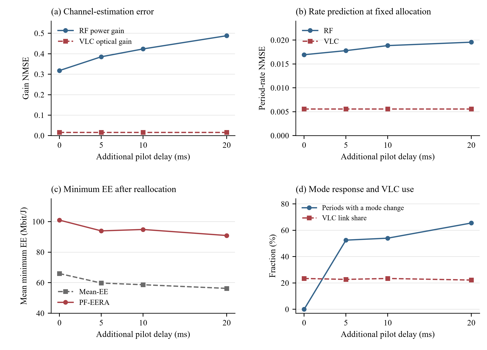
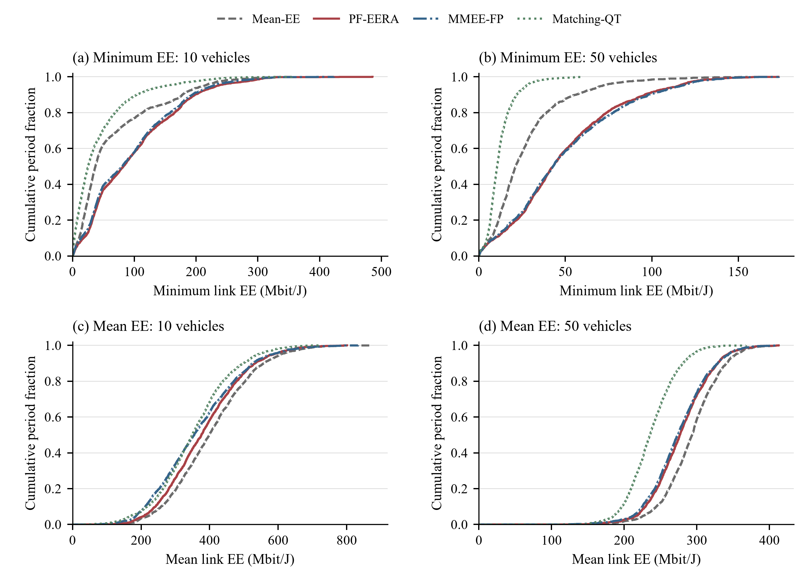
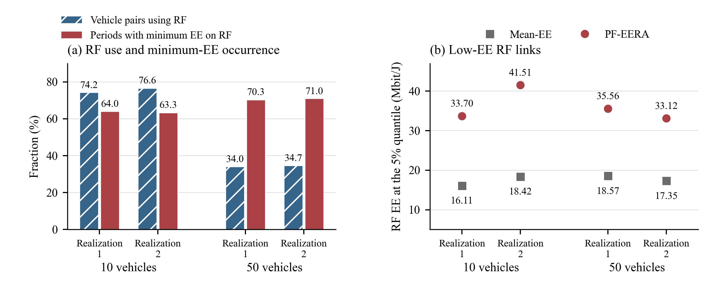
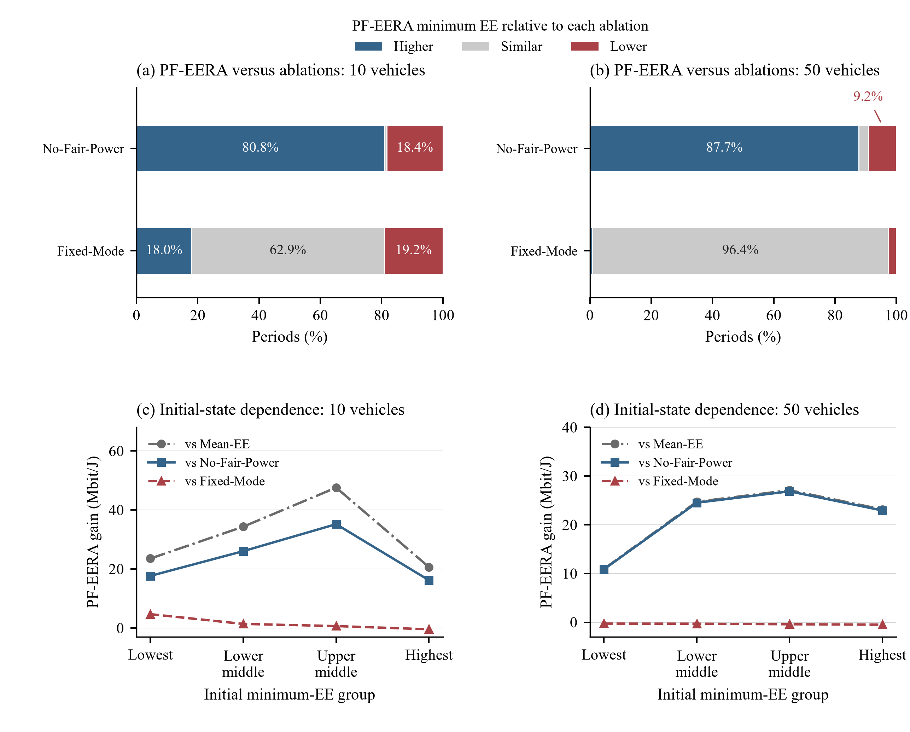
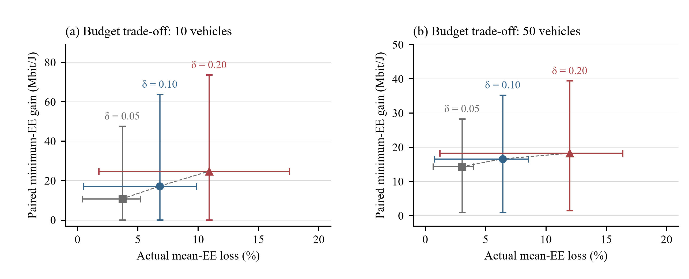
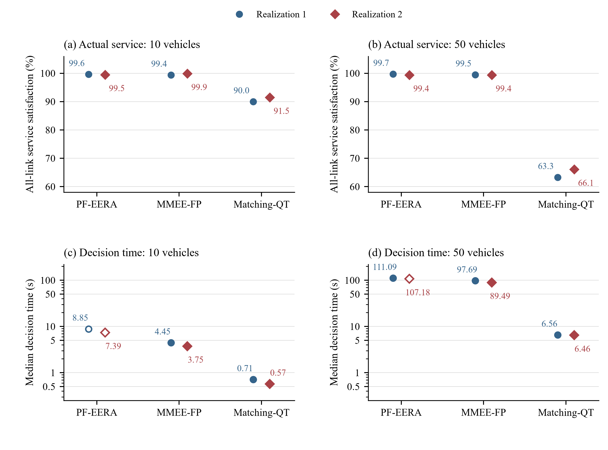

# V. 仿真结果与分析

### A. 仿真设置

采用10车和50车两种城市交通场景。每种规模设置两次独立的信道随机实现，各实现持续100 s，通信周期为100 ms，每次共评价1000次资源分配。相同规模的算法共用车辆轨迹、可用信道信息与执行信道；两个信道实现之间仅更换信道随机数，保持交通和业务条件不变。

交通轨迹由SUMO 1.22.0生成。10车路网节点跨度为80 m × 80 m，含3栋建筑；50车采用160 m × 120 m路网，含4栋建筑。两种场景每方向一条车道，限速30 km/h，使用Krauss跟驰模型及信号灯控制。经过30 s预热后记录车辆轨迹。车辆长、宽、高分别为4.5、1.8、1.5 m，VLC前后收发端距车身中心的纵向距离为±2.25 m，高度为1 m。VLC收发端之间的最小距离取1 m。

RF载波频率$f_c=5.89$ GHz，主要通信参数列于表I。带宽采用文献[9]的设置，光电响应度和接收半视场角采用文献[12]的取值。RF转换效率与电路功耗取自文献[27]；VLC电路功耗由文献[28]中的数模转换器与发送放大器功耗相加得到。文献[29]所列青色LED在200 mA下的电光转换效率为25.38%，本文据此取VLC的等效转换系数为0.25。

结合城市路网尺度与已有RF覆盖分析[30]，RF候选通信距离取100 m；VLC取实车试验覆盖的45 m[31]。

**表I　主要通信参数**

| 物理意义 | 符号 | 数值 |
|---|---|---|
| 通信带宽 | $B_m$ | RF：22 MHz；VLC：50 MHz[9] |
| 发射功率范围 | $[p_{\min,m},p_{\max,m}]$ | RF：0.01–20 W；VLC：0.1–30 W |
| 转换效率 | $\varepsilon_m$ | RF：0.10[27]；VLC：0.25[29] |
| 固定发送电路功耗 | $P_{c,m}$ | RF：0.1159 W[27]；VLC：1.745 W[28] |
| 实现间隙 | $10\log_{10}\Gamma_m$ | RF：3 dB；VLC：5.4 dB |
| 候选通信距离上限 | $d_{\max,m}$ | RF：100 m；VLC：45 m[31] |
| 光电探测器有效面积 | $A_{\mathrm{PD}}$ | 150 mm²[22] |
| 光电响应度 | $\varrho$ | 0.45 A/W[12] |
| 接收半视场角 | $\Psi_{\mathrm{FOV}}$ | 60°[12] |
| 光束扩展参数 | $(\zeta,\epsilon_o)$ | (0.1585 rad, 0.0175)[3] |

RF接收噪声功率为$6.9570\times10^{-13}$ W。VLC热噪声与背景光散粒噪声的方差之和为$5.83053\times10^{-14}$ A²，信号散粒噪声按式（12）计算。

RF阴影去相关距离$d_s=10$ m；VLC对数光强的标准差$\sigma_z=0.25$、相关时间$\tau_v=0.5$ s。导频输出功率均为2 W，每种通信方式分配20%的导频资源。表II给出观测与资源分配参数，相关时间限幅及估计设置列于附录A。

各算法的最低速率要求均为$R_{\min}=1$ Mbit/s。对PF-EERA及其两种消融方法，预测平均EE的允许下降比例默认取$\delta=0.10$。另取$\delta=0.05$、$0.10$和$0.20$，比较PF-EERA在不同效率约束下的最低链路EE。

**表II　观测与资源分配参数**

| 物理意义 | 符号 | 数值 |
|---|---|---|
| 导频观测间隔 | $\Delta_m$ | RF：1 ms；VLC：50 ms |
| 导频到达时延 | $d_m$ | RF：2 ms；VLC：5 ms |
| 导频积分时长 | $T_{p,m}$ | 10车：RF 20 μs、VLC 1 ms；50车：RF 4 μs、VLC 0.2 ms |
| 条件信道轨迹数量 | $S$ | 10车：32；50车：16 |
| 最低周期平均速率 | $R_{\min}$ | 1 Mbit/s |
| 允许预测平均EE下降比例 | $\delta$ | 0.10 |
| 预测速率分位比例 | $q$ | 0.05 |
| 预测速率校准系数 | $\alpha$ | 1.35 |
| SINR启发式评分系数 | $(\kappa_1,\kappa_2)$ | (2, 3.3) |
| 对数观测噪声标准差下限 | $\sigma_0$ | 0.12 |

信道与速率计算的时间间隔为1 ms。式（35）的初始链路评分分别在0.01、0.3和3 W下计算，超出功率范围时取相应边界；最终发射功率连续优化。10车和50车的通信模式搜索上限分别为8轮和4轮，50车每轮至多评价64个调整，优先涉及低EE链路。NM迭代与初始化设置见附录A。

表III列出PF-EERA、平均EE参考方法Mean-EE、两种文献对照及两种消融方法。两种文献对照均采用相同的信道模型、功耗参数与候选配对条件，优化目标按各自的方法设定。

**表III　算法与消融定义**

| 名称 | 优化任务与保留环节 |
|---|---|
| **PF-EERA** | 本文完整方法：平均EE参考分配、平均EE约束下的模式比较、NM与解析联合功率优化 |
| **Mean-EE** | 第一阶段平均EE参考分配，不执行后续公平优化 |
| **Matching-QT [6]** | 交替优化匹配与连续功率，以平均EE为目标 |
| **MMEE-FP [19]** | 固定Mean-EE给出的通信模式，采用广义分式规划和局部速率近似，在功率与速率约束下优化最低链路EE |
| **Fixed-Mode** | 固定第一阶段的通信模式，保留公平连续功率优化 |
| **No-Fair-Power** | 保留公平模式候选比较，关闭其后的NM与解析功率协调 |

### B. 信道信息与异构能效表现

**导频时延的影响。** 为考察信息新鲜度如何影响预测和分配，在10车场景的第二次信道实现上改变额外导频到达时延，取$\Delta d\in\{0,5,10,20\}$ ms。在覆盖整个100 s的200个均匀选定时刻，使用各档可获得的观测重新估计信道，并分别求得Mean-EE和PF-EERA分配。图1(a)给出信道增益的归一化均方误差；图1(b)固定零额外时延下的Mean-EE通信模式与功率，比较不同信息条件下的周期速率预测。图1(c)、(d)给出重新分配后的实际最低EE和通信模式变化。

**图1　导频时延对预测与资源分配的影响。** (a) 信道误差；(b) 固定分配的速率误差；(c) 最低EE；(d) 相对零额外时延的模式变化比例与VLC使用比例。

额外时延从0增至20 ms时，RF信道增益的归一化均方误差由0.318增至0.488，固定分配下RF周期速率的相应误差由0.01694增至0.01957。RF导频每1 ms更新，到达时延增大使资源决策依赖更早的观测。VLC的两项误差保持不变。VLC每50 ms发送一次导频，系统每100 ms进行一次资源决策。在所比较的每个决策时刻，四档时延下最近一次可用的VLC导频观测均相同。因此，缩短到达时延能否更新决策所依据的信道估计，取决于下一次导频观测能否及时到达。

PF-EERA在四档时延下均提高了相对于Mean-EE的实际最低链路EE，均值增幅为53.02%–61.63%，平均EE下降5.17%–6.55%。与零额外时延相比，20 ms额外时延下VLC使用比例仅由23.4%变为22.2%，但PF-EERA在65.5%的决策时刻改变了车辆间的通信模式。

**不同算法的能效。** 部分车对的高EE可以抬高平均值，因此只优化平均EE可能忽视能效较低的车对。PF-EERA在公平阶段以每个通信周期的预测最低链路EE为优化目标。图2表明，与Mean-EE相比，两种车辆规模下实际最低链路EE的中位数和第25百分位均提高。10车场景的中位数由36.94升至82.29 Mbit/J，第25百分位由20.66升至36.84 Mbit/J。50车场景的相应数值分别由21.22升至42.88 Mbit/J、由12.93升至26.48 Mbit/J。

**图2　不同算法的最低链路EE与平均EE分布。** 上排为最低EE，下排为平均EE；左列10车，右列50车。

图2选取六种方法均返回完整分配的通信周期，并对同一车辆规模的两次信道实现等权汇总。

在四组实验中，相对于Mean-EE，PF-EERA的实际平均EE下降4.95%–5.62%，实际最低链路EE的均值提高44.65%–80.59%。相对于两种文献对照，PF-EERA在10车场景取得更高的平均EE和最低EE；50车场景中，其最低EE分布与MMEE-FP接近，平均EE为277.56 Mbit/J，高于后者的274.77 Mbit/J。

**RF与VLC的链路差异。** 在PF-EERA的50车分配结果中，RF链路的平均EE高于VLC链路，但多数通信周期中EE最低的链路采用的是RF通信。两次信道实现中，采用RF传输的车对分别占34.04%和34.70%，而最低链路EE出现在RF车对的周期分别占70.30%和70.97%。

**图3　RF使用比例与低能效链路的改善。** (a) PF-EERA中RF使用比例及最低EE出现在RF链路的周期比例；(b) RF链路EE的第5百分位。

图3分别显示两次信道实现。统计RF使用比例和链路EE时，每个周期实际通信的一对收发车辆计为一个样本。统计最低链路EE出现在哪种通信方式时，每个有完整分配的周期计为一个样本。

图3(b)进一步比较RF链路EE的第5百分位，即按EE从低到高排列后，最差5%样本与其余样本之间的分界值。相对于Mean-EE，PF-EERA在50车两次信道实现中将RF链路EE的第5百分位分别由18.57提高至35.56 Mbit/J、由17.35提高至33.12 Mbit/J，增幅为91.48%和90.87%。RF/VLC使用比例基本不变，RF链路中能效较低的部分却得到明显改善。因此，提高异构通信的能效公平性，需要识别各通信方式内部EE较低的链路，并联合调整相应发送车辆的功率。

### C. 公平优化、效率约束与实际服务

**通信模式和功率的作用。** 图4(a)、(b)比较PF-EERA与两项消融的实际最低EE。加入公平连续功率优化后，10车和50车分别有80.84%和87.74%的周期获得高于No-Fair-Power的最低EE。与Fixed-Mode相比，10车和50车分别有62.88%和96.45%的周期，两种方法实际最低链路EE之差的绝对值不超过$10^{-6}$ Mbit/J。第一阶段确定收发车对和通信方式后，进一步改善最低链路EE主要依靠各发送车辆联合调整功率。

**图4　通信模式与连续功率优化的作用。** 上排为PF-EERA相对两种消融方法的最低EE更高、相近或更低的周期比例。下排为按初始最低EE分组后的平均增量。

图4选取PF-EERA、Fixed-Mode和No-Fair-Power均返回完整分配的通信周期，并对同一车辆规模的两次信道实现等权汇总。

图4(c)、(d)按Mean-EE分配下各周期的最低链路EE，将通信周期由低到高分为数量相近的四组。与Mean-EE相比，PF-EERA在四组中的最低链路EE均值都有提高；第三组的平均增量最大，10车和50车分别为47.56和27.08 Mbit/J。因此，初始分配中最差链路的EE越低，并不意味着公平优化带来的绝对增量越大。结合功率优化模型，这种差异说明判断改善空间还需考虑允许的功率调整范围与链路间的干扰关系，初始最低EE不能单独决定公平优化的收益。

在50车场景的第二次信道实现中，两种方案都执行通信模式比较和NM功率细化。增加解析功率协调后，实际最低链路EE的均值由37.045提高到48.470 Mbit/J，增幅为30.84%，平均EE下降2.40%。NM直接搜索周期预测指标，解析协调利用功率与交叉干扰的显式关系生成另一组联合调整方案。该对照说明，固定通信模式后，利用干扰关系构造新的联合功率调整仍能进一步提高最低链路EE。

**允许平均EE下降比例的影响。** 取10车和50车场景的第二次信道实现。在每个场景内，三种$\delta$设置共用同一组200个决策时刻，以及各时刻的Mean-EE参考分配，分别求解公平分配。图5中，每个点的横、纵坐标分别为相对Mean-EE的实际平均EE下降百分比和实际最低链路EE增量的中位数。横向和纵向误差线各自覆盖对应指标的第25至第75百分位。

**图5　允许平均EE下降比例与最低EE收益。** (a) 10车；(b) 50车。

增大允许的平均EE下降比例能够继续提高最低链路EE，但新增收益与代价并不成比例。以50车为例，允许下降比例由5%增至10%时，图5中的最低EE增量中位值增加2.23 Mbit/J，实际平均EE损失中位值增加3.37个百分点；由10%增至20%时，两项增量分别为1.67 Mbit/J和5.55个百分点。按相邻两档中位数的变化计算，每多让出一个百分点的平均EE，换得的最低链路EE增量由0.66降至0.30 Mbit/J。在这组50车实验中，从10%放宽到20%所获得的额外公平收益小于从5%放宽到10%，付出的平均EE代价却更高。

**实际服务与计算时间。** 在两种车辆规模的四组实验中，PF-EERA的实际服务达标率为99.4%–99.7%，Matching-QT为63.3%–91.5%（图6）。

**图6　不同算法的实际服务与计算时间。** 上排为实际服务达标率，下排为决策耗时中位数。空心点表示逐周期合计分项耗时后的中位数。

图6分别给出同一规模下两次信道实现的结果。实际服务达标率以全部计划周期为分母。某一周期有完整分配，且每对收发车辆的实际周期平均速率都达到$R_{\min}$，该周期计为达标。

在10车第二次信道实现中，仅将公平阶段的校准速率筛选改为预测均值筛选，平均EE和最低EE分别增加0.34%和0.66%，实际服务达标率由99.5%变为99.4%。该对照中，两种筛选都已使1 Mbit/s业务的实际服务接近饱和，差异主要表现为幅度较小的能效与服务取舍。

计算主要消耗在初始通信模式搜索和平均EE功率求解。当前采用离线求解，图6给出决策时间中位数；仿真车辆轨迹不包含程序计算等待。50车第一次实现的PF-EERA时间来自完整流程计时，其余三次由原流程与新增解析协调的逐周期耗时相加得到。10车原流程使用1个数值线程，50车使用2个，解析协调使用1个；解析协调运行于AMD Ryzen 5 3600处理器。50车第二次实现中，解析协调平均增加1.97 s，相对于初始模式与功率搜索的计算量较小。由此，缩短计算时间应优先减少初始搜索中的重复求解，并保留完整周期预测对最终分配的统一评价。