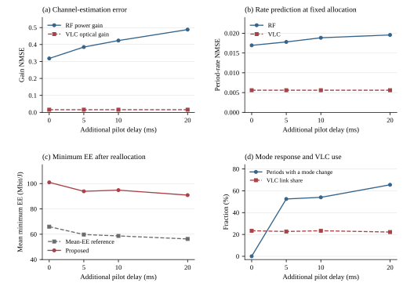
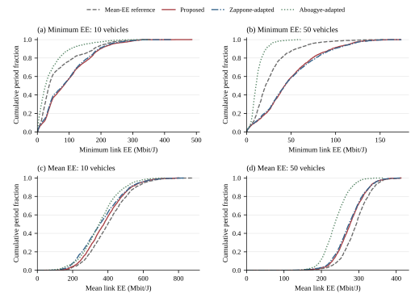
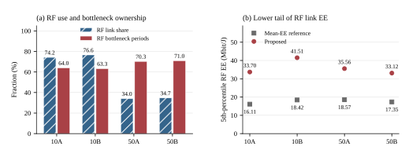
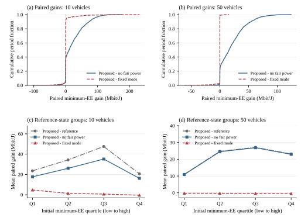
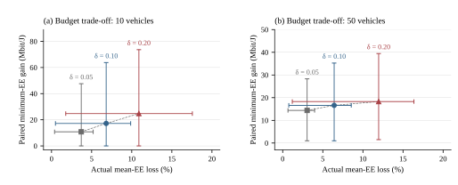
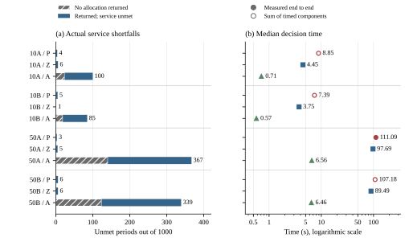

# 不完美CSI下V2V RF/VLC异构通信的能效公平资源分配

## 摘要

<!-- CHANGE M01 -->
RF/VLC异构车用通信需要在改善弱链路能效的同时维持整体传输效率。车辆运动与信道估计误差使资源分配还需考虑通信周期内的信号和干扰变化。本文研究不完美信道状态信息下通信模式与连续发射功率的联合优化。由RF/VLC状态递推生成条件信道轨迹，利用周期速率分布的均值评价链路能效，并利用校准下分位检查最低速率要求。在此基础上，先求得平均能效初始分配，再固定其效率参考，在预测平均能效下降预算内最大化最低链路能效。求解方法结合通信模式搜索、完整周期预测下的连续功率细化，以及解析干扰关系引导的联合功率协调。10车和50车的四组实验中，在各组共同求解成功周期上，相对于平均能效初始分配，所提方法以4.95%–5.62%的实际平均能效代价，使最低链路能效均值提高44.65%–80.59%。消融结果表明，连续功率协调贡献了主要公平增量；分方式统计进一步发现，平均能效较高的RF仍频繁构成最弱链路，说明异构能效公平需要面向具体链路协调功率，而不能仅依据方式平均性能选择RF或VLC。

**关键词：** 车用通信；RF/VLC异构网络；不完美CSI；能效公平；连续功率优化。

# I. 引言

车用通信是智能交通系统的重要组成部分，车辆对车辆（vehicle-to-vehicle，V2V）通信在提高交通安全与通行效率方面发挥着重要作用[1]。射频（radio frequency，RF）通信具有较广的覆盖范围，但共享频谱的链路之间存在同频干扰。可见光通信（visible light communication，VLC）利用车灯传输数据，具有较强的方向性，有利于空间复用[2]，但其通信质量受到车辆相对位置、收发角度和遮挡的影响[3]。通过联合优化车辆间的通信模式和发射功率，RF/VLC异构资源分配能够发挥两种通信方式的互补优势，改善车用通信系统的通信性能。

资源分配的效果受到信道状态信息（channel state information，CSI）准确性的直接影响。车辆运动会改变接收信号强度以及其他车辆产生的干扰；车用VLC实测也表明，转弯和车辆垂直运动会引起接收功率变化，从而影响车辆间的通信效果[4]。在本文考虑的周期性资源分配中，系统在每个通信周期开始时根据已有CSI确定通信模式和发射功率，并在该周期内保持不变。信道估计误差不仅影响本链路的速率判断，还会通过通信模式和发射功率的选择影响其他链路的服务质量（quality of service，QoS）。因此，资源分配需要考虑估计误差以及通信周期内的信道变化，联合预测各链路的传输速率及其相互干扰。

除了满足通信质量要求，RF/VLC异构资源分配还需兼顾能效（energy efficiency，EE）与链路间的公平性。由于高EE链路能够抬高平均值，平均EE的提高并不意味着低EE链路也得到改善。最低速率约束也不足以保障能效公平，因为不同链路达到相同速率所需的功耗可能不同。另一方面，以最大化最低链路EE（Max-Min EE）为目标进行资源分配，也可能导致平均EE下降。因此，本文研究不完美CSI下通信模式与发射功率的联合优化，在满足预测速率约束并限定预测平均EE下降比例的条件下，提高最低链路EE。

<!-- CHANGE M02 -->
### A. 相关工作

<!-- CHANGE M03 -->
**1）RF/VLC异构通信的联合资源分配。**

RF/VLC异构系统的能效优化涉及多种通信资源的联合分配。Zhang等采用Dinkelbach变换处理能效比值目标，并结合交替方向乘子法（ADMM）分布式求解RF/VLC子信道与发射功率的联合分配问题[5]；Aboagye等结合匹配理论与交替优化，联合确定接入点关联、子信道和发射功率，并考虑同频干扰与VLC遮挡对能效的影响[6]。这些研究通过协调接入关系、频谱和发射功率，提高RF/VLC系统的能效。

在车用RF/VLC网络中，Chen和Wang利用博弈方法调整链路与功率，在网络连通性和功耗之间进行权衡[7]，并进一步引入历史状态信息，使拓扑控制适应车辆移动[8]。Yin等利用等效信干噪比选择RF/VLC通信模式，在直接通信受阻或质量不足时引入邻车中继，以提高车用通信的传输速率[9]。这些研究从链路选择和功率协调出发改善异构通信性能；在动态V2V环境中，如何依据不准确的信道信息作出有效决策，也是资源分配需要解决的问题。

<!-- CHANGE M04 -->
**2）不完美CSI下的信道预测与可靠资源分配。**

用于资源分配的CSI可能存在观测与估计误差；即使准确估计了某一时刻的信道，随后发生的车辆移动和衰落变化也会使这些信息过时。Al Hammadi等分析了信道估计误差对混合VLC/RF系统总传输速率和能效的影响[10]；Hsiao等将给定范围内的信道估计误差纳入RF/VLC波束设计，在满足用户速率要求的同时优化最坏情况下的系统EE[11]。针对车用动态信道，Qin等结合卡尔曼滤波与最小均方误差估计，联合优化通信模式和发射功率，以提高车用RF/VLC系统的能效[12]。Bozanis等则根据移动引起的VLC覆盖变化预测传输速率，主动分配RF/VLC资源，减轻过时CSI造成的通信中断[13]。

在可靠资源分配方面，Liang等利用统计信道信息协调频谱与功率，在提高车辆与基础设施间通信容量的同时满足V2V可靠性要求[14]。Wu等根据CSI估计误差的分布信息构造机会约束，并在误差分布不完全已知时利用统计矩和支持集设计分布鲁棒资源分配方法[15]。本文依据已有信道观测，预测不同通信模式和发射功率下各链路在一个通信周期内的平均传输速率，并考虑车辆间的相互干扰。在此基础上，利用经校准的速率下分位数判断各链路是否满足预先设定的最低速率要求，为通信模式选择和功率分配提供依据。

<!-- CHANGE M05 -->
**3）能效公平与平均EE的取舍。**

公平性既可以针对传输速率，也可以针对链路EE。Yang等将用户消息分为公共和私有两部分，并由信道较好的用户通过RF链路向弱用户转发公共消息；通过联合优化VLC预编码、公共消息的速率分配与RF发射功率，最大化最低用户速率[16]。在能效公平方面，Zamani等采用个体EE的加权和，通过设置用户EE权重表达不同的优先级[17]；Ding等联合优化用户关联与发射功率，分别研究比例公平EE和Max-Min EE两类优化目标[18]。针对相互干扰的无线链路，Zappone等在最低速率和功率约束下，结合分式规划与逐次凸优化求解Max-Min EE功率控制问题[19]。

在上述能效公平研究中，用户EE加权和与Max-Min EE分别通过设置用户权重和最大化最低链路EE进行资源分配，但这两类目标本身并未显式限定平均EE的下降比例。本文首先以平均EE最大化为目标求得通信模式与发射功率的初始分配，再以Max-Min EE为目标进一步优化，并约束预测平均EE相对于第一阶段结果的下降比例。由此，在优化过程中明确控制改善最低链路EE所伴随的平均EE下降。

<!-- CHANGE M06 -->
### B. 本文方法与主要贡献

<!-- CHANGE M07 -->
针对周期内信道变化与链路能效差异，本文提出预测驱动的RF/VLC车用通信资源分配方法。主要贡献如下。

1. **建立考虑信道估计误差、信道变化及链路间干扰的速率预测方法。** 根据已获得的信道观测，预测通信周期内的信道变化，并在给定通信模式和发射功率后计算各链路平均传输速率的分布。利用周期平均传输速率预测分布的均值计算链路EE，并利用经校准的速率下分位数检查预先设定的最低速率要求，为能效优化和通信质量约束提供依据。

2. **构建限制平均EE下降比例的Max-Min EE优化问题。** 第一阶段以平均EE最大化为目标得到初始分配；第二阶段通过参数$\delta$限定预测平均EE相对初始结果的允许下降比例，并在此约束下最大化最低链路EE。该设计将平均EE与最低链路EE之间的取舍明确写入优化约束。

3. **设计结合周期速率预测与干扰耦合关系的通信模式搜索和连续功率协调方法。** 在通信模式搜索的基础上，结合面向完整周期预测的连续功率细化与平均信道增益下的解析联合调整，协调期望信号、同方式干扰和发送功耗。解析模型提供联合功率调整方向，完整周期预测统一评价候选分配的能效与服务条件，从而在预测平均EE下降预算内改善最低链路EE。

<!-- CHANGE M08 -->
仿真结果表明，所提方法以有限的平均EE代价提高最低链路EE，其跨周期分布的中部和低端均有改善。连续功率协调贡献了主要公平增益；放宽效率预算可进一步改善弱链路，但新增收益与平均EE代价并不等比例增长。

<!-- CHANGE M09 -->
本文其余部分安排如下：第II节介绍系统与信道信息模型；第III节给出RF/VLC信道估计方法，分析导频观测的CRLB及信息老化对状态预测误差的影响；第IV节建立周期速率预测与能效公平优化问题，并给出通信模式搜索和连续功率协调方法；第V节介绍仿真设置并分析结果；第VI节总结全文。

# II. 系统模型

### A. 通信场景与可用信息

考虑由$N$辆车组成的V2V RF/VLC异构通信网络，车辆集合为$\mathcal V=\{1,\ldots,N\}$。每辆车配置RF收发设备，并在车头和车尾设置等效VLC发射与接收端口，用于描述车辆前后方向的可见光通信链路。车辆位置和行驶方向决定车辆间的传播距离、光信号的发射与入射角度，并随车辆运动而变化。系统汇集车辆当前的位置、速度、航向及已到达的信道观测，统一确定车辆间的通信模式和发射功率。

时间划分为长度为$T$的通信周期，第$k$个周期为$[t_k,t_k+T)$，其中$t_k=kT$。系统在周期开始时作出资源分配决策，选定的通信车辆、RF/VLC方式、VLC端口及发射功率在整个周期内保持不变。这一设置使资源分配需要考虑后续一段时间内的信道变化，而不能只依据周期开始时的链路质量。

本文考虑车辆间的共享信息单播，假设候选通信车辆之间存在可用的共享内容，并采用统一的通信服务要求。系统从满足通信条件的邻车中选择通信对象。对于偶数辆车，每个周期建立$K=N/2$条有向链路，每辆车作为发送端或接收端参与其中一条链路。定义二元变量$x_{ij}^{m}(k)$：当车辆$i$在第$k$个周期通过方式$m\in\{\mathrm{RF},\mathrm{VLC}\}$向车辆$j$发送数据时，$x_{ij}^{m}(k)=1$，否则为0。合法通信模式满足

$$
\sum_{m\in\{\mathrm{RF},\mathrm{VLC}\}}\sum_{j\ne i}
\left[x_{ij}^{m}(k)+x_{ji}^{m}(k)\right]=1,
\qquad i\in\mathcal V. \tag{1}
$$

式(1)规定每辆车在当前通信周期内恰好参与一条有向链路，发送与接收角色互斥。令$\mathcal E_k$表示周期开始时的候选链路集合，要求

$$
x_{ij}^{m}(k)\in\{0,1\},\qquad
x_{ij}^{m}(k)=0\quad\text{if }(i,j,m)\notin\mathcal E_k. \tag{2}
$$

<!-- CHANGE M10 -->
RF候选资格由车辆间距离确定，VLC还需满足发射方向、接收视场及无遮挡条件。这些条件在周期开始时检查；周期内的转弯和遮挡通过信道增益的变化影响传输速率。同方式干扰按全部活动发送者到目标接收者的交叉信道计算，不受候选距离阈值截断。

<!-- CHANGE M11 -->
选中链路集合记为$\mathcal L_k=\{\ell:x_{ij}^{m}(k)=1\}$，链路$\ell$对应发送车辆$i_\ell$、接收车辆$j_\ell$和方式$m_\ell$。对每条VLC候选链路，根据周期开始时估计的平均光增益选择收发端口，记为$(u_\ell,v_\ell)$。本文所称的通信模式同时确定通信车辆、发送方向及RF/VLC方式；数据发送支路的电输入功率记为$p_\ell$。下文讨论单个周期时省略$k$。

导频用于获取信道状态，其输出能量影响观测噪声方差；数据发送功率则是资源分配的优化变量，用于计算传输速率与发送能耗。设导频观测时刻为$s$，方式$m$的观测到达时延为$d_m$。第$k$个周期的决策仅使用满足$s+d_m\le t_k$的已到达观测。

将这些观测、车辆当前的位置、速度与航向，以及静态道路和建筑信息记为$\mathcal I_k$。车辆位置根据当前速度和航向外推，传播距离、VLC收发角度与遮挡条件据此确定。第三节建立导频观测与状态估计方法，给出在$\mathcal I_k$下描述信道不确定性所需的状态均值、方差及时间演化关系。

### B. RF/VLC信道模型

**RF信道。** RF传播包含路径损耗、阴影衰落和小尺度衰落。采用3GPP TR 37.885中的城市V2V视距与非视距路径损耗表达式[20]：

$$
\mathrm{PL}_{ij}(t)=
\begin{cases}
38.77+16.7\log_{10}d_{ij}(t)+18.2\log_{10}f_c,&\mathrm{LOS},\\
36.85+30\log_{10}d_{ij}(t)+18.9\log_{10}f_c,&\mathrm{NLOS},
\end{cases} \tag{3}
$$

其中$d_{ij}$为三维距离，单位为m；$f_c$为载频，单位为GHz。距离小于1 m时按1 m计算。本文根据建筑物是否遮挡传播路径区分上述两种状态，车辆遮挡单独作用于VLC链路。RF功率增益为

$$
g_{ij}^{\mathrm{RF}}(t)=10^{-\mathrm{PL}_{ij}(t)/10}
e^{L_{ij}(t)}|a_{ij}(t)|^2, \tag{4}
$$

其中$L_{ij}=(\ln 10/10)X_{ij}$为对数阴影状态，$X_{ij}$是以dB计的零均值高斯状态。在固定LOS或NLOS条件下，其平稳标准差分别取3 dB和4 dB；传播条件变化时，阴影状态及其方差按式(5)递推。$a_{ij}$为归一化复衰落系数，其平稳分布为$\mathcal{CN}(0,1)$。

为描述通信周期内的信道变化，快衰落与阴影状态分别采用一阶相关过程。以$\Delta t$为采样间隔，有

$$
\begin{aligned}
a_{ij}(t+\Delta t)&=\rho_{ij}a_{ij}(t)
 +\sqrt{1-\rho_{ij}^{2}}\,\xi_{ij}(t),\\
L_{ij}(t+\Delta t)&=\rho_{s,ij}L_{ij}(t)
 +\sigma_{L,ij}\sqrt{1-\rho_{s,ij}^{2}}\,w_{ij}(t),
\end{aligned} \tag{5}
$$

其中$\xi_{ij}\sim\mathcal{CN}(0,1)$、$w_{ij}\sim\mathcal N(0,1)$，$\sigma_{L,ij}=(\ln10/10)\sigma_{X,ij}$。相关系数为$\rho_{ij}=\exp(-\Delta t/\tau_{ij})$和$\rho_{s,ij}=\exp(-v_{ij}^{\mathrm{rel}}\Delta t/d_s)$，$v_{ij}^{\mathrm{rel}}$为相对速度，$d_s$为阴影去相关距离。参考相干时间近似[21, Sec. 5.7.3]，本文按相对速度设定时间常数$\tau_{ij}=0.423\lambda/v_{ij}^{\mathrm{rel}}$，其中$\lambda$为RF载波波长；数值计算时采用第五节的限幅范围。这使同向与相向行驶的链路具有不同的时间变化速度，并使后续信道预测能够利用当前状态及其时间相关特征。各有向链路的随机扰动独立生成。

**VLC信道。** VLC光增益与收发端口的位置和方向有关。参考Karbalayghareh等车灯光增益模型的晴天表达[3]，结合端口朝向、接收视场与遮挡判定，对车辆$i$的发射端口$u$与车辆$j$的接收端口$v$建立等效光增益：

$$
H_{ij}^{uv}(t)=\chi_{ij}^{uv}(t)
\left(\frac{D_{\mathrm{PD}}}{\zeta d_{ij}^{uv}(t)}\right)^2
\left[\cos\phi_{ij}^{uv}(t)\right]^{2/\epsilon_o}. \tag{6}
$$

<!-- CHANGE M12 -->
其中$d_{ij}^{uv}$为端口间距离，$\phi_{ij}^{uv}$为发射方向与传播路径的夹角，$D_{\mathrm{PD}}=2\sqrt{A_{\mathrm{PD}}/\pi}$为由接收面积换算的等效直径，$\zeta$和$\epsilon_o$为模型参数。可见标志$\chi_{ij}^{uv}(t)\in\{0,1\}$在发射角小于$90^\circ$、入射角不超过接收半视场、端口距离不小于设定下限，且路径未被建筑物或其他车辆遮挡时取1，否则取0。接收半视场的取值见第五节。式(6)仅在可见条件成立时计算余弦幂项。

在几何增益基础上，以乘性随机过程描述光强波动：

$$
\begin{aligned}
h_{ij}^{uv}(t)&=H_{ij}^{uv}(t)e^{z_{ij}^{uv}(t)},\\
z_{ij}^{uv}(t+\Delta t)&=\mu_z+\rho_v[z_{ij}^{uv}(t)-\mu_z]
 +\sigma_z\sqrt{1-\rho_v^2}\,\omega_{ij}^{uv}(t),
\end{aligned} \tag{7}
$$

其中$\omega_{ij}^{uv}\sim\mathcal N(0,1)$，$\rho_v=\exp(-\Delta t/\tau_v)$，$\mu_z=-\sigma_z^2/2$，从而平稳状态下$\mathbb E[e^z]=1$。车辆运动引起的方向与遮挡变化由$H_{ij}^{uv}$描述，剩余光强波动由$z_{ij}^{uv}$描述。周期内若选定端口失去可见条件，其光增益变为0，系统在下一通信周期重新分配通信模式。

### C. 干扰、传输速率与链路能效

RF链路共享RF带宽，VLC链路共享VLC带宽，两种方式之间不计交叉干扰。功率变量$p_\ell$统一表示数据发送支路的电输入功率。令$\eta_{\mathrm{RF}}$和$\eta_{\mathrm{VLC}}$分别为电到RF辐射功率和电到光功率的转换效率，则

$$
P_\ell^{\mathrm{rad}}=\eta_{\mathrm{RF}}p_\ell,
\qquad P_\ell^{\mathrm{opt}}=\eta_{\mathrm{VLC}}p_\ell. \tag{8}
$$

对RF链路$\ell$，瞬时信干噪比为

$$
\gamma_\ell^{\mathrm{RF}}(t)=
\frac{\eta_{\mathrm{RF}}p_\ell g_{i_\ell j_\ell}^{\mathrm{RF}}(t)}
{N_{\mathrm{RF}}+
\displaystyle\sum_{b\in\mathcal L_k\setminus\{\ell\}:m_b=\mathrm{RF}}
\eta_{\mathrm{RF}}p_b g_{i_bj_\ell}^{\mathrm{RF}}(t)}. \tag{9}
$$

其中$N_{\mathrm{RF}}$为RF接收带宽内的噪声功率。干扰项使用其他活动发送车辆到目标接收车辆的交叉信道，完整计入同模式发送者的影响。

对VLC链路$\ell$，令$\varrho$为光电响应度，定义发送链路$b$在接收端$j_\ell$产生的接收光功率为

$$
O_{b\ell}(t)=\eta_{\mathrm{VLC}}p_b
h_{i_bj_\ell}^{u_bv_\ell}(t). \tag{10}
$$

于是VLC信干噪比为

$$
\gamma_\ell^{\mathrm{VLC}}(t)=
\frac{[\varrho O_{\ell\ell}(t)]^2}
{\displaystyle\sum_{b\ne\ell:m_b=\mathrm{VLC}}
[\varrho O_{b\ell}(t)]^2+\sigma_\ell^2(t)}, \tag{11}
$$

$$
\sigma_\ell^2(t)=\sigma_{\mathrm{th}}^2+\sigma_{\mathrm{bg}}^2
+2q_e\varrho B_{\mathrm{VLC}}
\sum_{b:m_b=\mathrm{VLC}}O_{b\ell}(t). \tag{12}
$$

<!-- CHANGE M13 -->
其中$q_e$为电子电荷，$\sigma_{\mathrm{th}}^2$和$\sigma_{\mathrm{bg}}^2$分别为热噪声和背景光散粒噪声方差。接收噪声采用Luo等的热噪声与散粒噪声模型[22]，式(12)中的信号相关项由到达接收端的总光功率确定，包括期望与同模式干扰发送者的光功率。式(11)中的信号与干扰电流平方、噪声方差均以A²计。交叉光信道使用干扰车辆实际选定的发射端口和目标链路选定的接收端口，因此调整通信模式也会改变其他链路受到的光干扰。

两种方式的瞬时传输速率统一表示为

$$
r_\ell(t)=B_{m_\ell}\log_2\left(1+
\frac{\gamma_\ell^{m_\ell}(t)}{\Gamma_{m_\ell}}\right),
\qquad
\overline R_\ell(k)=\frac{1}{T}\int_{t_k}^{t_k+T}r_\ell(t)\,\mathrm dt, \tag{13}
$$

<!-- CHANGE M14 -->
其中$B_m$为带宽，$\Gamma_m$为方式$m$的实现间隙。$\overline R_\ell(k)$表示链路在整个通信周期内的平均传输速率。式(13)评价数据传输阶段的毛速率，固定导频方案的开销另行记录。所有链路采用预先设定的最低周期平均速率要求$R_{\min}$，其取值及数值积分间隔见第五节。资源分配改变的是预测速率和实际速率，业务要求$R_{\min}$保持不变。

链路在一个周期内的通信发送能量为

$$
E_\ell(k)=T\left(P_{c,m_\ell}+p_\ell\right),\qquad
p_{\min,m_\ell}\le p_\ell\le p_{\max,m_\ell}, \tag{14}
$$

其中$P_{c,m}$为通信发送端的固定电路功耗。本文以数据发送支路的电输入与该固定电路项评价通信能效，车辆原有照明、接收端及其他车载设备能耗不纳入此指标。由于$p_\ell$已经是电输入功率，转换效率通过式(8)影响接收信号，能耗中直接采用$P_{c,m_\ell}+p_\ell$。

链路EE、平均EE和最低链路EE分别定义为

$$
\eta_\ell(k)=\frac{T\overline R_\ell(k)}{E_\ell(k)}
=\frac{\overline R_\ell(k)}{P_{c,m_\ell}+p_\ell},\qquad
\eta_{\mathrm{avg}}(k)=\frac1K\sum_{\ell\in\mathcal L_k}\eta_\ell(k),\qquad
\eta_{\min}(k)=\min_{\ell\in\mathcal L_k}\eta_\ell(k). \tag{15}
$$

平均EE对各条活动链路赋予相同权重，最低链路EE刻画当前周期能效最弱的通信链路。

# III. 信道估计与CRLB分析

本节根据已到达的导频观测估计RF与VLC信道状态，分析单次观测精度及信息老化引起的预测不确定性，为周期速率预测提供状态均值、方差和时间相关信息。

### A. 导频观测与信道状态估计

<!-- CHANGE M15 -->
根据式(5)、(7)的状态模型，RF分别估计阴影状态 $L$ 和复衰落状态 $a$，VLC估计对数光强状态 $z$。以下观测模型仅适用于已到达且满足可观测条件的导频：导频输出功率、积分时长及RF几何增益为正，VLC几何光增益须超过第五节给定的可观测门限。为简化记号，省略链路、端口和观测时刻下标，$P_{p,m}$、$T_{p,m}$ 分别表示方式 $m$ 的导频输出功率与积分时长。

RF导频按已知发射信号和几何路径增益 $g^{\mathrm{RF,geom}}=10^{-\mathrm{PL}/10}$ 归一化后，观测为

$$
\begin{aligned}
y^{\mathrm{RF}}&=h+n,\qquad h=e^{L/2}a,
\qquad n\sim\mathcal{CN}(0,\nu^{\mathrm{RF}}),\\
\nu^{\mathrm{RF}}&=
\frac{N_{\mathrm{RF}}}
{B_{\mathrm{RF}}P_{p,\mathrm{RF}}T_{p,\mathrm{RF}}g^{\mathrm{RF,geom}}}.
\end{aligned} \tag{16}
$$

其中 $P_{p,\mathrm{RF}}$ 为导频辐射功率，$N_{\mathrm{RF}}/B_{\mathrm{RF}}$ 为接收噪声功率谱密度，复噪声满足 $\mathbb E|n|^2=\nu^{\mathrm{RF}}$。

对VLC，由几何光增益 $H$ 和随机光强状态 $z$，导频接收光功率满足

$$
P_{r,0}=HP_{p,\mathrm{VLC}},\qquad
P_r=P_{r,0}e^z, \tag{17}
$$

其中 $P_{p,\mathrm{VLC}}$ 为导频发射光功率，$P_{r,0}$ 是仅考虑几何增益时的接收光功率，$P_r$ 还包含随机光强波动。本文以 $P_{r,0}$ 计算对数域有效观测噪声，建立

$$
\begin{aligned}
y^{\mathrm{VLC}}&=z+e,\qquad e\sim\mathcal N(0,\nu^{\mathrm{VLC}}),\\
\nu^{\mathrm{VLC}}&=\max\!\left\{
\frac{\sigma_{\mathrm{th}}^2+\sigma_{\mathrm{bg}}^2
+2q_e\varrho B_{\mathrm{VLC}}P_{r,0}}
{(\varrho P_{r,0})^2B_{\mathrm{VLC}}T_{p,\mathrm{VLC}}},
\ \sigma_0^2\right\}.
\end{aligned} \tag{18}
$$

<!-- CHANGE M16 -->
热噪声、背景光噪声和光电响应度的定义与式(12)相同，$\sigma_0$ 为预设的对数域观测噪声标准差下限，取值见第五节。给定几何与导频设置后，式(18)的观测方差确定，不随待估状态 $z$ 改变。

观测更新前，先将上一时刻的估计传播到当前时刻。对任一标量状态，记其平稳均值为 $\mu$、状态转移系数为 $A_n$、独立过程扰动方差为 $Q_n$，则均值与方差预测为

$$
m_{n+1}^-=\mu+A_n(m_n^+-\mu),\qquad
P_{n+1}^-=|A_n|^2P_n^++Q_n. \tag{19}
$$

RF两状态的 $\mu=0$，VLC取式(7)的 $\mu_z$；各状态的转移系数及数值设置见第五节。上标“−”和“+”分别表示观测更新前后。对于观测量 $y_o$ 及其方差 $R_o$，采用标量卡尔曼更新[23]：

$$
\kappa=\frac{P^-}{P^-+R_o},\qquad
m^+=m^-+\kappa(y_o-m^-),\qquad
P^+=(1-\kappa)P^-. \tag{20}
$$

无新观测或未达到可观测条件时，取 $m^+=m^-$、$P^+=P^-$，继续按式(19)预测。VLC直接取 $y_o=y^{\mathrm{VLC}}$、$R_o=\nu^{\mathrm{VLC}}$，得到所定义线性高斯模型下的后验均值与方差，后验均值为条件最小均方误差估计。

RF观测同时含有阴影与快衰落。为分别跟踪两者的变化尺度，采用独立高斯近似下的顺序更新：先由导频强度构造阴影的有效观测，再用更新后的阴影尺度归一化复幅度，令

$$
\begin{aligned}
y_L&=\ln|y^{\mathrm{RF}}|^2+\gamma_E,
&R_L&=\frac{\pi^2}{6}+\left(\frac{\nu^{\mathrm{RF}}}{|y^{\mathrm{RF}}|^2}\right)^2,\\
s_L&=e^{m_L^+/2},\qquad y_a=\frac{y^{\mathrm{RF}}}{s_L},
&R_a&=\frac{\nu^{\mathrm{RF}}}{s_L^2}
+|y_a|^2\left(e^{P_L^+}-1\right).
\end{aligned} \tag{21}
$$

其中 $\gamma_E$ 为欧拉常数，$\gamma_E$ 和 $\pi^2/6$ 分别对应单位平均功率Rayleigh衰落对数强度的均值修正与方差。式(20)中，阴影与复衰落的观测参数分别为 $(y_L,R_L)$ 和 $(y_a,R_a)$；$R_a$ 的两项分别表示归一化导频噪声和阴影估计不确定性对快衰落估计的影响。

### B. 导频观测精度的CRLB分析

为分析导频能够提供的信息量，考虑几何、导频设置和噪声方差已知，且观测方差有限、为正的链路，将观测时刻的待估量视为确定性参数。对仅利用该次观测、满足正则条件的无偏估计量，使用经典CRLB[24, Chs. 3 and 15]。

式(16)中，复噪声的实部与虚部方差均为 $\nu^{\mathrm{RF}}/2$。以 $\boldsymbol\theta=[\operatorname{Re}h,\operatorname{Im}h]^T$ 为参数，由复高斯似然得到Fisher信息矩阵与估计误差下界：

$$
\mathbf J_{\mathrm{RF}}=\frac{2}{\nu^{\mathrm{RF}}}\mathbf I_2,
\qquad
\mathbb E_h\!\left[|\widehat h-h|^2\right]
\ge\operatorname{tr}(\mathbf J_{\mathrm{RF}}^{-1})
=\nu^{\mathrm{RF}}. \tag{22}
$$

单次估计 $\widehat h=y^{\mathrm{RF}}$ 达到该界。由式(16)，导频能量或几何增益增加时，归一化复信道的观测误差界降低。

式(18)的观测方差 $\nu^{\mathrm{VLC}}$ 与参数 $z$ 无关，由其高斯似然得到Fisher信息及估计方差下界：

$$
J_{\mathrm{VLC}}=\frac{1}{\nu^{\mathrm{VLC}}},\qquad
\operatorname{Var}_z(\widehat z)\ge J_{\mathrm{VLC}}^{-1}
=\nu^{\mathrm{VLC}}. \tag{23}
$$

增大式(17)中的 $P_{r,0}$ 或导频积分时长，会减小式(18)的分式项；该项低于 $\sigma_0^2$ 后，观测方差及对应单次观测界取预设下限。上述两个界分别分析RF复幅度与VLC对数光强。递推估计还利用历史观测和状态先验，其均值与方差按式(19)–(21)更新，并用于后续预测。

### C. 信息老化与信道预测

<!-- CHANGE M17 -->
设最近一次可用导频的观测时刻为 $s$，更新后的状态方差为 $P^+(s)$，则决策时刻 $t_k$ 的信息年龄为 $\tau_a=t_k-s$。在没有新观测的区间内，式(19)同时传播估计均值与方差。对平稳方差固定为 $\Sigma$、且 $Q_n=(1-|A_n|^2)\Sigma$ 的匹配标量模型，记 $\rho(\tau_a)=\prod_n|A_n|$，可得

$$
P(t_k)=\rho^2(\tau_a)P^+(s)
+\left[1-\rho^2(\tau_a)\right]\Sigma. \tag{24}
$$

若 $P^+(s)\le\Sigma$ 且相关性随年龄衰减，预测方差随年龄增大或保持不变；当 $\rho(\tau_a)\to0$ 时，其趋于平稳方差。因而即使观测时刻估计较准确，较旧观测对当前信道的约束也会减弱。RF快衰落、阴影状态和VLC对数光强的平稳方差分别为 $1$、$\sigma_{L,ij}^2$ 和 $\sigma_z^2$；传播条件变化时，采用式(19)逐步计算。

记决策时刻的状态预测均值为 $\widehat L_{ij}$、$\widehat a_{ij}$、$\widehat z_{ij}^{uv}$，相应方差为 $P_{L,ij}$、$P_{a,ij}$、$P_{z,ij}^{uv}$。由RF两状态独立高斯近似和VLC高斯对数状态，分别得到RF功率增益与VLC光增益的均值：

$$
\begin{aligned}
\widehat g_{ij}^{\mathrm{RF}}
&=g_{ij}^{\mathrm{RF,geom}}
e^{\widehat L_{ij}+P_{L,ij}/2}
\left(|\widehat a_{ij}|^2+P_{a,ij}\right),\\
\widehat h_{ij}^{uv}
&=H_{ij}^{uv}
\exp\!\left(\widehat z_{ij}^{uv}+\frac{P_{z,ij}^{uv}}2\right).
\end{aligned} \tag{25}
$$

上述递推得到决策时刻RF与VLC状态的均值、方差及其时间相关描述。下一节利用这些统计量预测通信周期内的速率，并据此优化通信模式与发射功率。

# IV. 预测驱动的能效公平资源分配

本节联合优化通信模式与发射功率。利用第三节得到的信道状态统计量，预测不同分配方案下的周期平均速率；先搜索平均链路EE较高的初始分配，再以其为效率参考，在给定预测平均EE下降预算内提高最低链路EE。

### A. 周期速率预测与服务评价

<!-- CHANGE M18 -->
记 $\boldsymbol x$ 为第二节通信模式变量 $x_{ij}^{m}$ 的统称，$\mathbf p$ 为各活动链路的连续电输入功率。活动链路集合 $\mathcal L_k$ 随 $\boldsymbol x$ 确定，VLC收发端按第二节A的平均光增益规则预先选择。以下省略各预测量的周期下标。

根据式(19)–(21)，将 $L,a,z$ 的状态均值与方差更新并预测至当前决策时刻。按RF两状态的独立高斯近似和VLC的高斯后验分别抽样，再结合车辆运动外推及式(5)、(7)的时间相关规律，生成 $S$ 条覆盖当前通信周期的条件信道轨迹。对给定 $(\boldsymbol x,\mathbf p)$，每条轨迹同时计算直接信号和全部同方式干扰，并按式(13)对周期内速率取平均：

$$
\begin{aligned}
\overline R_\ell^{(s)}(\boldsymbol x,\mathbf p)
&=\frac1M\sum_{n=0}^{M-1}
r_\ell^{(s)}(t_k+n\Delta t;\boldsymbol x,\mathbf p),\\
\widehat R_\ell&=\frac1S\sum_{s=1}^{S}\overline R_\ell^{(s)},\qquad
Q_{\ell,0.05}=\operatorname{Quantile}_{0.05}
\{\overline R_\ell^{(s)}\}_{s=1}^{S},
\end{aligned} \tag{26}
$$

其中 $M=T/\Delta t$。$\widehat R_\ell$ 用于计算预测EE，$Q_{\ell,0.05}$ 描述周期速率的预测下尾。为调整该下分位与均值的相对距离，以固定系数 $\alpha$ 构造服务评价值，并与预先设定的最低速率比较：

$$
\widetilde Q_\ell=\max(\widehat R_\ell,r_f)
\left[\frac{\max(Q_{\ell,0.05},r_f)}
{\max(\widehat R_\ell,r_f)}\right]^\alpha,
\qquad
\widetilde Q_\ell\ge R_{\min},\quad\ell\in\mathcal L_k. \tag{27}
$$

$r_f>0$ 为数值保护项。当下分位低于均值时，$\alpha>1$ 扩大二者的对数间隔，使服务检查更严格；$R_{\min}$ 本身保持不变。同一周期的所有分配共用一组覆盖全部车辆及VLC端口间信道的轨迹，改变通信模式或功率后，重新计算信号、干扰与速率。

<!-- CHANGE M19 -->
导频质量和信息年龄影响状态均值与方差，进而改变周期速率分布。因此，两个分配即使具有接近的预测平均速率，也可能因下尾不同而得到不同的服务判定。因此，优化同时利用预测均值比较能效、利用下分位检查服务要求。实际服务表现由执行信道上的周期平均速率评价。

### B. 两阶段能效公平优化

将式(26)的预测速率均值代入式(15)，得到 $\widehat\eta_\ell=\widehat R_\ell/(P_{c,m_\ell}+p_\ell)$，并计算逐链路算术平均 $\widehat\eta_{\mathrm{avg}}$ 和最低值 $\widehat\eta_{\min}$。平均EE用于建立当前周期的效率基准，最低EE用于评价最弱链路；两阶段共用相同的通信规则和预测服务要求。

第一阶段的目标为

$$
\begin{aligned}
\max_{\boldsymbol x,\mathbf p}\quad&\widehat\eta_{\mathrm{avg}}(\boldsymbol x,\mathbf p) &&\text{(28a)}\\
\mathrm{s.t.}\quad&\sum_{m\in\{\mathrm{RF},\mathrm{VLC}\}}\sum_{j\ne i}
(x_{ij}^{m}+x_{ji}^{m})=1,\quad i\in\mathcal V, &&\text{(28b)}\\
&x_{ij}^{m}\in\{0,1\},\quad i\ne j,\ m\in\{\mathrm{RF},\mathrm{VLC}\}, &&\text{(28c)}\\
&x_{ij}^{m}=0,\quad(i,j,m)\notin\mathcal E_k, &&\text{(28d)}\\
&p_{\min,m_\ell}\le p_\ell\le p_{\max,m_\ell},\quad\ell\in\mathcal L_k, &&\text{(28e)}\\
&\widetilde Q_\ell(\boldsymbol x,\mathbf p)\ge R_{\min},
\quad\ell\in\mathcal L_k. &&\text{(28f)}
\end{aligned}
$$

记数值搜索返回的分配为 $(\boldsymbol x^{(0)},\mathbf p^{(0)})$，以其预测平均EE定义 $\eta_{\mathrm{ref}}=\widehat\eta_{\mathrm{avg}}(\boldsymbol x^{(0)},\mathbf p^{(0)})$。第二阶段固定这一参考值，通过允许一定的平均EE下降，为改善低EE链路留出调整空间：

$$
\begin{aligned}
\max_{\boldsymbol x,\mathbf p,\theta}\quad&\theta\\
\mathrm{s.t.}\quad&\widehat\eta_\ell(\boldsymbol x,\mathbf p)\ge\theta,
\quad\ell\in\mathcal L_k,\\
&\widehat\eta_{\mathrm{avg}}(\boldsymbol x,\mathbf p)
\ge(1-\delta)\eta_{\mathrm{ref}},\\
&\widetilde Q_\ell(\boldsymbol x,\mathbf p)\ge R_{\min},
\quad\ell\in\mathcal L_k,\\
&\text{(28b)--(28e)}.
\end{aligned} \tag{29}
$$

其中 $\delta\in[0,1]$ 限定相对初始分配的预测平均EE下降比例。初始分配若通过式(27)，则取 $\theta=\widehat\eta_{\min}(\boldsymbol x^{(0)},\mathbf p^{(0)})$ 即为式(29)的可行起点。后续搜索只更新通信模式和功率，不重设 $\eta_{\mathrm{ref}}$；实际执行中的平均EE损失在第五节单独统计。

### C. 通信模式与发射功率的联合求解

第一阶段通过通信模式搜索与连续功率优化建立效率参考；第二阶段在该参考预算内，依次比较公平候选、进行完整预测下的NM功率细化，并利用解析关系进一步协调功率。下面先给出两阶段共用的速率变换，再说明各步如何形成和选择分配。

固定通信模式后，每条链路的功率既影响自身信号与能耗，也影响其他同方式链路受到的干扰，因此需要联合优化各链路功率。为建立功率与速率的显式关系，将式(25)中的RF功率增益均值代入式(9)，将VLC光增益均值代入式(10)–(12)，再由式(13)得到解析速率

$$
r_\ell^{\mathrm a}(\mathbf p)
=B_{m_\ell}\log_2\!\left(1+
\frac{S_\ell(\mathbf p)}{\Gamma_{m_\ell}D_\ell(\mathbf p)}\right).
$$

对RF，$S_\ell$ 和 $D_\ell$ 分别为式(9)的期望接收功率和干扰加噪声功率；对VLC，二者分别为式(11)的期望信号电流平方，以及干扰电流平方与噪声方差之和。$r_\ell^{\mathrm a}$ 用于连续功率求解，候选分配仍以式(26)–(27)的周期预测结果评价。

利用二次变换[25]，将有效SINR的分式表示改写为关于辅助变量 $y_\ell$ 的等价最大化形式：

$$
\frac{S_\ell(\mathbf p)}{\Gamma_{m_\ell}D_\ell(\mathbf p)}
=\max_{y_\ell\in\mathbb R}
\left[2y_\ell\sqrt{S_\ell(\mathbf p)}
-y_\ell^2\Gamma_{m_\ell}D_\ell(\mathbf p)\right]. \tag{30}
$$

在当前迭代功率 $\mathbf p^{(r)}$ 处，最大化右端的辅助量及固定它后得到的表达式为

$$
\begin{aligned}
y_\ell^{(r)}&=\frac{\sqrt{S_\ell(\mathbf p^{(r)})}}
{\Gamma_{m_\ell}D_\ell(\mathbf p^{(r)})},\\
A_\ell^{(r)}(\mathbf p)
&=2y_\ell^{(r)}\sqrt{S_\ell(\mathbf p)}
-(y_\ell^{(r)})^2\Gamma_{m_\ell}D_\ell(\mathbf p).
\end{aligned} \tag{31}
$$

由式(30)，$A_\ell^{(r)}$ 不高于原有效SINR，且在当前功率处相等。下面分别利用该下界构造平均EE功率子问题和最低EE功率子问题。

**1）平均EE初始分配。** 为形成满足完整配对规则的通信模式，先在若干参考功率 $p_{0,m}$ 下计算孤立链路EE评分

$$
w_{ij}^{m}(p_{0,m})=
\frac{r_{ij,\mathrm{iso}}^{m}(p_{0,m})}{P_{c,m}+p_{0,m}}.
$$

$r_{ij,\mathrm{iso}}^{m}$ 按上述解析速率计算，但不计其他发送者的干扰；$p_{0,m}$ 为参考功率按方式 $m$ 的范围限幅后的值。为补充不同搜索起点，另构造SINR启发式评分

$$
w_{ij,\gamma}^{\mathrm{RF}}=\gamma_{ij,\mathrm{iso}}^{\mathrm{RF}},\qquad
w_{ij,\gamma}^{\mathrm{VLC}}=\kappa_1
\left[\left(1+\frac{\gamma_{ij,\mathrm{iso}}^{\mathrm{VLC}}}{\kappa_2}\right)^{B_{\mathrm{VLC}}/B_{\mathrm{RF}}}-1\right].
$$

<!-- CHANGE M20 -->
其中 $\gamma_{ij,\mathrm{iso}}^{m}$ 为不计其他发送者干扰、未除以实现间隙的SINR，$\kappa_1,\kappa_2>0$ 为固定评分系数。分别使用两类评分，在完整配对与候选资格约束下最大化所选边的评分之和，得到初始通信模式。邻域进一步考察单条链路的RF/VLC方式切换、同方式下的发送方向反转，以及两条链路交换接收端；交换接收端时，分别考察保留原方式和同时对调两条链路方式的情况。各调整均满足式(1)、(2)。当候选邻域较多时，采用弱链路优先搜索，将有限的搜索预算集中于涉及低EE链路的通信模式调整。每轮先按解析速率的服务缺口与平均EE筛选邻域分配，再用完整周期预测判断是否接受所选分配。

<!-- CHANGE M21 -->
固定候选模式后，以最大化平均解析EE $K^{-1}\sum_\ell r_\ell^{\mathrm a}(\mathbf p)/d_\ell(\mathbf p)$ 为功率优化目标，其中 $d_\ell(\mathbf p)=P_{c,m_\ell}+p_\ell$。对每个速率与功耗的比值，再利用 $r/d=\max_{b\ge0}(2b\sqrt r-b^2d)$，在当前功率处取 $b_\ell^{(r)}=\sqrt{r_\ell^{\mathrm a}(\mathbf p^{(r)})}/d_\ell(\mathbf p^{(r)})$。引入非负变量 $s_\ell$，使 $s_\ell^2$ 表示速率下界，将目标中的速率平方根写成关于 $s_\ell$ 的线性项。固定 $y_\ell^{(r)}$ 和 $b_\ell^{(r)}$ 后，联合求解

$$
\begin{aligned}
\max_{\mathbf p,\mathbf s}\quad&
\frac1K\sum_{\ell\in\mathcal L_k}
\left[2b_\ell^{(r)}s_\ell-(b_\ell^{(r)})^2d_\ell(\mathbf p)\right]\\
\mathrm{s.t.}\quad&2^{s_\ell^2/B_{m_\ell}}-1\le A_\ell^{(r)}(\mathbf p),\\
&s_\ell\ge\sqrt{R_\ell^{\mathrm{tar}}},\qquad
p_{\min,m_\ell}\le p_\ell\le p_{\max,m_\ell},
\quad\ell\in\mathcal L_k.
\end{aligned} \tag{32}
$$

$R_\ell^{\mathrm{tar}}$ 是内部解析速率目标，初始取 $R_{\min}$。第一条约束等价于 $s_\ell^2\le B_{m_\ell}\log_2(1+A_\ell^{(r)})$，并保证右端速率下界非负。固定辅助量后，RF的 $\sqrt{S_\ell}$ 为凹平方根函数，VLC的 $\sqrt{S_\ell}$ 为线性函数，而 $D_\ell$ 为仿射或凸函数，故非负 $y_\ell^{(r)}$ 对应的 $A_\ell^{(r)}$ 为凹函数。式(32)因而具有仿射目标和凸约束，可通过交替更新辅助量与求解凸功率子问题搜索平均EE改进方案。

<!-- CHANGE M22 -->
完整周期预测后的候选分配按下分位达标情况、违约总缺口和预测平均EE依次比较。若服务检查未通过，则按附录A提高违约链路的内部速率目标，重新求解功率；已达标链路的目标保持为 $R_{\min}$。目标修复改变解析功率搜索的要求，最终服务判定仍使用式(27)。模式邻域搜索与末端连续细化的顺序见算法1。

**2）预算内的公平改进。** 对三个参考功率，分别以孤立链路EE的对数作为边评分，得到模式候选 $\boldsymbol x^{[j]}$，$j=1,2,3$。对数评分减弱极高EE链路对匹配求和的主导作用。候选 $j$ 中链路 $\ell$ 的功率直接赋为

$$
p_\ell^{[j]}=\min\!\left\{p_{\max,m_\ell^{[j]}},
\max\!\left(p_{\min,m_\ell^{[j]}},p_0^{[j]}\right)\right\},
\qquad j=1,2,3. \tag{33}
$$

其中 $m_\ell^{[j]}$ 为候选中的通信方式，$p_0^{[j]}$ 为相应参考功率。另构造保持初始模式的功率重平衡候选：对 $\widehat\eta_\ell^{(0)}>\widehat\eta_{\min}^{(0)}$ 的链路，将功率改为 $\max\{p_{\min,m_\ell},c_{\mathrm b}p_\ell^{(0)}\}$，其余保持不变，$0<c_{\mathrm b}<1$。降低这些链路的功率可减少其能耗，也可能缓解弱链路受到的干扰。

上述四个候选按式(26)–(27)预测周期速率，并据式(15)计算EE；通过式(29)预算与服务检查后，按预测最低EE择优。随后固定选定模式，以 $p_\ell=\operatorname{clip}(e^{\xi_\ell},p_{\min,m_\ell},p_{\max,m_\ell})$ 参数化连续功率，使用Nelder–Mead（NM）方法[26]搜索 $\boldsymbol\xi$。每次功率试探均重新进行周期预测；搜索目标为负的归一化最低EE，加上平均EE预算不足与最大逐链路速率缺口的罚项。搜索期间独立保存满足原约束的最好访问点，结束后再与当前分配比较。外层择优规则见附录B，完整罚函数见补充材料II第S2节；重启数及迭代预算见第五节。

**3）公平阶段的联合功率协调。** NM直接搜索完整周期预测指标；解析协调则利用信号与交叉干扰对功率的显式关系，产生进一步的联合调整方案，并由相同的周期预测指标决定是否采用。

对固定模式，利用式(31)构造 $\widetilde r_\ell^{(r)}(\mathbf p)=B_{m_\ell}\log_2[1+A_\ell^{(r)}(\mathbf p)]$。当 $1+A_\ell^{(r)}(\mathbf p)>0$ 时，它是 $r_\ell^{\mathrm a}$ 的下界，并在当前功率处相等。给定最低EE试探值 $\theta>0$，要求各链路满足 $\widetilde r_\ell^{(r)}\ge\theta d_\ell$。为同时改善各条链路的余量，固定 $\theta$ 和 $y_\ell^{(r)}$，求解

$$
\begin{aligned}
\max_{\mathbf p,\epsilon\ge0}\quad&\epsilon\\
\mathrm{s.t.}\quad&
\widetilde r_\ell^{(r)}(\mathbf p)-\theta d_\ell(\mathbf p)
\ge\epsilon\,\theta d_\ell(\mathbf p^{(r)}),\\
&\widetilde r_\ell^{(r)}(\mathbf p)\ge R_{\min},\quad\ell\in\mathcal L_k,\\
&\max\!\left\{p_{\min,m_\ell},\frac{p_\ell^{(r)}}{\omega}\right\}
\le p_\ell\le
\min\!\left\{p_{\max,m_\ell},\omega p_\ell^{(r)}\right\},
\quad\ell\in\mathcal L_k.
\end{aligned} \tag{34}
$$

$\epsilon$ 为各链路共同的归一化余量，$\omega>1$ 限定单次功率调整幅度。首先按附录C的固定能耗分母子问题开展多起点搜索，获得初始功率。随后在对数尺度上对最低EE门限 $\theta$ 进行有限次二分：给定 $\theta$，更新辅助量并求解式(34)，再以原解析速率检查最低EE和服务要求。找到满足要求的功率时提高试探下界，否则收缩试探范围。

记进入该步骤的功率为 $\mathbf p^{\mathrm b}$，并初始化当前保留功率 $\mathbf p^{\mathrm{keep}}=\mathbf p^{\mathrm b}$。解析搜索得到 $\mathbf p^{\mathrm{sca}}$，对其中解析速率不足的链路再作限幅功率修正，形成另一候选。对每个候选功率 $\mathbf p^{\mathrm c}$，从同一基点生成不同调整幅度

$$
p_\ell(\beta)=\exp\!\left[(1-\beta)\ln p_\ell^{\mathrm b}
+\beta\ln p_\ell^{\mathrm c}\right],\qquad 0<\beta\le1. \tag{35}
$$

以原条件轨迹重新评价各插值功率，只有同时满足

$$
\begin{aligned}
\widehat\eta_{\mathrm{avg}}(\mathbf p)&\ge(1-\delta)\eta_{\mathrm{ref}},\\
\widetilde Q_\ell(\mathbf p)&\ge R_{\min},\quad\ell\in\mathcal L_k,\\
\widehat\eta_{\min}(\mathbf p)&>
\widehat\eta_{\min}(\mathbf p^{\mathrm{keep}})+\varepsilon_{\mathrm{num}}
\end{aligned} \tag{36}
$$

<!-- CHANGE M23 -->
才更新当前功率 $\mathbf p^{\mathrm{keep}}$，其中 $\varepsilon_{\mathrm{num}}$ 为数值容差，插值基点 $\mathbf p^{\mathrm b}$ 始终固定。解析关系据此提供联合功率调整方向，周期速率预测决定是否采用该调整。

算法1汇总两阶段流程；模式候选赋值、连续子问题与接受条件分别由式(33)、式(32)/(34)和式(36)确定。初始服务修复后仍未找到下分位达标分配时，可启用全部链路预测均值达标的后备分配，并由其建立 $\eta_{\mathrm{ref}}$；后续新候选仍执行原下分位检查。两类分配均未找到时返回求解失败，最终动作的服务状态单独记录。

**算法1　预测驱动的通信模式与发射功率联合分配**

```text
输入：当前状态统计量、候选通信关系、功率范围、R_min、δ及搜索预算。
输出：通信模式 x、连续电输入功率 p及求解与服务状态。
Begin
 1  预选VLC收发端，生成共用条件轨迹及两类初始模式候选。
    第一阶段：建立平均EE参考，式(28)
 2  for 每个初始模式候选 do
 3      按式(31)–(32)求功率并预测周期速率；按达标、缺口、平均EE择优。
 4  end for
 5  repeat 在邻域内求功率并按解析指标择优，再以周期预测复评；
 6  until 无改善或达到搜索上限。
 7  固定模式再次细化功率并复评；必要时按附录A修复或选均值后备。
 8  若两类分配均未获得则返回失败；否则保留(x⁰,p⁰)并固定η_ref。
    第二阶段：预算内提高最低EE，式(29)
 9  按式(33)赋予公平候选功率，加入重平衡候选；检查预算和下分位，
    按最低EE及附录B的平局规则择优。
10  固定模式作多起点NM细化；保存最好合格点并按附录B比较更新。
11  固定pᵇ，令p_keep=pᵇ；按附录C、式(34)及服务修正生成功率候选。
12  for 每个候选终点及其预设插值步长 do
13      按式(35)从pᵇ插值，并用式(26)–(27)预测周期速率。
14      if 满足式(36) then 更新p_keep。
15  end for
16  返回当前通信模式与p_keep，独立记录最终服务状态。
End
```

# V. 仿真结果与分析

### A. 仿真设置与评价方法

<!-- CHANGE M24 -->
采用10车与50车城市交通场景评价所提方法。两种场景每个周期分别建立5条和25条有向链路，通信模式和发射功率在100 ms周期内保持不变，实际速率按1 ms间隔计算。每组评价100 s，共1000个计划周期。同一规模的A、B组共用交通轨迹、业务要求及物理参数，采用不同的信道随机实现。

<!-- CHANGE M25 -->
交通轨迹由SUMO 1.22.0生成。10车路网的节点跨度为80 m × 80 m，包含3栋建筑；50车路网扩展为160 m × 120 m，包含4栋建筑。两种路网每方向设置一条车道，限速30 km/h，采用Krauss跟驰模型和信号灯路口控制。经过30 s预热后记录轨迹，并在相邻100 ms轨迹帧之间插值。车辆长、宽、高分别为4.5、1.8、1.5 m，前后VLC端口位于车身中心纵向±2.25 m、高度1 m处，用于计算距离、角度和遮挡。

<!-- CHANGE M26 -->
表I汇总决定传输速率、发送功耗与观测时序的主要参数。RF采用5.89 GHz载频及城市V2V路径损耗模型[20]；LOS和NLOS的阴影标准差分别为3和4 dB，去相关距离为10 m。式(5)中的快衰落时间常数按相对速度计算，并限制在0.001–0.5 s。VLC采用文献[3]的晴天光束参数$\zeta=0.1585$ rad和$\epsilon_o=0.0175$，接收面积为150 mm²[22]，光电响应度为0.45 A/W，接收半视场角为60°。前后端口采用相同的等效设备参数，端口间距离下限为1 m；对数光强状态的平稳标准差与相关时间分别为0.25和0.5 s。

**表I　RF/VLC传输与观测参数**

| 物理意义 | 符号 | 数值 |
|---|---|---|
| 通信带宽 | $B_m$ | RF：22 MHz；VLC：50 MHz |
| 数据电输入功率范围 | $[p_{\min,m},p_{\max,m}]$ | RF：0.01–20 W；VLC：0.1–30 W |
| 功率转换效率 | $\eta_m$ | RF：0.1<sup>[27]</sup>；VLC：0.25 |
| 固定发送电路功耗 | $P_{c,m}$ | RF：0.1159 W<sup>[27]</sup>；VLC：1.745 W<sup>[28]</sup> |
| 速率实现间隙 | $\Gamma_m$ | RF：3 dB；VLC：5.4 dB |
| 候选通信距离 | — | RF：100 m；VLC：45 m |
| 导频输出功率 | $P_{p,m}$ | RF：2 W辐射功率；VLC：2 W光功率 |
| 导频观测间隔 | $\Delta_m$ | RF：1 ms；VLC：50 ms |
| 基础观测到达时延 | $d_m$ | RF：2 ms；VLC：5 ms |

<!-- CHANGE M27 -->
表注：文献编号标于相应数值右上角，其余取值为本文设置。$\Gamma_m$按线性值参与速率计算；候选距离仅用于链路资格筛选。

<!-- CHANGE M28 -->
RF在22 MHz内的接收噪声功率为$6.9570\times10^{-13}$ W，由10 MHz内−95 dBm按固定谱密度换算。采用文献[22]的接收器参数时，VLC热噪声与背景散粒噪声之和为$5.83053\times10^{-14}$ A²；式(12)中信号散粒噪声随总接收光功率变化，其系数$2q_e\varrho B_{\mathrm{VLC}}=7.209\times10^{-12}$ A²/W。完整器件参数及换算过程列于补充材料I。

<!-- CHANGE M29 -->
每种方式分配20%的名义导频资源预算，单车单次积分时长为$T_{p,m}=\min(1\ \mathrm{ms},0.20\Delta_m/N)$。表II给出两种规模下的积分时长及主要求解预算。VLC几何增益达到$10^{-8}$时执行观测更新，式(18)的对数观测噪声标准差下限取$\sigma_0=0.12$。10车有效VLC观测的方差均为$\sigma_0^2$；50车积分时长较短，弱可观测链路的方差还受物理噪声项影响。式(13)评价数据传输毛速率，式(15)评价数据发送支路能效，导频输出能量另行记录。

<!-- CHANGE M30 -->
**表II　不同车辆规模的观测与求解设置**

| 物理意义 | 符号 | 数值 |
|---|---|---|
| RF单次导频积分时长 | $T_{p,\mathrm{RF}}$ | 10车：20 μs；50车：4 μs |
| VLC单次导频积分时长 | $T_{p,\mathrm{VLC}}$ | 10车：1 ms；50车：0.2 ms |
| 条件信道轨迹数 | $S$ | 10车：32；50车：16 |
| 初始模式搜索轮数／每轮邻域上限 | — | 10车：8／全部；50车：4／64 |
| 每起点NM迭代上限／附加重启数 | — | 10车：240／2；50车：120／1 |

<!-- CHANGE M31 -->
所有活动链路的最低周期平均速率为$R_{\min}=1$ Mbit/s，主比较取预测平均EE下降预算$\delta=0.10$。经验下分位水平为0.05，式(27)的校准系数为1.35。模式评分参考电功率取0.01、0.3和3 W，并按RF/VLC功率范围限幅；SINR评分系数取$\kappa_1=2$、$\kappa_2=3.3$。解析协调的门限试探、每锚点更新及服务修复次数上限分别为6、3和2。初始化与候选接受规则见附录A—C，完整数值设置见补充材料I、II。

<!-- CHANGE M32 -->
主比较采用以下四种方法。

<!-- CHANGE M33 -->
- **平均EE参考：** 第一阶段返回的通信模式与功率分配，用于评价公平改进的收益和效率代价。
- **本文方法：** 在该参考上执行公平模式比较、NM连续功率细化与解析联合功率协调。
- **Zappone适配[19]：** 固定共同初始模式，结合广义分式规划与局部速率近似优化最低链路EE。
- **Aboagye适配[6]：** 交替优化匹配与连续功率，以平均链路EE为目标。

<!-- CHANGE M34 -->
文献适配方法采用本文的信道、功耗和服务评价，保留各自优化目标。另设置两项内部消融：固定初始模式方案保留公平功率优化；无公平连续细化方案保留公平模式候选比较，关闭NM与解析协调。两项消融分别检验公平模式搜索和连续功率优化的增量作用。

<!-- CHANGE M35 -->
各方法共用交通轨迹、决策时可用信息和执行信道。返回满足配对、候选资格及功率范围的完整分配记为求解成功，预测与实际服务另行统计。主比较采用六方法共同求解成功周期，10A、10B、50A、50B分别为976、980、859、875个；内部消融的共同周期分别为1000、999、1000、999个。同一规模按$F=0.5F_A+0.5F_B$合并经验分布。主比较的相对变化以共同周期上的指标均值之比计算，实际服务达标率以全部计划周期为分母。信息时延和预算专项的评价周期在各自图注中注明。

### B. 信道信息质量与异构能效表现

<!-- CHANGE M36 -->
**信息时延对预测与分配的影响。** 在10B的100 s轨迹中预先均匀选取200个决策时点，设置额外导频到达时延$\Delta d\in\{0,5,10,20\}$ ms。各档连续处理全部历史观测，独立估计信道状态、生成条件轨迹并求解两阶段分配。RF功率增益与VLC光增益的NMSE分别计算，均为误差平方和与真实增益平方和之比。评价对象由各时点的几何条件确定，分别为RF候选有向链路和VLC可观测收发端组合，四档保持一致。

{width=100%}

<!-- CHANGE M37 -->
**图1　导频到达时延对信道估计、速率预测与资源分配的影响。** (a) 决策时刻的信道增益NMSE；(b) 固定零额外时延初始分配时的周期速率NMSE；(c) 各档重新优化后的实际最低链路EE均值；(d) 相对零额外时延的通信模式变化比例及VLC链路占比。四档共用200个预定时点，零额外时延仍包含基础到达时延与导频噪声。

<!-- CHANGE M38 -->
图1(a)显示，额外时延由0增至20 ms时，RF增益NMSE由0.318升至0.488，增加53.51%；VLC增益NMSE保持0.0158。RF每1 ms更新导频，到达时延增加使决策依赖更早的信道观测。VLC的50 ms导频间隔与100 ms决策间隔则使四档在决策时刻获得相同的最新观测。因而，导频更新频率与到达时延需要结合决策时刻考察：新增观测能否及时参与当前分配，决定了其对本周期估计输入的作用。

<!-- CHANGE M39 -->
图1(b)进一步固定各周期零额外时延下的初始分配，只改变用于评价该分配的预测信息。RF周期速率NMSE由0.01694增至0.01957，VLC保持0.00560；四档中，真实周期速率不低于校准下分位的比例为95.2%–95.8%，分母均为1000个固定链路周期。该比较保持通信模式、功率和实际传输结果相同，直接反映信息老化对速率预测的影响。信道增益误差评价全部候选信道，速率误差评价固定已选链路，后者还经过信号、干扰和周期平均计算；两项指标分别检验状态估计和传输预测这两个环节。

<!-- CHANGE M40 -->
重新优化后，初始分配与本文方法的实际最低EE均值从0至20 ms分别下降14.69%与9.98%。在四档时延下，本文方法相对各自初始分配，以5.17%–6.55%的平均EE代价取得53.02%–61.63%的最低EE提升。图1(d)还显示，20 ms时有131/200个周期改变了通信模式，VLC链路占比却仅由23.4%变为22.2%。信息老化引起的调整主要发生在具体的有向通信关系与方式选择中，总体RF/VLC比例相近仍可对应明显不同的资源分配。

<!-- CHANGE M41 -->
**主要方法的效率与公平性。** 图2比较四种主要方法的实际能效分布。相对于平均EE参考，本文方法在10车和50车中的最低EE中位数分别由36.94、21.22 Mbit/J提高至82.29、42.88 Mbit/J，第25百分位由20.66、12.93 Mbit/J提高至36.84、26.48 Mbit/J。最低EE分布的中部和低端同时上移，说明改善不仅表现为均值提高。第一阶段优化活动链路的平均EE，第二阶段以每个周期的最弱链路为调整对象，这种目标分工在跨周期分布中形成了清楚的效率与公平取舍。

{width=100%}

<!-- CHANGE M42 -->
**图2　主要方法的实际最低链路EE与平均链路EE分布。** (a)、(b) 分别为10车、50车的最低链路EE；(c)、(d) 为对应的平均链路EE。各规模采用六方法共同求解成功周期，按$F=0.5F_A+0.5F_B$合并A/B经验分布。

<!-- CHANGE M43 -->
在四组主实验各自的共同周期上，本文方法以4.95%–5.62%的平均EE代价，使最低EE均值提高44.65%–80.59%。与两种文献适配方法相比，本文方法在10车两组同时取得更高的平均EE和最低EE；在50车中，其最低EE分布与Zappone适配方法接近，而A/B等权平均EE达到277.56 Mbit/J，高于后者的274.77 Mbit/J。平均EE预算使公平优化保留对整体效率的约束，并将允许的效率让渡用于改善薄弱链路。

<!-- CHANGE M44 -->
**方式平均性能与链路瓶颈。** 较高的方式平均EE并不意味着较少承担公平瓶颈。图3(a)中，50车的RF仅占约35%的活动链路，却在约70%的周期决定最低链路EE；其平均链路EE仍为343–366 Mbit/J，高于VLC的约237 Mbit/J。RF较低的固定电路功耗有利于低功率传输，VLC则在满足方向、视场与可见条件的连接上提供较高速率。不同连接的信号与干扰条件使同一种通信方式内部也存在明显能效差异，方式均值无法指出当前的最弱链路。

{width=100%}

<!-- CHANGE M45 -->
**图3　RF链路占比、瓶颈归属与低端能效变化。** (a) 本文方法中RF占已执行链路的比例，以及RF成为周期最低EE链路的比例；(b) 初始分配与本文方法的RF链路EE第5百分位。方式占比和EE分位数按已执行链路周期统计，瓶颈归属按求解成功周期统计。

<!-- CHANGE M46 -->
图3(b)中，50A、50B的RF链路EE第5百分位分别由18.57、17.35 Mbit/J提高至35.56、33.12 Mbit/J，RF/VLC占比基本保持。功率统计进一步显示，50A的RF电输入功率中位数由12.86增至13.65 mW，第95百分位由53.46增至70.22 mW；VLC功率中位数由0.557略降至0.551 W，第95百分位则由1.243增至1.801 W。两种方式的功率分布呈现不同变化，VLC中位与高分位甚至向相反方向移动。公平分配的重点由此落在方式内部的低EE链路：根据各链路的信号、干扰和功耗调整连续功率，而不以方式平均EE或总体使用比例替代瓶颈判断。

### C. 公平收益来源、预算调节与执行表现

<!-- CHANGE M47 -->
**连续功率优化与模式调整。** 图4(a)、(b)给出本文方法相对两项消融的同周期最低EE差值。相对于无公平连续细化，10车和50车分别有80.84%、87.74%的周期取得正增量，中位增量为10.50、15.97 Mbit/J；相对于固定初始模式，62.88%、96.45%的周期最低EE近似相同。初始模式搜索建立高效通信关系后，公平收益主要来自连续功率重分配，即在已有连接上协调期望信号、同方式干扰和发送功耗。

{width=100%}

<!-- CHANGE M48 -->
**图4　公平优化的配对增量及其对初始链路状态的依赖。** (a)、(b) 为10车、50车的本文方法与控制方法之间的最低EE差ECDF；(c)、(d) 按各信道实现的初始最低EE由低至高分成Q1–Q4，分别比较本文方法相对初始分配、无公平连续细化及固定初始模式的条件均值增量。各图使用三个内部方法的共同求解成功周期，A/B等权汇总；三类差值对应各自控制组，不作加性分解。近零判据见补充材料III。

<!-- CHANGE M49 -->
图4(c)、(d)显示，初始最低EE最小的周期并不一定获得最大的绝对增量。10车Q1—Q4相对初始分配的最低EE平均增量依次为23.53、34.33、47.56、20.63 Mbit/J，50车为10.94、24.71、27.08、23.14 Mbit/J；两种规模的最大增量均出现在Q3。Q1同样获得改善，但初始瓶颈严重程度不足以单独判断可获得的收益。结合式(29)的目标与预算约束，公平调整还取决于其余链路能够让出的平均效率，以及联合功率变化对信号和交叉干扰的影响。

<!-- CHANGE M50 -->
固定通信模式后，解析协调仍能补充直接数值搜索。50B的999个共同求解成功周期中，在模式比较与NM细化基础上加入解析协调，最低EE均值由37.045提高至48.470 Mbit/J，增加30.84%，平均EE下降2.40%。NM直接搜索完整周期预测指标，解析协调利用信号与交叉干扰对功率的显式关系产生联合调整方向；二者由相同的周期预测指标决定是否接受新功率。该结果说明，固定通信模式下的公平收益不仅取决于功率范围，也取决于搜索能否有效利用链路间的干扰关系。

<!-- CHANGE M51 -->
**效率预算的新增收益与代价。** 在10B、50B各200个预定周期上，共用初始分配、参考EE及条件轨迹，分别运行$\delta=0.05,0.10,0.20$的完整公平阶段。图5的横坐标为实际平均EE损失$L_k=100(1-\eta_{\mathrm{avg},k}^{\delta}/\eta_{\mathrm{avg},k}^{\mathrm{ref}})$，纵坐标为最低EE增量$G_k=\eta_{\min,k}^{\delta}-\eta_{\min,k}^{\mathrm{ref}}$；两项指标先逐周期计算，再分别取中位数。

{width=100%}

<!-- CHANGE M52 -->
**图5　平均EE预算调节下的实际效率代价与最低EE收益。** (a) 10B；(b) 50B。各点为损失与增量的边际中位数，横纵误差线分别表示第25至第75百分位，点旁标出$\delta$。每个场景三档均采用相同的200个共同求解成功周期。

<!-- CHANGE M53 -->
预算放宽使两种规模的最低EE增量中位数持续增加，但50B在较宽预算区间的新增回报明显减小。从5%增加至10%时，最低EE增量中位数增加2.23 Mbit/J，实际平均EE损失中位数增加3.37个百分点；从10%增加至20%时，最低EE收益增加1.67 Mbit/J，而实际损失增加5.55个百分点。以图中相邻中位点的坐标差计算，每增加一个百分点实际平均EE损失所对应的最低EE增量由0.66降至0.30 Mbit/J。效率预算因此应依据新增弱链路收益与平均效率代价的关系选择，较大的允许损失并不自动带来相称的公平收益。

<!-- CHANGE M54 -->
六档专项的预测平均EE预算检查均通过，实际全链路达标率为99%–100%。图5的横向四分位区间同时表明，同一预测预算对应的实际损失在周期之间存在差异。预测约束用于选择分配，执行信道上的损失分布用于评价效率让渡的实际结果；逐档服务与预算超出计数列于补充材料IV。

<!-- CHANGE M55 -->
**实际服务与计算开销。** 图6(a)以全部计划周期为分母，区分未返回完整分配和返回后未能使全部链路实际达标两类情况。本文方法在四组1000个计划周期中的实际全链路达标数为996、995、997、994，达到99.4%–99.7%。Aboagye适配方法的对应达标数为900、915、633、661；其余未达标周期既包括未返回分配，也包括返回后的服务未达标。共同求解成功周期上的能效分布与计划周期服务统计分别反映返回分配的性能和整个计划时段的服务表现。

{width=100%}

<!-- CHANGE M56 -->
**图6　主要方法的计划周期服务状态与决策计算成本。** (a) 每1000个计划周期的未达标数，按求解失败与返回后实际未全部达标分解；P、Z、A分别表示本文、Zappone适配、Aboagye适配方法。(b) 各组记录执行条件下的决策时间中位数，时间轴为对数尺度；实心点为全程实测，空心点为逐周期分项合成。本文方法10A、10B、50B按历史完整流程与对应解析协调时间逐周期相加后统计，50A为完整流程实测；50A本文方法与Zappone适配采用995个完整计时周期。计算环境和分项时间见补充材料III。

<!-- CHANGE M57 -->
10B的服务筛选专项进一步比较公平阶段的校准下分位与预测均值筛选。两者共用初始分配、参考EE和条件轨迹。在999个共同求解成功周期中，下分位筛选与均值筛选的实际全链路达标数分别为995和994，两项EE均值差异均小于1%；最终未通过下分位检查的周期数分别为3和21。在该服务需求下，下尾筛选明显改变了预测服务选择，而实际服务已接近饱和，两种筛选的执行差异较小。

<!-- CHANGE M58 -->
图6(b)展示了获得上述分配的计算开销。50车的主要时间用于初始模式搜索与平均EE连续功率求解，50B解析协调的平均增量耗时为1.97 s。本文采用离线求解，并在固定交通与信道轨迹上按100 ms通信周期评价执行性能。计算成本的改进重点是减少初始模式与功率搜索中重复的候选求解，并保留条件速率分布对最终分配的评价。

# VI. 结论

<!-- CHANGE M59 -->
本文提出了不完美CSI下V2V RF/VLC通信的两阶段能效公平分配方法。利用状态均值、方差及时间相关性生成周期条件信道轨迹，使通信模式和功率选择同时依据预测速率均值与服务下尾；以平均EE初始分配为固定参考，将最弱链路的改善纳入明确的效率预算。连续功率求解结合完整周期预测与解析干扰关系，在统一的预测评价下协调各链路的信号、干扰和发送功耗。

<!-- CHANGE M60 -->
实验表明，所提方法在两种交通规模下均能以有限的平均EE代价提高最低链路EE，其跨周期分布的中部和低端同时上移。高效初始通信关系建立后，连续功率重分配承担了主要公平增量。RF方式的平均EE虽较高，却频繁决定周期瓶颈，因而方式平均性能不能替代逐链路能效判断。信息时延与预算专项还显示，导频到达和决策时序共同决定可用信道信息，而更宽预算带来的额外弱链路收益可能伴随更高的平均EE代价。V2V异构资源分配应围绕具体瓶颈链路选择功率调整方向，并依据新增公平收益确定效率让渡幅度。

# 附录：求解规则与补充推导

## 附录A　内部服务目标与初始分配比较

式(32)的内部速率目标初始取 $R_{\min}$。完整周期预测未通过下分位检查时，由当前预测均值与校准下分位更新

$$
\begin{aligned}
a_\ell&=\min\!\left\{100,\max\!\left(1,
\frac{R_{\min}}{\max(\widetilde Q_\ell,r_{\mathrm g})}\right)\right\},\\
R_\ell^{\mathrm{tar}}&=
\begin{cases}
\max(\widehat R_\ell a_\ell,R_{\min}),
&\widetilde Q_\ell<R_{\min}(1-\varepsilon_q),\\
R_{\min},&\widetilde Q_\ell\ge R_{\min}(1-\varepsilon_q),
\end{cases}
\end{aligned}\tag{A1}
$$

其中，$r_{\mathrm g}=1$ bit/s，$\varepsilon_q=10^{-8}$。该更新提高违约链路的内部目标，已达标链路仍采用原业务要求。每轮由当前预测结果重新计算，至多修复两轮。

第一阶段先比较全部链路是否通过下分位检查；均未通过时选择总缺口 $\sum_\ell[R_{\min}-\widetilde Q_\ell]_+$ 较小者；均通过或缺口相等时选择预测平均EE较高者。修复结束后，若无下分位达标分配，则从已评价分配中选取全部链路预测均值达标且平均EE最高的后备分配；后备分配也不存在时记录求解失败。第一阶段返回后固定 $\eta_{\mathrm{ref}}$。连续功率搜索的初始化与内部可行性搜索见补充材料II第S1节。

## 附录B　公平候选比较与NM搜索

NM以负的归一化预测最低EE、平均EE预算不足及最大逐链路服务缺口组成罚函数。满足原预算和下分位条件的访问点独立保存，按预测最低EE选出最好点，再与外层当前分配比较。完整罚函数、重启和数值设置见补充材料II第S2节。

10车实验仅接受预测最低EE严格增加的分配。50车实验首先接受最低EE严格增加的分配；对相对差不超过 $10^{-9}$ 的其余候选，若预算余量 $G_c=\widehat\eta_{\mathrm{avg}}-(1-\delta)\eta_{\mathrm{ref}}$ 更大，也予以接受。相对差以两者最低EE绝对值与 $10^{-12}$ 的最大值归一化。该平局规则作用于公平候选和NM返回点的外层比较；解析协调按式(36)接受。

## 附录C　固定分母初始化与门限搜索

在当前功率 $\mathbf p^{(r)}$ 更新式(31)的辅助量，并固定能耗分母 $d_\ell^{(r)}=P_{c,m_\ell}+p_\ell^{(r)}$，求解

$$
\begin{aligned}
\max_{\mathbf p,\theta_{\mathrm w}\ge0}\quad&\theta_{\mathrm w}\\
\mathrm{s.t.}\quad&
\widetilde r_\ell^{(r)}(\mathbf p)\ge\theta_{\mathrm w} d_\ell^{(r)},\\
&\widetilde r_\ell^{(r)}(\mathbf p)\ge R_{\min},\\
&\max\!\left\{p_{\min,m_\ell},p_\ell^{(r)}/\omega\right\}
\le p_\ell\le
\min\!\left\{p_{\max,m_\ell},\omega p_\ell^{(r)}\right\},
\quad\ell\in\mathcal L_k.
\end{aligned}\tag{C1}
$$

$\theta_{\mathrm w}$ 为固定分母下的最低EE试探量，$\omega=2$。固定分母使 $\theta_{\mathrm w}$ 与功率不再相乘，从而可以直接联合求解。初始化分别从 $\mathbf p^{\mathrm b}$、$\mathbf p_{\min}$、$\mathbf p_{\max}$ 和逐链路几何中点出发，各起点最多更新3步。每一步均用原解析速率计算最低EE，独立保留最好功率，并以本步所得功率更新下一锚点；最终将各起点的最好结果与原功率比较。初始化按解析最低EE择优，服务状态在后续门限检查和完整周期预测中评价。

随后以保留功率的解析最低EE作为搜索下端，以逐链路无干扰EE上界确定上端，在对数尺度取几何中点试探 $\theta$。每次固定门限求式(34)，再用原解析速率检查EE与服务要求；通过时提高搜索下端，未通过时收缩本次试探范围，至多试探6次。区间公式、数值复验、服务修正及插值步长见补充材料II第S3节。最终分配始终由完整周期预测和式(36)确定。

# 参考文献

<!-- CHANGE M61 -->
[1] Md. Noor-A-Rahim, Zilong Liu, Haeyoung Lee, G. G. Md. Nawaz Ali, Dirk Pesch, Pei Xiao. “A Survey on Resource Allocation in Vehicular Networks”. *IEEE Transactions on Intelligent Transportation Systems, 23(2), 701, 2022*. DOI: [10.1109/TITS.2020.3019322](https://doi.org/10.1109/TITS.2020.3019322).

<!-- CHANGE M62 -->
[2] Agon Memedi, Falko Dressler. “Vehicular Visible Light Communications: A Survey”. *IEEE Communications Surveys & Tutorials, 23(1), 161, 2021*. DOI: [10.1109/COMST.2020.3034224](https://doi.org/10.1109/COMST.2020.3034224).

<!-- CHANGE M63 -->
[3] Mehdi Karbalayghareh, et al. “Channel Modelling and Performance Limits of Vehicular Visible Light Communication Systems”. *IEEE Transactions on Vehicular Technology, 69(7), 6891–6901, 2020*. DOI: [10.1109/TVT.2020.2993294](https://doi.org/10.1109/TVT.2020.2993294).

<!-- CHANGE M64 -->
[4] Ai-Ling Chen, Hao-Ping Wu, Yu-Lin Wei, Hsin-Mu Tsai. “Time Variation in Vehicle-to-Vehicle Visible Light Communication Channels”. *IEEE Vehicular Networking Conference (VNC), 2016*.

<!-- CHANGE M65 -->
[5] Haijun Zhang, Na Liu, Keping Long, Julian Cheng, Victor C. M. Leung, Lajos Hanzo. “Energy Efficient Subchannel and Power Allocation for Software-defined Heterogeneous VLC and RF Networks”. *IEEE Journal on Selected Areas in Communications, 36(3), 658, 2018*. DOI: [10.1109/JSAC.2018.2815478](https://doi.org/10.1109/JSAC.2018.2815478).

<!-- CHANGE M66 -->
[6] Sylvester Aboagye, Telex M. N. Ngatched, Octavia A. Dobre, H. Vincent Poor. “Energy-Efficient Resource Allocation for Aggregated RF/VLC Systems”. *IEEE Transactions on Wireless Communications, 22(10), 6624–6640, 2023*. DOI: [10.1109/TWC.2023.3244871](https://doi.org/10.1109/TWC.2023.3244871).

<!-- CHANGE M67 -->
[7] Jiaxuan Chen, Zhaocheng Wang. “Topology Control in Hybrid VLC/RF Vehicular Ad-Hoc Network”. *IEEE Transactions on Wireless Communications, 19(3), 1965–1976, 2020*. DOI: [10.1109/TWC.2019.2960229](https://doi.org/10.1109/TWC.2019.2960229).

<!-- CHANGE M68 -->
[8] Jiaxuan Chen, Zhaocheng Wang. “Coordination Game Theory-Based Adaptive Topology Control for Hybrid VLC/RF VANET”. *IEEE Transactions on Communications, 69(8), 5312, 2021*. DOI: [10.1109/TCOMM.2021.3077950](https://doi.org/10.1109/TCOMM.2021.3077950).

<!-- CHANGE M69 -->
[9] RongRong Yin, Jun Sang, Xingyue Shen, Kuankuan Jia, Mengfa Zhai. “Heterogeneous VLC/RF multi-hop cluster V2V channel allocation algorithm based on equivalent SINR”. *Applied Optics, 62(6), 1528, 2023*. DOI: [10.1364/AO.482563](https://doi.org/10.1364/AO.482563).

<!-- CHANGE M70 -->
[10] Ahmed Al-Hammadi, Paschalis C. Sofotasios, Sami Muhaidat, Mahmoud Al-Qutayri, Hany Elgala. “Non-Orthogonal Multiple Access for Hybrid VLC-RF Networks With Imperfect Channel State Information”. *IEEE Transactions on Vehicular Technology, 70(1), 398–411, 2021*. DOI: [10.1109/TVT.2020.3044837](https://doi.org/10.1109/TVT.2020.3044837).

<!-- CHANGE M71 -->
[11] Yi-Chun Hsiao, Yi-Chen Wu, Che Lin. “Energy-Efficient Beamforming Design for MU-MISO Mixed RF/VLC Heterogeneous Wireless Networks”. *IEEE Transactions on Signal Processing, 67(14), 3770, 2019*. DOI: [10.1109/TSP.2019.2920612](https://doi.org/10.1109/TSP.2019.2920612).

<!-- CHANGE M72 -->
[12] Hao Qin, RongRong Yin, et al. “Optimization algorithm for energy efficiency in vehicular heterogeneous VLC/RF systems based on channel estimation”. *AEU—International Journal of Electronics and Communications, 195, 155769, 2025*. DOI: [10.1016/j.aeue.2025.155769](https://doi.org/10.1016/j.aeue.2025.155769).

<!-- CHANGE M73 -->
[13] Dimitrios Bozanis, et al. “Proactive Resource Allocation for Aggregated VLC/RF Networks With Outdated CSI”. *IEEE Wireless Communications Letters, 13(4), 944–948, 2024*. DOI: [10.1109/LWC.2024.3352705](https://doi.org/10.1109/LWC.2024.3352705).

<!-- CHANGE M74 -->
[14] Le Liang, Geoffrey Ye Li, Wei Xu. “Resource Allocation for D2D-Enabled Vehicular Communications”. *IEEE Transactions on Communications, 65(7), 3186, 2017*. DOI: [10.1109/TCOMM.2017.2699194](https://doi.org/10.1109/TCOMM.2017.2699194).

<!-- CHANGE M75 -->
[15] Weihua Wu, Runzi Liu, Qinghai Yang, Tony Q. S. Quek. “Robust Resource Allocation for Vehicular Communications With Imperfect CSI”. *IEEE Transactions on Wireless Communications, 20(9), 5883, 2021*. DOI: [10.1109/TWC.2021.3070894](https://doi.org/10.1109/TWC.2021.3070894).

<!-- CHANGE M76 -->
[16] Junliang Yang, Shaoshuai Gao, Yan Lu, Zhao Yang, Guofang Tu. “Max-Min Fairness of Cooperative RSMA for Aggregated VLC/RF Systems”. *IEEE Communications Letters, 29(3), 552, 2025*. DOI: [10.1109/LCOMM.2025.3530139](https://doi.org/10.1109/LCOMM.2025.3530139).

<!-- CHANGE M77 -->
[17] Mohammad Reza Zamani, Mohsen Eslami, Mostafa Khorramizadeh, Hojatollah Zamani, Zhiguo Ding. “Optimizing Weighted-Sum Energy Efficiency in Downlink and Uplink NOMA Systems”. *IEEE Transactions on Vehicular Technology, 69(10), 11112–11127, 2020*. DOI: [10.1109/TVT.2020.3007716](https://doi.org/10.1109/TVT.2020.3007716).

<!-- CHANGE M78 -->
[18] Hui Ding, Feng Zhao, Jie Tian, Haixia Zhang. “Fairness-Driven Energy Efficient Resource Allocation in Uplink MIMO Enabled HetNets”. *IEEE Access, 2020*. DOI: [10.1109/ACCESS.2020.2975301](https://doi.org/10.1109/ACCESS.2020.2975301).

<!-- CHANGE M79 -->
[19] Alessio Zappone, Luca Sanguinetti, Giacomo Bacci, Eduard Jorswieck, Mérouane Debbah. “Energy-Efficient Power Control: A Look at 5G Wireless Technologies”. *IEEE Transactions on Signal Processing, 64(7), 1668–1683, 2016*. DOI: [10.1109/TSP.2015.2500200](https://doi.org/10.1109/TSP.2015.2500200).

<!-- CHANGE M80 -->
[20] 3GPP, *Study on Evaluation Methodology of New Vehicle-to-Everything (V2X) Use Cases for LTE and NR*, TR 37.885, ver. 15.3.0, Sec. 6.2.1, Table 6.2.1-1.

<!-- CHANGE M81 -->
[21] R. W. Heath, Jr., *Introduction to Wireless Digital Communication: A Signal Processing Perspective*. Pearson, 2017, Sec. 5.7.3, ISBN 978-0-13-443179-6.

[22] P. Luo et al., “Performance analysis of a car-to-car visible light communication system,” *Applied Optics*, vol. 54, no. 7, pp. 1696–1706, 2015, doi: [10.1364/AO.54.001696](https://doi.org/10.1364/AO.54.001696).

[23] R. E. Kalman, “A New Approach to Linear Filtering and Prediction Problems,” *Journal of Basic Engineering*, vol. 82, no. 1, pp. 35–45, 1960, doi: [10.1115/1.3662552](https://doi.org/10.1115/1.3662552).

[24] S. M. Kay, *Fundamentals of Statistical Signal Processing, Vol. I: Estimation Theory*. Englewood Cliffs, NJ, USA: Prentice Hall, 1993.

[25] K. Shen and W. Yu, “Fractional Programming for Communication Systems—Part I: Power Control and Beamforming,” *IEEE Transactions on Signal Processing*, vol. 66, no. 10, pp. 2616–2630, May 2018, doi: [10.1109/TSP.2018.2812733](https://doi.org/10.1109/TSP.2018.2812733).

[26] J. A. Nelder and R. Mead, “A Simplex Method for Function Minimization,” *The Computer Journal*, vol. 7, no. 4, pp. 308–313, 1965, doi: [10.1093/comjnl/7.4.308](https://doi.org/10.1093/comjnl/7.4.308).

[27] W. Wang, Y. Liu, Y. Dai, and Y. He, “Joint cooperative caching and power control for UAV-assisted internet of vehicles,” *Scientific Reports*, vol. 14, Art. no. 9341, 2024, doi: [10.1038/s41598-024-59823-9](https://doi.org/10.1038/s41598-024-59823-9).

<!-- CHANGE M82 -->
[28] M. Mayahi, *Communication Protocols Based on Alternative Paradigm for Wireless Mobile Devices*, Ph.D. dissertation, Université de Lille, 2022.
