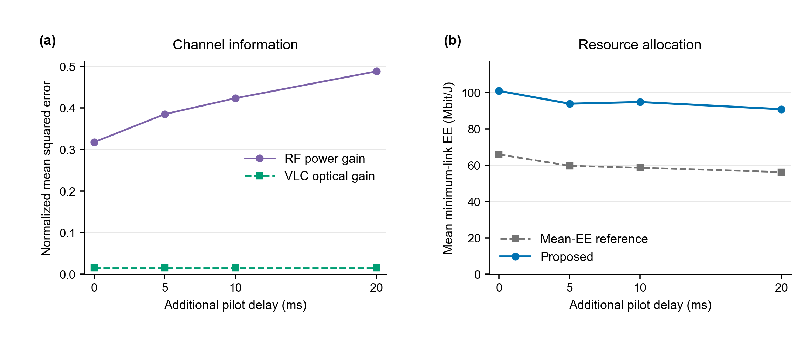
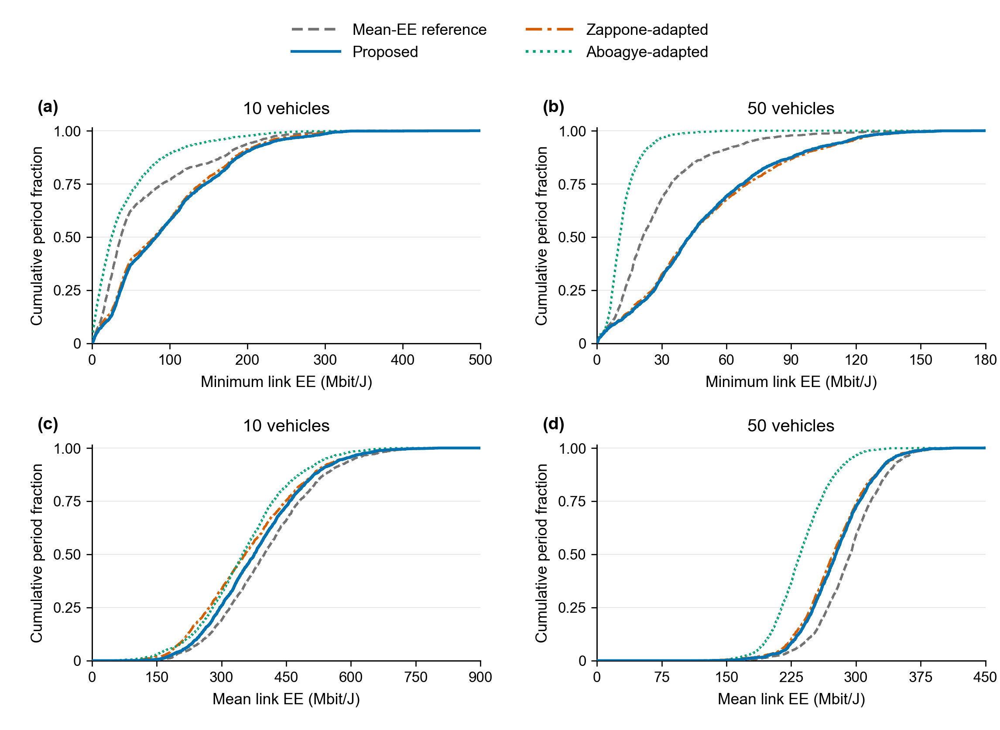
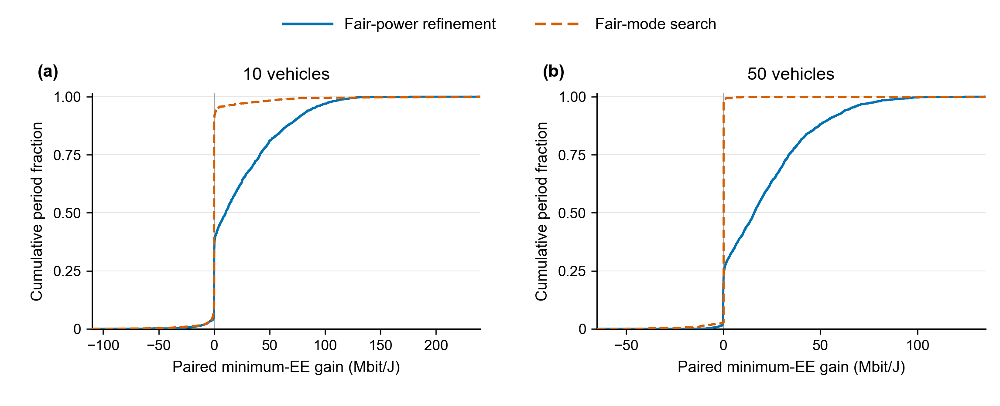
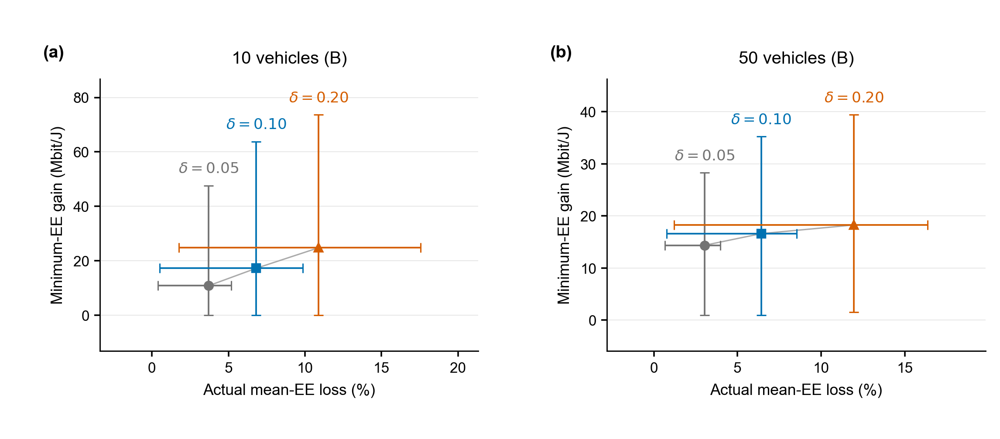

# V. 仿真结果与分析

### 5.1 仿真设置与评价方法

采用10车和50车城市交通场景评价所提方法，每个通信周期分别建立5条和25条有向链路。通信模式和数据发送功率在100 ms周期内保持不变，以1 ms间隔计算传输速率。每组实验持续100 s，包含1000个计划通信周期。同一规模的A、B组共用交通轨迹、业务要求和物理参数，仅采用不同的信道随机实现。

交通轨迹由SUMO 1.22.0生成。10车与50车分别采用节点跨度为80 m×80 m和160 m×120 m的合成网格路网，每方向一条车道，限速30 km/h，场景中分别布置3栋和4栋建筑。车辆采用Krauss跟驰模型，十字及T形路口使用信号灯控制；经过30 s预热后记录100 s轨迹。原始轨迹的时间间隔为100 ms，物理层计算在相邻轨迹帧之间插值。

主要物理与观测参数见表I。RF路径损耗和阴影标准差采用3GPP车用通信模型[20]；VLC几何增益采用晴天车灯模型[3]，前、后收发端使用相同的等效设备参数。RF电路功耗和功率转换效率参考文献[27]，VLC固定发送电路功耗由文献[28]的DAC和发送放大器功耗相加得到。接收面积及噪声器件参数参考文献[22]。表中功率范围约束数据发送支路的电输入，导频功率则分别表示RF辐射功率和VLC光输出功率。

**表I 主要物理与观测参数**

| 物理意义 | 符号 | 数值 |
|---|---|---|
| RF载频 | $f_c$ | 5.89 GHz |
| 通信带宽 | $B_m$ | RF：22 MHz；VLC：50 MHz |
| 数据电输入功率范围 | $[p_{\min,m},p_{\max,m}]$ | RF：0.01–20 W；VLC：0.1–30 W |
| 功率转换效率 | $\eta_m$ | RF：0.1[27]；VLC：0.25 |
| 固定发送电路功耗 | $P_{c,m}$ | RF：0.1159 W[27]；VLC：1.745 W[28] |
| 速率实现间隙 | $\Gamma_m$ | RF：3 dB；VLC：5.4 dB |
| 候选通信距离 | $d_m^{\max}$ | RF：100 m；VLC：45 m |
| RF带内噪声功率 | $N_{\rm RF}$ | $6.957\times10^{-13}$ W（22 MHz内） |
| 光电探测器面积与响应度 | $A_{\rm PD},\varrho$ | 150 mm²[22]；0.45 A/W |
| VLC接收半视场角与光束参数 | $\Psi_c,\zeta,\epsilon_o$ | 60°；0.1585 rad[3]；0.0175[3] |
| RF阴影标准差与去相关距离 | $\sigma_X,d_s$ | LOS：3 dB[20]；NLOS：4 dB[20]；10 m |
| RF快衰落与VLC光强相关时间 | $\tau_{ij},\tau_v$ | RF：按相对速度计算[21]，限于0.001–0.5 s；VLC：0.5 s |
| 对数光强平稳标准差 | $\sigma_z$ | 0.25 |
| 导频输出功率 | $P_{p,m}$ | RF：2 W；VLC：2 W |
| 导频观测间隔与到达时延 | $\Delta_m,d_m$ | RF：1 ms、2 ms；VLC：50 ms、5 ms |
| 单车单次导频积分时长 | $T_{p,m}$ | 10车：RF 20 μs、VLC 1 ms；50车：RF 4 μs、VLC 0.2 ms |
| 对数观测噪声标准差下限 | $\sigma_0$ | 0.12 |
| VLC可观测几何增益门限 | $H_{\min}$ | $10^{-8}$ |

表注：未标注文献的取值为本文设置。噪声功率由10 MHz内的−95 dBm按固定谱密度换算。VLC固定电路功耗为$1.400+0.345=1.745$ W；0.25为等效电光转换效率。速率计算中的$\Gamma_m$取对应线性值。

每种通信方式的名义导频资源预算取$b_{\rm pil}=0.20$，单车单次积分时长为$T_{p,m}=\min(1\ \mathrm{ms},b_{\rm pil}\Delta_m/N)$。因此，50车条件下每车获得的导频积分时长为10车的五分之一。采用批量观测抽象，数据速率按式(13)评价毛速率，导频开销单独记录。将表I参数代入式(18)，10车有效VLC观测的噪声方差均取$\sigma_0^2$；50车较短的积分时长使弱可观测链路仍可能受物理噪声项限制。

场景与主要求解设置见表II。所有活动链路采用相同的最低周期平均速率要求$R_{\min}=1$ Mbit/s，主比较的预测平均EE下降预算取$\delta=0.10$。预测均值用于计算EE，校准下分位用于服务筛选；执行后的速率和EE由实际信道计算。

**表II 场景、预测与主要求解设置**

| 物理意义 | 符号 | 数值 |
|---|---|---|
| 车辆数与活动链路数 | $N,K$ | 10车：10、5；50车：50、25 |
| 通信周期与速率采样间隔 | $T,\Delta t$ | 100 ms、1 ms |
| 计划评价时长与周期数 | $T_{\rm sim},N_{\rm blk}$ | 100 s、1000 |
| 最低周期平均速率 | $R_{\min}$ | 1 Mbit/s |
| 预测平均EE下降预算 | $\delta$ | 0.10 |
| 下分位水平与校准系数 | $q,\alpha$ | 0.05、1.35 |
| 条件信道轨迹数 | $S$ | 10车：32；50车：16 |
| 初始模式搜索轮数与每轮邻域上限 | — | 10车：8、不截断；50车：4、64 |
| 每起点NM迭代上限与附加重启数 | — | 10车：240、2；50车：120、1 |
| 最低EE门限二分次数与每锚点SCA次数上限 | — | 6、3 |
| 下分位服务修复次数上限 | — | 2 |

表注：算法次数为最大搜索预算，满足相应终止条件时提前结束。NM重启数不含原起点。模式评分的名义电输入功率取0.01、0.3和3 W，并分别限制在RF/VLC允许范围内；SINR启发式评分系数取$\kappa_1=2$、$\kappa_2=3.3$。完整器件参数与观测设置列于补充材料I，数值求解规则列于补充材料II。

为比较能效分配效果，采用平均EE参考分配、本文完整方法及两种文献适配方法。Zappone适配方法[19]固定初始通信模式，通过广义分式规划与局部速率近似优化最低链路EE；Aboagye适配方法[6]交替优化匹配与连续功率，以平均链路EE为目标。两者均采用本文的信道、功耗和服务模型，保留各自的优化目标。另设置两项消融：固定初始模式消融仅在初始通信模式下优化公平功率；无公平连续细化消融保留模式候选比较，关闭其后的NM细化与解析协调。

各方法共用交通轨迹、决策时可用信息和实际执行信道。返回满足配对、候选资格与功率范围的完整分配，记为求解成功；预测服务和实际服务另行统计。平均EE与最低EE按式(15)逐周期计算。主比较使用六方法共同求解成功周期，10A、10B、50A、50B分别为976、980、859、875个；消融使用三个内部方法的共同周期，分别为1000、999、1000、999个。同一规模的A/B经验分布等权合并，相对均值变化仍按各组共同周期内的指标均值之比计算。各组精确数值、功率分布及比较索引列于补充材料III。

### 5.2 导频信息时延与资源决策

为考察信息老化对资源分配的影响，在10B的100 s轨迹中预先均匀选取200个决策周期，设置额外导频到达时延$\Delta d\in\{0,5,10,20\}$ ms。各档连续处理全部导频历史，重新估计状态、生成条件轨迹并求解两阶段分配，各自建立平均EE参考值。RF功率增益与VLC光增益的归一化均方误差分别计算，具体评价对象见补充材料IV。

**图R1　导频到达时延对信道信息与实际最低链路EE的影响。** 左图分别评价RF功率增益与VLC光增益在决策时刻的误差；右图为各档初始分配与完整方法的实际最低EE均值。四档采用相同的200个预定周期，零额外时延对应表I的有噪导频设置。

额外时延由0增至20 ms时，RF增益NMSE由0.318升至0.488，增加53.51%。RF导频每1 ms更新一次，较大的到达时延使决策依赖更早的信道观测。VLC的NMSE则保持在0.0158：在50 ms导频间隔与100 ms决策时刻下，这四档时延对应相同的已到达VLC观测。平台由导频与决策的时序关系产生；缩短到达时延是否改变估计输入，取决于能否使更新的观测在决策前可用。因此，导频更新需要与资源决策周期协调。

信息老化同时影响初始分配与公平优化。额外时延由0增至20 ms时，初始分配与完整方法的实际最低EE均值分别下降14.69%和9.98%。四档中，完整方法以5.17%–6.55%的平均EE代价，使最低EE相对各自初始分配提高53.02%–61.63%。联合分配对信息老化的响应并非简单地增加VLC使用：20 ms额外时延使131/200个周期改变通信模式，VLC链路占比却仅由23.4%变为22.2%。总体方式占比相近，具体通信关系与RF/VLC选择已在多数周期发生变化，说明仅凭方式占比无法描述资源分配对信息老化的响应。

### 5.3 平均能效与弱链路能效的取舍

平均EE优化侧重活动链路的整体效率，公平阶段则以每个周期的预测最低链路EE为优化目标。图R2展示这一调整在跨周期实际能效分布中的效果。相对于平均EE参考，本文方法在10车与50车中的最低EE中位数分别由36.94和21.22 Mbit/J提高至82.29和42.88 Mbit/J，第25百分位分别由20.66和12.93 Mbit/J提高至36.84和26.48 Mbit/J。中位数与较低分位数同时提高，表明弱链路改善反映在典型周期及低能效周期中。

**图R2　主要方法的实际能效分布。** 上排为最低链路EE，下排为平均链路EE；左列10车，右列50车。各组采用六方法共同求解成功周期，同一规模按$F(x)=\tfrac12F_A(x)+\tfrac12F_B(x)$合并。图中显示四种主比较方法，两项消融另见图R3。

四组实验中，本文方法相对于初始分配的平均EE代价为4.95%–5.62%，最低EE增幅为44.65%–80.59%。两阶段设计将初始平均EE固定为效率基准，再利用预算内的功率与模式调整提高最弱链路能效，从而以较小的平均EE代价获得明显的公平收益。

与文献适配方法相比，本文方法在10车两组同时取得更高的平均EE和最低EE；在50车中，与Zappone适配方法的最低EE分布接近，同时保持更高的平均EE。按A/B等权汇总，50车两者的平均EE分别为277.56与274.77 Mbit/J。

高平均能效的通信方式仍可能主导公平瓶颈。按完整方法全部已执行链路周期统计，50车两组中RF仅占约35%的活动链路，却在约70%的周期决定最低链路EE；其平均链路EE为343–366 Mbit/J，仍高于VLC的约237 Mbit/J。RF较低的固定电路功耗有利于低功率传输的能效，但其平均优势并未消除个别链路的低EE；VLC则在满足方向、视场与可见条件的通信关系上提供较高的传输速率。

公平优化后，50A和50B的RF链路EE第5百分位分别由18.57、17.35 Mbit/J提高至35.56、33.12 Mbit/J，而RF/VLC使用比例基本保持。较高的方式平均EE不能替代链路级瓶颈判断，公平分配需要识别各方式内部的低EE链路并协调其功率，而非仅依据方式均值调整RF/VLC占比。

### 5.4 连续功率协调与预算调节

图R3比较完整方法与两项消融在同一周期的最低EE差值。相对于无公平连续细化方案，完整方法在10车和50车中分别使80.84%和87.74%的周期获得正增量，中位增量分别为10.50和15.97 Mbit/J。

**图R3　公平阶段各环节的实际最低EE增量。** 蓝线为完整方法减去无公平连续细化消融，橙线为完整方法减去固定初始模式消融。各组使用三个内部方法共同求解成功周期，A/B等权合并。横轴为同周期最低EE差，负值、零值及正值均计入；近零判据见补充材料III。

在平均EE初始分配已经确定通信关系后，进一步的公平收益主要来自连续功率重分配。完整方法与固定初始模式方案的最低EE在10车和50车的62.88%、96.45%周期内近似相同，而移除公平连续功率优化会明显削弱最低EE增量。初始模式选择建立高效传输关系，公平功率协调则在这些关系上重新平衡期望信号、同方式干扰和发送功耗。

固定模式后的公平改进仍取决于功率搜索如何利用链路间耦合。在50B的999个配对周期上，保留模式比较与NM细化后加入解析协调，最低EE均值由37.045提高至48.470 Mbit/J，增幅30.84%，平均EE代价为2.40%。NM直接搜索完整周期预测指标，解析模型则利用信号与交叉干扰对功率的显式关系生成联合调整方向，补充前者的搜索，并由完整周期预测筛选出进一步改善最低EE的功率分配。

图R4进一步考察效率预算如何调节上述公平收益。10B和50B各使用相同的200个预定周期，固定每周期的初始分配、参考EE及条件轨迹，比较$\delta=0.05,0.10,0.20$下的完整公平分配。横坐标为每周期相对初始分配的实际平均EE损失百分比，纵坐标为实际最低EE增量。

**图R4　平均EE预算与实际公平收益。** 每个点的横、纵坐标分别为实际平均EE损失和最低EE增量的中位数，水平与垂直误差线分别为对应指标的第25至第75百分位。每种规模的三档均使用200个共同求解成功周期。

放宽效率预算能够继续提高最低链路EE，但新增收益并不与平均EE代价等比例增长。50B中，预算从5%增加至10%时，最低EE增量中位数增加2.23 Mbit/J，实际平均EE损失中位数增加3.37个百分点；从10%增加至20%时，两者分别增加1.67 Mbit/J和5.55个百分点。按图中中位取舍点的坐标差计算，每增加一个百分点的平均EE损失，对应的最低EE收益由约0.66降至0.30 Mbit/J。较宽预算下，额外平均EE让渡换得的弱链路收益减少，预算应依据新增公平收益与效率代价的比例选择。

### 5.5 实际服务与计算成本

表III同时报告求解输出、实际服务和决策耗时。本文方法在四组实验中有99.4%–99.7%的计划周期实现全链路实际达标，在提高最低链路EE的同时维持了较高的整体服务水平。

**表III　主要方法的求解、实际服务与决策耗时**

| 场景 | 方法 | 求解成功 / 1000 | 全链路实际达标 / 1000 | 决策耗时中位数 / s |
|---|---|---:|---:|---:|
| 10A | 本文方法 | 1000 | 996 | 8.845† |
| 10A | Zappone适配 | 1000 | 994 | 4.445 |
| 10A | Aboagye适配 | 976 | 900 | 0.712 |
| 10B | 本文方法 | 999 | 995 | 7.391† |
| 10B | Zappone适配 | 999 | 999 | 3.754 |
| 10B | Aboagye适配 | 981 | 915 | 0.571 |
| 50A | 本文方法 | 1000 | 997 | 111.085 |
| 50A | Zappone适配 | 1000 | 995 | 97.686 |
| 50A | Aboagye适配 | 859 | 633 | 6.565 |
| 50B | 本文方法 | 999 | 994 | 107.176† |
| 50B | Zappone适配 | 999 | 994 | 89.493 |
| 50B | Aboagye适配 | 876 | 661 | 6.457 |

表注：实际服务以1000个计划周期为分母；耗时在有完整计时的求解成功周期统计。†为历史完整流程与同周期解析协调耗时之和，其余为完整流程实测。50A的本文方法和Zappone适配有995个完整计时周期。计算环境和分项时间见补充材料III。

10B的服务筛选专项进一步比较了校准下分位与预测均值两种条件。两者在999个共同周期上的实际平均EE和最低EE差异均小于1%；在1000个计划周期中，全链路实际达标分别为995和994个。下分位筛选使最终未通过下分位检查的动作由21个减少至3个，主要作用是收紧对预测下尾的选择。详细配对结果见补充材料III。

计算开销主要来自初始通信模式搜索与连续功率求解，在50车两组约占总决策时间的83%和84%；50B解析协调的平均增量耗时为1.97 s。完整方法的计算时间长于100 ms通信周期，本实验采用离线求解、按通信周期评价执行性能。面向实时V2V分配，降低计算成本应优先着眼于初始模式搜索与连续功率求解，并保留完整周期预测对最终分配的评价。

### 参考文献

[27] W. Wang, Y. Liu, Y. Dai, and Y. He, “Joint cooperative caching and power control for UAV-assisted internet of vehicles,” *Scientific Reports*, vol. 14, Art. no. 9341, 2024, doi: [10.1038/s41598-024-59823-9](https://doi.org/10.1038/s41598-024-59823-9).

[28] M. Mayahi, *Communication Protocols Based on Alternative Paradigm for Wireless Mobile Devices*, Ph.D. dissertation, Université de Lille, 2022. [学校原文](https://pepite-depot.univ-lille.fr/LIBRE/EDMADIS/2022/2022ULILB046.pdf).
